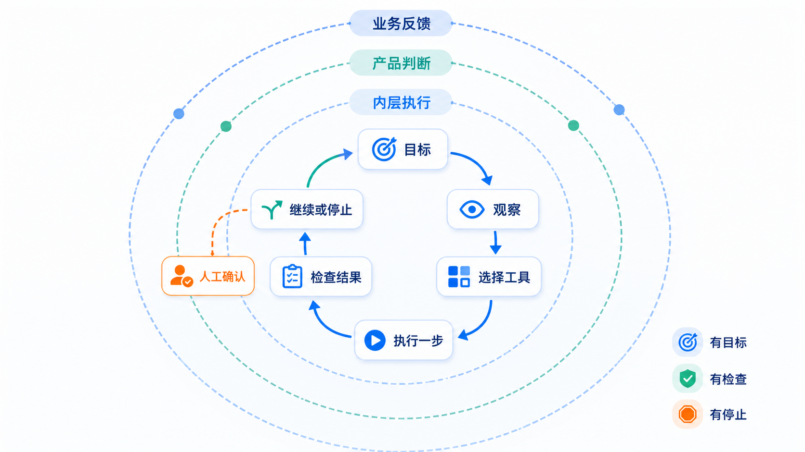

# Harness 工程：让 Agent 有明确的运行现场

Prompt 说明一次工作，[Agent 里的 Grill](04-Agent工程-能力选择与停止.md#grill只追问会改变方案的决定) 把模糊决定问清楚；Harness 准备可以工作的现场，Loop 根据结果决定下一步。

## Harness：让 Agent 看得见、做得到、错了能回来

Harness 不是某个框架或一段系统提示。它是 Agent 工作时能够看到和使用的完整环境：

| 组成 | 本课程怎样落地 |
|---|---|
| 项目地图 | 简短入口指向章节、数据、代码和检查，不把全部历史塞进上下文 |
| 类型化工具 | 只开放数据体检、检索、生成、测试等明确动作 |
| 可读反馈 | 页面、文件、日志、测试和指标都能被再次检查 |
| 结构约束 | 目录、数据合同、状态转移和依赖方向由程序校验 |
| 权限与预算 | 限制路径、次数、时长、外部调用和高影响动作 |
| 恢复点 | 长任务保存已完成项、当前结果和唯一下一步 |

Agent 能启动项目却看不到错误日志，或者能写文件却不知道允许目录，都说明 Harness 不完整。好的 Harness 不替 Agent 作业务判断，而是让正确动作容易执行、错误动作容易被发现。

### Harness 怎样落地：四个具体物件

上面六要素是定义，落地时它们长成四个具体物件：

| 落地件 | 对应六要素 | 说明 |
|---|---|---|
| 项目文档（CLAUDE.md / AGENT.md / .cursorrules） | 项目地图 | 相当于新员工的 onboarding 文档，告诉 Agent 这个项目的规矩、目录结构和约定 |
| 进度追踪器（JSON Feature Lists） | 恢复点 | 条目标注验证方式和通过/失败状态，长任务断点续跑时直接读，不靠回放聊天记录 |
| 记忆文件 | 恢复点 + 权限与预算 | 跨会话持久化踩坑和成功方案，上次怎么错的、这次别再犯 |
| 工具定义做减法 | 类型化工具 | 工具不是越多越好——Vercel 移除 80% 工具定义后 Agent 性能反升；只开放数据体检、检索、生成、测试等明确动作 |

六要素是定义，四个落地件是它们的物理形态。项目文档让 Agent 看得到规矩，进度追踪器和记忆文件让 Agent 错了能回来，工具做减法让 Agent 做得到而不被噪声淹没。

Grill 不是脱离运行环境的无限追问：可读取的项目材料、可用工具、文件范围和高影响动作的审批，由本章的 Harness 约束；该问什么、何时停止追问仍由 Agent 负责。
