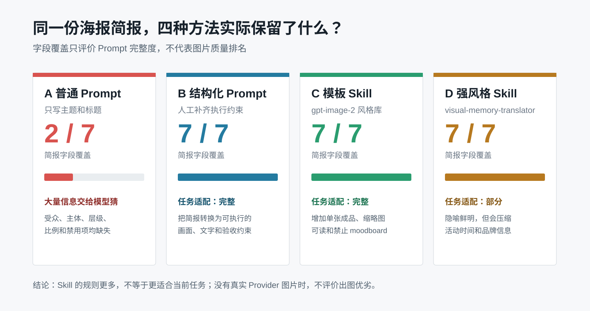
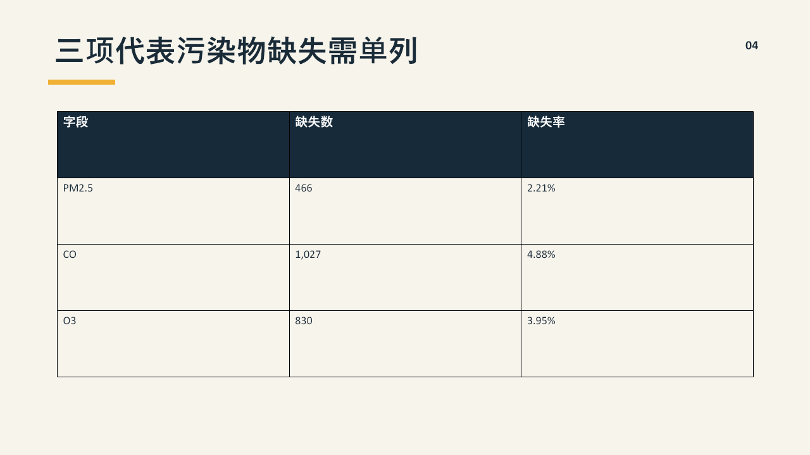
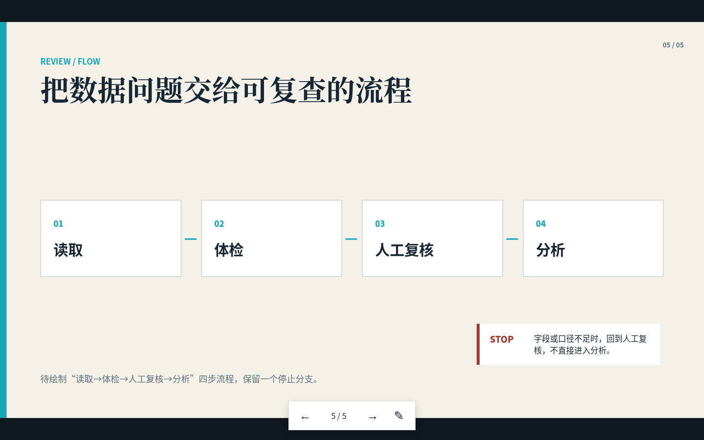
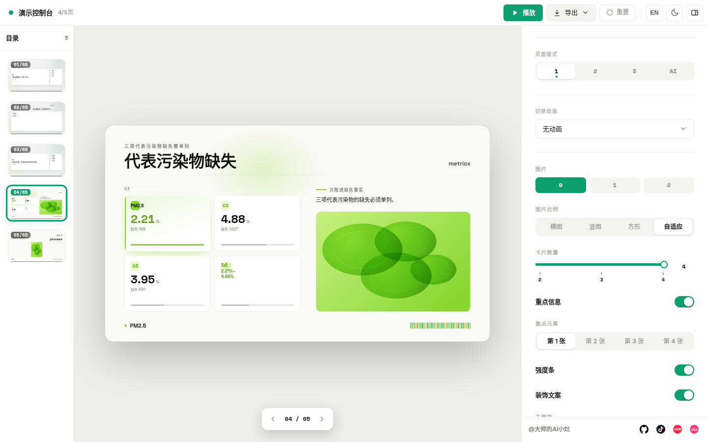
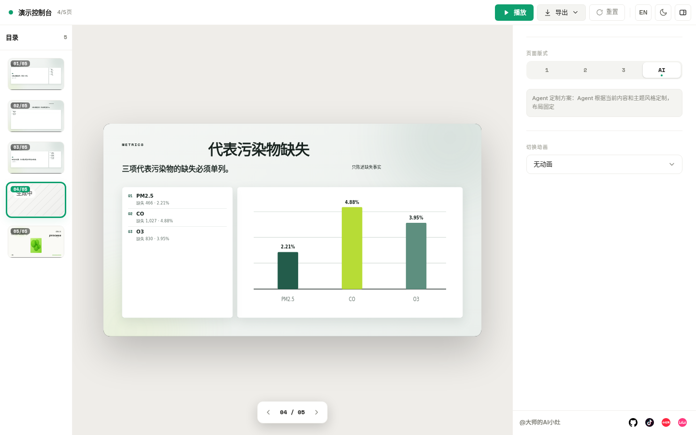
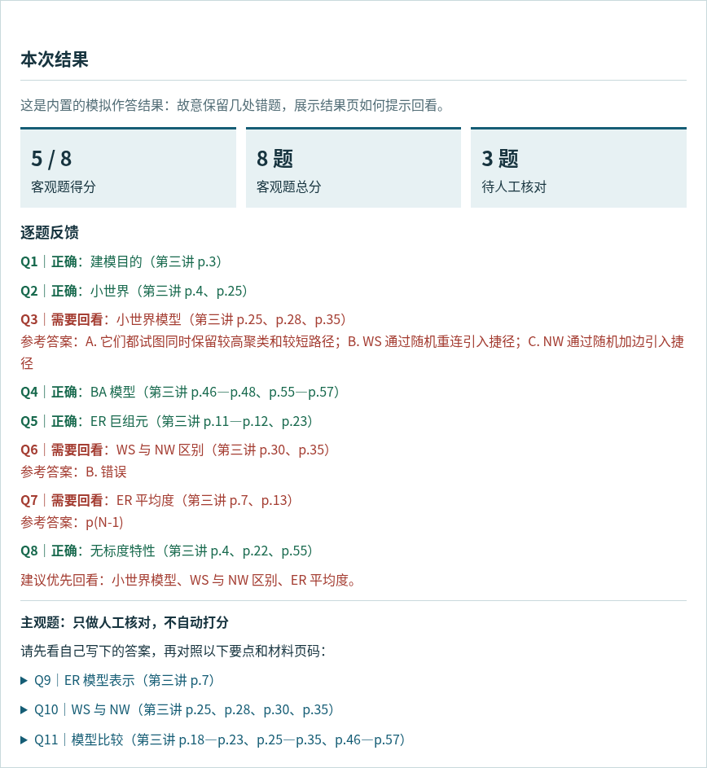

# 通用 Skill 案例：办公与表达

做海报、做演示稿，常见的起点都是一句“帮我做得好看些”。但作品最终给谁用、哪些信息不能丢、交付后谁要继续编辑，比“好看”更早决定做法。学习材料要变成小测时，还得先确认范围、答案和回看依据。本章先用一张表选择任务，再直接进入三个各自完整的案例；代码与生成文件仍在自己的位置。

## 先看要交付什么

| 任务 | 先确认的事 | 现有案例和成果 | 适合讨论的选择 |
|---|---|---|---|
| 活动海报 | 固定简报里的文字、受众、画布和禁用项有没有被保留 | [S05：雨天旧书店图像 Skill 测评](#skill-s05)：四份完整 Prompt、字段覆盖对比、本地可编辑构图样张 | 风格更鲜明，是否就更适合传递活动信息？ |
| 五页演示稿 | 同一大纲能否守住事实，交付后是要改 Office 对象、轻量播放，还是探索多种排版 | [S06：PPTX 与 HTML Skill 竞技场](#skill-s06)：可编辑 PPTX、离线 HTML、多方案演示和浏览器检查 | 哪一种交付更适合这次的使用场景？ |
| 第三讲课后小测 | 课程 PPT 能支持哪些题，错了以后能否回到材料核对 | [第三讲网络模型小测](#skill-network-model-quiz)：六类题型、可交互页面、模拟作答结果 | 能自动判分的题和只能人工核对的题，边界在哪里？ |

这三例都不是“装一个 Skill 就完成了”。先写下固定输入、不能丢的信息、交给谁使用，以及要打开检查的成果，再比较方法；不要用工具名称代替作品要求。如果这次只需要核算和讲清会员数据，可以先看 [Skill 章的 S03 简报实验](../02-能力篇/05-Skill工程-结构发布与治理.md)，不必因为这里出现海报和 PPT 就强行把数据变成演示稿。

<a id="skill-s05"></a>

## S05：雨天旧书店，四种 Prompt 能守住同一份海报简报吗？

### 场景与任务

书店准备发布夜读与换书活动海报。雨线、橱窗灯光、标题和“周五 19:30”都已经定好；如果只说“做得好看”，活动时间和品牌名也许就消失在画面里了。先不比哪张“最美”，而是让四组方法面对同一份简报，看哪些信息会被写进生成指令。本案例选择两个公开的图像 Prompt Skill：一个擅长从风格库中选择海报模板，另一个擅长把文字转成带隐喻的编辑视觉。即使没有 OpenAI API Key 或本地图片模型，也可以先回答一个能够现场展示、能够复跑的问题：

> 同一份海报简报，普通 Prompt、人工结构化 Prompt、模板 Skill 和强风格 Skill，分别把需求编译成了什么？

本案例测的是 **Prompt 编译质量和任务适配**，不是没有图片时猜测哪一组“出图最好”。这一区分让零 Key 实验仍然有真实证据，也避免把文字分析包装成图像实测。

### 固定输入

四组方法都读取同一份“雨天旧书店”活动简报。实验不允许为某一组临时增加信息。

| 简报字段 | 固定内容 |
|---|---|
| 主题 | 雨天旧书店 |
| 受众 | 下班后想慢下来的城市读者 |
| 标题 | 雨落下来，书页慢下来 |
| 辅助文字 | 躺进一页旧时光；周五 19:30 · 夜读与换书 |
| 必备文字 | SECOND PAGE BOOKS；入场免费 |
| 可见主体 | 雨线、暖黄橱窗、旧书脊、一盏灯 |
| 禁用项 | 人物大特写、高饱和多色渐变、密集商业促销标签 |
| 画布 | 1080 × 1440，3:4 竖版 |

原始输入保存在 [`rainy-bookstore-brief.json`](../../code/skills/poster-recipe/examples/rainy-bookstore-brief.json)，生成器只读该文件，并在结果中记录 SHA-256。

### Skills 介绍与实验设计

```text
同一份简报
   ├─ A 普通 Prompt
   ├─ B 人工结构化 Prompt
   ├─ C 模板 Skill：poster-layout-system
   └─ D 强风格 Skill：editorial_text_card
          ↓
   保存四份完整 Prompt
          ↓
   检查字段覆盖、任务适配和来源
          ↓
   生成一张本地可编辑构图样张
          ↓
   有真实图片服务时，再进入同模型盲评
```

课程自有 [`poster-recipe`](../../code/skills/poster-recipe/SKILL.md) 负责读取同一简报、保存对比结果与制作可编辑构图样张；[`gpt-image-2-style-library`](../../skills/gpt-image-2-style-library/SKILL.md) 提供 C 组的模板排版规则，[`visual-memory-translator`](../../skills/visual-memory-translator/SKILL.md) 提供 D 组的编辑隐喻方向。B 组是人工结构化 Prompt，不能算 Skill 的输出。两项外部 Skill 在此用来编排文字指令，不代表图片生成服务已经运行。

这里有意把实验拆成两道门：

1. **Prompt 门**：不需要 Key，现在就能完成；
2. **图片门**：必须拿到真实图片、参数和 Provider 回执后才能进入。

没有通过第二道门，不影响第一道门的结果成立，但不能填写图片质量分数。

### Prompt：四份实际输入

A 是没有补充约束的普通请求；B 是人工写出的结构化任务；C、D 是按各自 Skill 编排的指令。这四份保存的都是**文字产物**，并非已投喂图片模型后的出图记录。也可打开[原始对比记录](../../assets/S05/comparison/prompt-comparison.md)核对。

**A：普通 Prompt**

```text
为“雨天旧书店”设计一张竖版活动海报，标题是“雨落下来，书页慢下来”。
```

**B：人工结构化 Prompt**

```text
Use case: ads-marketing
Asset type: 3:4 竖版活动海报
Primary request: 为“雨天旧书店”设计一张可直接发布的活动海报
Audience: 下班后想慢下来的城市读者
Scene/backdrop: 深蓝雨夜中的旧书店，画面安静、克制，不做热闹促销氛围
Subject: “雨线”、“暖黄橱窗”、“旧书脊”、“一盏灯”
Composition/framing: 3:4 竖构图；标题、活动信息、品牌文字形成清楚的三级层级；保留足够留白
Lighting/mood: 冷雨与单一暖黄灯光对比，表达下班后慢下来的情绪
Color palette: 米白、深蓝、暖黄与低饱和灰；不使用多色渐变
Text (verbatim): 主标题“雨落下来，书页慢下来”；辅助文字“躺进一页旧时光”、“周五 19:30 · 夜读与换书”；必备文字“SECOND PAGE BOOKS”、“入场免费”
Constraints: 所有指定文字逐字准确、各出现一次；雨线、暖黄橱窗、旧书脊和一盏灯必须可见；小尺寸仍可读；只输出一张完成海报
Avoid: “人物大特写”、“高饱和多色渐变”、“密集商业促销标签”、乱码、随机英文、额外活动信息、Logo、水印、拼贴过程板
```

**C：模板 Skill 编排的 Prompt**

```text
Selected template: Poster Layout System / 海报排版系统
Template ID: poster-layout-system
Example cases: case 345, case 5, case 10

Subject and task: 为“雨天旧书店”生成一张完成度高的活动海报，面向下班后想慢下来的城市读者。
Composition and layout: 3:4 竖版；采用编辑式不对称布局。标题位于上部主要阅读区，暖黄橱窗作为唯一视觉锚点，旧书脊集中在下部，细雨线连接上下空间。标题、活动信息、品牌文字形成清楚的三级层级，至少保留约 30% 安静留白。不要输出 moodboard、宫格或设计过程。
Visual style and materials: 当代编辑海报、克制的纸张颗粒、米白与深蓝为主色，只用一个暖黄色锚点；冷雨和暖光形成清晰对比。字体气质为现代宋体标题配中性无衬线正文。
Text and labels (verbatim): “雨落下来，书页慢下来”；“躺进一页旧时光”、“周五 19:30 · 夜读与换书”；“SECOND PAGE BOOKS”、“入场免费”。每段只出现一次，不得改写、漏字或增加随机文字。
Aspect ratio and output: 3:4 竖版单张完成海报。
Required subjects: “雨线”、“暖黄橱窗”、“旧书脊”、“一盏灯”。
Constraints and negative details: 禁止“人物大特写”、“高饱和多色渐变”、“密集商业促销标签”；禁止拼贴展示板、无关装饰符号、乱码、随机英文、Logo 和水印；保证标题层级和主视觉在手机缩略图中仍可辨认。
```

**D：强风格 Skill 编排的 Prompt**

```text
Skill preset: editorial_text_card
Input mode: text
Preview mode: skip
Original display mode: translation_only
Layout mode: large_whitespace_small_art
Style mode: editorial_metaphor_card
Ratio: 3:4

将“雨落下来，书页慢下来”转译为一张 3:4 竖版编辑隐喻海报，同时保留活动信息功能。面向下班后想慢下来的城市读者，整体像独立艺术出版页，不像商业促销模板。

只使用一个视觉隐喻：一张打开的旧书页像窄屋檐承接三条雨线，书页下方一个小型暖黄矩形代表旧书店橱窗灯光，旁边只保留少量旧书脊线条和一盏灯的轮廓。视觉隐喻占画面 15%–30%，其余为暖米白艺术纸留白。配色限定为深灰、米白、深蓝和一个暖黄强调色，无渐变。

Text (verbatim): 主标题“雨落下来，书页慢下来”；辅助文字“躺进一页旧时光”、“周五 19:30 · 夜读与换书”；必备文字“SECOND PAGE BOOKS”、“入场免费”。保留原句，不改写成鸡汤；所有文字逐字准确、各出现一次，文字总面积保持克制但活动时间必须可读。

避免完整雨夜场景、雨窗照片、人物情节、PPT 图标墙、毛玻璃卡片、手账贴纸、人物大特写、高饱和多色渐变、密集商业促销标签、随机英文、Logo、水印和额外文字。只输出一张完成海报。
```

### 看得见的结果

| 组 | 方法 | 七类简报字段覆盖 | 任务适配 | 实际增加的东西 |
|---|---|---:|---|---|
| A | 一句普通 Prompt | 2/7 | 基线 | 只有主题和标题，其他内容交给模型猜 |
| B | 人工结构化 Prompt | 7/7 | 完整 | 明确受众、逐字文字、主体、层级、比例和禁用项 |
| C | `gpt-image-2-style-library` | 7/7 | 完整 | 在 B 的约束上增加编辑式不对称版式、单一色彩锚点、缩略图可读和禁止 moodboard |
| D | `visual-memory-translator` | 7/7 | 部分 | 把“书页像屋檐承接雨线”固定为单一隐喻，并使用大留白、小画面的编辑卡片风格 |



七类字段指主题、受众、标题、辅助文字、必备文字、可见主体和禁用项。覆盖完整只表示 Prompt 没漏掉简报信息，不表示最后图片一定更美。

下面这张图是课程自有 `poster-recipe` 根据同一简报生成的**本地可编辑 SVG 构图样张**。它用于展示信息层级、冷暖色锚和构图交接，不是 OpenAI 或其他图片模型的输出。


这张样张让案例在没有 Key 时仍能现场展示三件事：

- 标题与活动信息是否形成清楚层级；
- 冷雨和暖黄橱窗是否形成单一视觉锚点；
- 交付物是否可编辑，而不只是一段抽象审美描述。

它不能证明 C 或 D 的真实出图效果，也不能替代图片模型测评。页面底部保留 `NO IMAGE PROVIDER RECEIPT`，就是为了防止展示时误读。

### 结论与课堂讨论

本轮可以据证据得出三个结论：

1. A 组漏掉五类简报信息，生成结果需要模型大量猜测；B、C、D 都保留了七类固定输入。
2. C 的价值不是“Prompt 更长”，而是补充了海报交付约束，例如单张成品、缩略图可读和禁止过程板。
3. D 的审美意图最鲜明，但原 Skill 面向编辑隐喻卡，活动时间和品牌信息不是它的第一目标，所以任务适配只能记为“部分”。Skill 风格越强，不代表越适合当前业务。

本轮不能得出“C 出图最好”或“D 最有高级感”。这些判断需要真实图片后再做。

### 怎样在课堂上使用

一次 5 分钟展示可以按下面顺序进行：

1. 先展示固定简报，说明四组不能偷偷换题；
2. 展示 2/7 与 7/7 对比，让观众找到 A 组漏掉的信息；
3. 对照 C 和 D，提问“规则更多”和“任务更合适”是不是同一件事；
4. 展示本地 SVG，明确它是构图样张，不是 AI 出图；
5. 最后揭示证据边界：当前能评价 Prompt，不能评价不存在的图片。

这个展示本身就是 Skill 工程案例：Skill 的价值不只在生成内容，还在固定输入、保存中间产物、声明边界和留下复验入口。

**互动：A 组把标题写对了，就能交给书店发布吗？** 不能。A 缺少活动时间、品牌文字、受众与禁用项；先让“品牌方”圈出必须逐字出现的内容，再让“设计者”从 B/C/D 中选择，并说出会先检查哪一句。C/D 即使字段齐全，也还没有通过真实图片的文字与画面检查。

### 如果以后补测真实图片

不需要先开发 API 程序。只要以后能使用任意一个带图片生成能力的产品界面，就可以手工完成第二阶段：

1. 只选一个产品、一个模型和一个尺寸；
2. 依次粘贴 A、B、C、D 四份完整 Prompt，每组生成相同张数；
3. 保存原图、生成时间和界面中可见的模型信息，不后期修图；
4. 匿名打乱图片后，再评文字准确、约束符合、信息层级、构图留白、风格一致和主题表达；
5. 如果不能固定模型或参数，就标为“展示性复验”，不包装成严格横向实验。

使用消费级产品界面时通常不需要 API Key，但可能需要对应产品账号或图片额度。只有希望脚本自动批量生成、保存请求 ID 时，才需要配置该服务的 API Key。

### 复查入口

在仓库根目录运行：

```bash
python3 -B code/skills/poster-recipe/scripts/build_prompt_comparison.py \
  --input code/skills/poster-recipe/examples/rainy-bookstore-brief.json \
  --allowed-root code/skills/poster-recipe/examples \
  --output-dir assets/S05/comparison

python3 -B code/skills/poster-recipe/scripts/build_poster.py \
  --input code/skills/poster-recipe/examples/rainy-bookstore-brief.json \
  --allowed-root code/skills/poster-recipe/examples \
  --recipe-output assets/S05/poster-recipes.json \
  --svg-output assets/S05/poster.svg
```

主要证据：

- [四组 Prompt 与结论边界](../../assets/S05/comparison/prompt-comparison.md)
- [机器可读实验记录](../../assets/S05/comparison/prompt-comparison.json)
- [本地海报配方](../../assets/S05/poster-recipes.json)
- [`poster-recipe` Skill](../../code/skills/poster-recipe/SKILL.md)
- [`gpt-image-2-style-library` 固定副本](../../skills/gpt-image-2-style-library/SKILL.md)
- [`visual-memory-translator` 固定副本](../../skills/visual-memory-translator/SKILL.md)

当前实验状态应保持：`prompts_compiled=true`、`images_generated=false`、`provider_execution.status=not-run`。

---

<a id="skill-s06"></a>

## S06：同一份大纲，PPTX 与 HTML 交付给谁？

> 固定输入：`assets/S06/outline.md`
> 实测日期：2026-09-17
> 结论边界：A 组只保存 Prompt，不伪造未调用模型的默认输出；B/C/D 均有实际文件和检查回执。

### 场景与任务

明天要开数据质量讨论会，今天得先发一份五页材料给同事。会议中还可能改数字和流程，第五页的图尚未画完：是交可编辑 PPTX，还是交离线能打开的 HTML？“帮我做一份好看的 PPT”把内容拆页、事实保持、版式、交互和验收全交给模型猜。Skill 的价值不应靠展示截图证明，而要看同一份输入经过不同流程后留下了什么可复查工件。

本案例固定为 5 页数据质量大纲，不允许改题：标题、章节、三条原则、三项污染物缺失表、带停止分支的四步流程。

### 四条交付轨道

| 组 | 输入或工具 | 实际产物 | 当前状态 |
|---|---|---|---|
| A 普通 Prompt | “把大纲做成好看的演示文稿” | [完整 Prompt](../../assets/S06/comparison/prompts/A-ordinary.txt) | 未调用外部模型，不伪造结果 |
| B 结构化 Prompt + 课程 `slide-plan` | 明确 5 种页型、事实和验收 | [可编辑 PPTX](../../assets/S06/presentation.pptx) | 已生成并审计 |
| C GitHub `frontend-slides` | 固定 1920×1080、单文件 HTML、浏览器交互 | [离线 HTML](../../assets/S06/frontend-slides/index.html) | 已生成并做桌面/手机实测 |
| D GitHub `dashi-ppt` | PageContentPack + 每页 3 个模板方案 + 1 个定制方案 | [Dashi HTML](../../assets/S06/dashi/ppt/index.html) | 5 页、20 个方案状态已逐一实测 |

A 没有输出并不是失败，而是证据边界：当前任务没有调用一个“默认生成 PPT”的外部模型，因此不能凭想象补一份结果。

### Skills 介绍：为什么是这三条实际轨道

是。两项外部 Skill 都按固定 commit 下载到项目 `skills/`，先做源码语义审查，再用于本案例。

| Skill | GitHub 固定版本 | 本地位置 | 许可证 | 实际使用 |
|---|---|---|---|---|
| `frontend-slides` | `zarazhangrui/frontend-slides@9906a34d640d2111f724544cbc50f7f130569ae1` | `skills/frontend-slides/` | MIT | 读取固定舞台、导航、动画与交付规程；生成单文件 HTML 并浏览器验收 |
| `dashi-ppt` | `chuspeeism/dashi-ppt-skill@21dc7e5fc8c3a0d7f6a94948153dd1ee954f4e64` | `skills/dashi-ppt/` | AGPL-3.0 | 真实运行 `goal-scaffold`、`validate-goal-spec`、`render-goal-deck`、Swiss 校验和浏览器方案切换 |

两项均标为 `CAUTION`。`frontend-slides` 的部署和 PDF 脚本可安装工具、启动服务或公网部署，本案例没有运行；`dashi-ppt` 包含依赖安装、子进程、本地服务与导出链，本案例只补齐固定版本 `esbuild 0.28.0` 并运行生成所需的本地脚本。

课程自己的 `slide-plan` 管 B 组“先列页型与事实再做可编辑 PPTX”；`frontend-slides` 管 C 组单文件演示和播放交互；`dashi-ppt` 管 D 组可切换的多套模板。三组共用[同一份大纲](../../assets/S06/outline.md)，不把多用了工具误认为内容更正确。

### Prompt：保存的 A/B 输入

**A：普通 Prompt（只保存，未运行）**

```text
请把下面的 Markdown 大纲做成一份好看的演示文稿：

assets/skill-cases/S06/outline.md
```

**B：结构化 Prompt（保存的任务输入）**

```text
读取 assets/skill-cases/S06/outline.md，只使用其中已经给出的事实，不新增污染原因或处置结论。

把内容映射为 5 页 16:9 演示文稿：标题页、章节页、三要点正文页、三行数据表页、四步流程页。必须保留 PM2.5 缺失 466 条和 2.21%、CO 缺失 1,027 条和 4.88%、O3 缺失 830 条和 3.95%，并在流程页保留“字段或口径不足时停止并回到人工复核”的分支。

视觉上使用适合数据审计主题的克制编辑风格，避免紫色渐变、装饰性大卡片和重复版式。每页只承担一个主要信息角色，文字不得溢出或互相遮挡。

交付前检查：5 页内容覆盖、数字逐字一致、16:9 比例、标题与正文层级、越界、重叠、空白页、键盘导航和手机窗口。输出完整文件、检查回执和已知限制。
```

这是[A 原始文件](../../assets/S06/comparison/prompts/A-ordinary.txt)和[B 原始文件](../../assets/S06/comparison/prompts/B-structured.txt)的全文。两份记录沿用当时的 `assets/skill-cases/S06/outline.md` 路径；读者在当前仓库复现时需将其改为 [`assets/S06/outline.md`](../../assets/S06/outline.md)。C/D 以 Skill 规程和大纲驱动，未保存一份可核对的完整逐字 Prompt，因此不事后编造“当时输入”；其实际文件、内容包和浏览器回执见下文。

### B：Office 里还要继续改

B 组输出 23,339 字节的 5 页 PPTX，并保存 `slide-plan.json`、逐页备注、来源块、5 张预览和结构审计。5 页标题、备注、来源、空白、越界、重叠和文字溢出检查均通过。

它的优势不是动画，而是 Office 对象可继续编辑。限制也很明确：第 5 页保留的是待绘图对象合同，适合继续制作，不应冒充已经完成的流程图。



### C：同事离线打开就能播放

C 组是 13,736 字节的单文件 HTML，无远程字体、图片或脚本。它固定使用 1920×1080 舞台，整体缩放到桌面和手机窗口，不在手机上重排演示内容。

真实浏览器检查结果：

| 检查 | 结果 |
|---|---|
| 5 页键盘翻页 | 通过，始终只有 1 个 active 页面 |
| 鼠标滚轮、触摸、Home/End | 已实现 |
| 16:9 舞台 | 桌面和 390×844 手机均为 1.7778 |
| 元素越界 | 两个窗口、5 页均为 0 |
| 浏览器内文字编辑 | `E` 键或铅笔按钮可启用，`localStorage` 保存通过 |
| 控制台 | 0 error |



这里对上游规则做了一项有意偏离：原 Skill 推荐在线字体，本案例为了真正离线使用保留本地中文字体栈。偏离写进回执，不把“遵循 Skill”理解为机械复制所有建议。

### D：模板多了，也要逐页挑

D 组先把 5 页事实写入唯一的 `page-content-pack.json`，再由 Skill 用固定 seed 为每页生成 3 个模板方案和 1 个 Agent 定制方案。HTML 本体约 540 KB，连同运行时约 8.5 MB。浏览器逐页切换并检查了 20 个方案状态：全部非空，未出现 `AI Capital`、`SoundWave`、`OpenAI`、`Anthropic`、`Roadmap` 或“请输入文本”等默认文案。





但真实运行也暴露了三项问题：

1. 第 4 页 v3 把缺失率错误配上了模板默认单位“亿”，说明结构映射不能只靠自动选页；
2. 第 5 页 v1 只突出“读取”一个步骤，内容覆盖弱于 v2/v4；
3. 390×844 手机窗口中编辑侧栏遮住舞台，适合桌面制作，不适合直接当手机播放页。

此外，`validate:goal-copy` 报告所有动态 `projection` 数组未覆写；真实浏览器中这些内容已经正确注入，因此这部分是校验器未识别新投影模型的误报。报告不能删除，但也不能把误报当成可见缺陷。

### 运行结果与课堂选择

| 维度 | B `slide-plan` | C `frontend-slides` | D `dashi-ppt` |
|---|---|---|---|
| 内容覆盖 | 5/5；第 5 页为待绘图合同 | 5/5；流程图已完成 | 5/5，但个别模板候选覆盖较弱 |
| 事实保持 | 三项数字一致 | 三项数字一致 | 主方案一致；v3 出现错误单位 |
| 可编辑性 | PowerPoint 对象 | 浏览器文字编辑 | 浏览器面板和方案切换 |
| 离线体积 | 23 KB PPTX | 14 KB 单 HTML | 约 8.5 MB |
| 视觉探索 | 一套稳定版式 | 一套定制编辑风格 | 每页 4 套，探索面最广 |
| 移动端 | 依赖查看器 | 固定舞台可正常查看 | 编辑侧栏遮挡舞台 |
| 维护成本 | 中 | 低 | 高；Node 20、依赖、模板筛选和 AGPL |

没有单一赢家。需要 Office 后续编辑时选 B；需要零依赖、可分享的轻量演示时选 C；需要一次看到大量模板方向、且有人负责筛选和修正时才选 D。D 的功能最多，但它也最能说明：Skill 是流程和约束，不是“自动正确”的保证。

**练习：**假设明天开会还要修改数据页，今天下午先给同事一个离线预览。从 B/C/D 选一条最终交付、一条讨论样稿，分别说明数字是否准确、交出去后能在哪里改、手机和桌面能否读清。**参考思路：**需要 Office 中修改对象时以 B 为交付、C 为预览；若主要是离线播放，以 C 为交付、B 为后续编辑源。D 适合比较版式，但第 4 页 v3 的错误单位和手机侧栏遮挡必须先处理，不能直接发给观众。

### 不用 API Key 的条件与复查入口

本案例没有调用云模型生成 PPT，也没有调用图片生成服务。B 是本地 PPTX 工具链，C 是本地 Python 生成 HTML，D 是下载后的本地 Node/React 模板渲染器。因此三条实际产物轨道都不需要 API Key；只有将来要调用在线模型改写文案、生成图片或部署到公网时，才可能需要对应服务的账号或 Key。

完整浏览器回执位于：

- `assets/S06/frontend-slides/browser-check/browser-verification.json`
- `assets/S06/dashi/browser-check/browser-verification.json`

<a id="skill-network-model-quiz"></a>

## 第三讲网络模型：学完课件，怎样知道自己哪里没学会？

### 场景与任务

学生要复习《网络科学与计算》第三讲“典型网络模型”，希望学完后能做一次小测，知道错在哪里。手头有第三讲课件 PDF、跨章节复习课 PDF，以及不完整的教材试看页。直接让 AI “按教材出题”很容易把没提供的章节和老师没划定的范围混进来；只给一张漂亮的题目截图，也不能检验答案是否成立。

本例只做**第三讲材料能支撑的自测**，不声称知道正式考试范围、分值或教师原题。制作时参考了学校课程课件；课件原件是校内教学材料，不便上传本项目。这里展示题目、可试用页面和模拟作答效果；已有该课件的读者可以在页面选择本地 PDF，按题目标出的页码回看。

### Skills 介绍与材料处理

1. 先读第三讲课件，复习课只用来对照第三章重点；试看教材不完整，不拿来补齐缺失章节。
2. 以 [`exam-ready`](../../skills/external/github/awesome-copilot/exam-ready/SKILL.md) 整理定义、机制、结构指标和练习题候选，再把题目逐个对回课件页码。
3. 编入 [题库与页码记录](../../dataset/cases/network-model-quiz/questions.json)：单选 2 题、多选 2 题、判断 2 题、填空 2 题、简答 2 题、综合 1 题。每题保留知识点、参考答案和材料依据。这是教学题库，不是学生答卷或正式试题，也不属于二十个综合业务数据集。
4. 对照题干检查：例如 ER 平均度要写出课件给出的 `p(N−1)`，不能把近似式 `pN` 当作精确式；WS 是随机重连，NW 是随机加边。原先要求解释“为什么两种 ER 生成方式统计等价”的问法，课件只给结论，无法支撑证明，改为复述结论。
5. 把题库制作成 [可交互的小测](../../code/cases/network-model-quiz/index.html)。页面采用单文件、内嵌同一组题目，因而从本地直接打开也不需要读取外部 JSON；题库和内嵌题目的字段一致性由测试检查。设计时参考 [`frontend-design`](../../skills/external/anthropics/frontend-design/SKILL.md)：用课后试卷而非通用卡片后台作为视觉原型，页首只保留小型网络结构示意，题号、题型和反馈顺序对应，拉开题干与选项层级，同时保留手机布局及键盘焦点。这个副 Skill 提供设计准则，不是运行了某个自动生成网页的脚本。
6. [`verification-before-completion`](../../skills/external/obra/verification-before-completion/SKILL.md) 用在验收环节：核对题目、答案、链接和浏览器实际操作；它不是出题器，也不是页面生成器。三者分工是：`exam-ready` 帮助整理学习材料，`frontend-design` 指导页面呈现，`verification-before-completion` 指导交付前核对；事实与最终题目仍由人对照材料审阅。

`web-artifacts-builder` 的上游说明明确排除了简单单文件 HTML，本例没有使用它。页面采用轻量 HTML/JavaScript，打开文件即可答题，无须安装依赖或联网；并不把“写了网页”当成开发与设计类选题。

### 教学复现用 Prompt

这次没有留下一份可逐字核对的原始对话 Prompt，不能把事后整理的文字冒充当时执行记录。若读者持有自己的第三讲课件，可以按下面的**复现指令**从材料重新做一遍；生成候选题之后仍需人工逐题核对，不能把模型回复直接当作题库。

```text
读取我提供的《网络科学与计算》第三讲“典型网络模型”课件 PDF。
复习课只用于核对第三章重点；不完整的教材试看页不能用来补写缺失内容。
参考 exam-ready 的复习方法，先列出课件支持的知识点与对应页码，
再拟单选 2、多选 2、判断 2、填空 2、简答 2、综合 1 道自测题。
每题写明题型、题干、参考答案或人工核对要点、知识点、课件页码。
不要猜正式考试范围、教师原题或课件未给出的证明。
核对 ER 平均度 p(N−1)、WS 的随机重连与 NW 的随机加边。
先交题目与依据供人审核；确认后再做离线可打开的答题网页。
客观题按整题核对，主观题只给人工核对要点，不自动判分。
制作前后分别检查题库与网页一致、错题回看、清空重做和手机显示。
```

这段文字帮助复做，不保证另一次生成得到相同题目。此案例的实际题目、答案和可核查页码，以[已审阅题库](../../dataset/cases/network-model-quiz/questions.json)与下面的网页为准。

### 制作与调试：从题库到可用页面

最初试跑先做静态展示，再改成可答题的页面；把主观题与客观题分开处理：前者只显示核对要点，后者单选、判断和填空对照标准答案，多选必须完全匹配。为了演示反馈而不假装有学生数据，示例按钮填写一份有意保留三处错题的模拟答案。网页与题库各存一份同样的题目：这是为了兼顾离线打开与材料审阅，修改题干或页码时必须同步，并运行一致性检查。

调试时遇到的不是“网页已经能打开就算完”的问题：

| 发现的问题 | 实际调整与复核 |
|---|---|
| “清空答案”按钮使用 `id="reset"`，直接调用 `form.reset()` 时同名控件遮住表单方法 | 改为调用 `HTMLFormElement.prototype.reset.call(form)`；浏览器中示例填充后清空、再只答一题提交，显示 1/8。 |
| 初版页面指向制作电脑上的课件路径，其他读者无法打开 | 展示页不附课件原件；读者若持有课件，可在本机选择 PDF 并创建临时浏览器链接；非 PDF 拒绝显示，离开页面撤销临时链接。 |
| 原候选题要求解释课件仅陈述结论的“统计等价”原因 | 改为材料能支撑的问法；对照课件核查 ER 精确平均度 `p(N−1)`，以及 WS 重连和 NW 加边的区别。 |
| 初版圆角和渐变过多，题目像一组普通表单卡片 | 依据设计副 Skill 的任务导向复核，改成平整试卷、实心题号、清晰分隔和仅页首使用的网络图形；重拍题目、结果和手机画面，并以键盘检查聚焦提示。 |

### 运行结果：先做题，再回看

题目按六种题型逐题排列，答题前可以自行展开“材料依据”，但更适合先独立完成后再核对。下图是正式页的一道题；不是课件原图。


下图是**示例按钮填入的一次模拟作答**：八道客观题答对五道，多选题须选全才算对。结果区把错题集中到“小世界模型、WS 与 NW 区别、ER 平均度”，给出参考答案和对应课件页码。



需要看题目全貌，可打开[整页截图](../../assets/skill-network-model-quiz/quiz-full.png)；想实际作答、清空、重做，应下载仓库后用浏览器打开[小测 HTML 文件](../../code/cases/network-model-quiz/index.html)，GitHub 的文件预览不能直接运行。打开结果页后，三道主观题只显示核对要点，**不自动打分**：例如综合题不只要说“选 BA”，还需说清 ER 的随机连接、WS 的小世界特征、BA 的增长与优先连接为什么对应“明显的高度节点”。手机布局的[实测截图](../../assets/skill-network-model-quiz/quiz-mobile.png)也可供对照。

### 迭代与课堂练习

| 检查 | 这次实际看到的结果 |
|---|---|
| 题型和数量 | 11 题，覆盖单选、多选、判断、填空、简答、综合题 |
| 示例作答 | 客观题 5/8，三道主观题列为待人工核对，不冒充学生成绩 |
| 判分操作 | 浏览器中全对得到 8/8，清空后只答一题得到 1/8；示例中三处错题给出回看提示 |
| 材料入口 | 正式页面由读者选择自己持有的 PDF，在本机打开；未把仓库外路径伪装成公开链接 |
| 页面与题库 | 对照 JSON 检查 11 道题的题干、答案与材料页码一致；重新打开单文件网页无额外依赖 |
| 页面呈现 | 真实浏览器检查 390px 手机宽度无横溢、键盘聚焦可见、页面无 JavaScript 错误；展示图来自正式页面 |

这里没有独立学生试答，也没有统计实际提分效果。要判断题目是否贴合你所在班级的正式小测，还需拿教师明确的范围或题型要求重新筛题；已经保存的题库不能直接当作押题。

课堂上可两人一组：一人先答题、一人拿课件按页码核对。分别指出哪道题适合程序判分、哪道题必须读完整回答；最后把一处“材料只给结论，题目却索要证明”的题干改成材料真正支持的问法。**参考思路：**填空题 `p(N−1)` 可按预先约定的写法核对；简答题即便提到 WS“重连”，还要读它是否真正解释了和 NW“加边”的区别；课件只陈述统计等价时，题目可以要求复述结论，不能要求学生给出材料里不存在的证明。
