# 通用 Skill 案例：开发与设计

开发类任务不是把“做得高级”翻译成更多动画。页面先要承载数据和操作，再决定流程 Skill、UI Kit 或现成模板能帮到哪一层。本章先用真实潮位试一次“先问清问题、再动手做产品”，再看卧室试摆、工作台与三维地图；原始输入、制作过程与结果各有出处。

## 先把“能用”说具体

| 任务 | 使用者要完成什么 | 现有案例和成果 | 这次要看什么 |
|---|---|---|---|
| 潮汐音乐盒 | 从十四天真实潮位选三段素材，逐音改编、试听和带走作品 | [潮汐音乐盒](#skill-tide-musicbox)：一次真实的 Skill 规则补测、人工试听选规则、十四日编曲台与同源音频 | 同一份潮位怎样映射成音符，规则由谁选，作品怎样由人继续编排？ |
| 卧室里添一张书桌 | 在已有家具之间试摆，检查能否放下、是否挡门，保存两种摆法 | [卧室家具试摆](#skill-bedroom-layout)：模拟户型、实际运行 Skill 的交互页面、试摆图与浏览器记录 | 从选家具、处理冲突到导出，能否走完一次真实的试摆？ |
| 通信请求恢复核查工作台 | 查证调用链、记录结果，不把没有回执误判成成功或失败 | [S10：Prompt、Skill 与 UI Kit 的分工](#skill-s10)：B10 数据切片、两份实际页面、状态门与浏览器回执 | Prompt 写需求，Skill 管流程，UI Kit 管外观；各自到底贡献了什么？ |
| 中国地图下钻入口 | 看省级要素，进入浙江市级，再回到全国 | [S11：真实 GeoJSON 与 Three.js 地图](#skill-s11)：真实数据、手写 WebGL 与 Skill 模板、桌面和手机检查 | 轻量实现和完整地图模板，分别值得付出多少成本？ |

如果任务只是一个可键盘控制的原型、3D 资产检查或流程图动效，还可以接着读 [Skill 章的 S07—S09 实验](../02-能力篇/05-Skill工程-结构发布与治理.md)。选型前先想清楚：使用者要做什么、事实来自哪份数据、哪些状态必须区分、怎样亲手核查。不要把 Skill、UI Kit 或模板当作业务决策的替身。

<a id="skill-tide-musicbox"></a>

## 🦭 潮汐音乐盒：把十四天潮位，编成能亲手改的三段曲

> 固定输入：旧金山 9414290 站 2025 年 4 月 1—14 日的历史潮高。潮位是观测，音符是映射，调音是人的改动；作品是合成音乐，不是海浪录音。

### 场景：从曲线里挑三段，而不是交出一条自动生成的音频

一条潮位曲线能看出涨落，却不能直接回答“从哪一天取开场，哪里适合转折”。如果直接要求生成一首音乐，来源时刻、合成规则、人的修改很容易混在一起。这里的目标是让人**从十四天的整日曲线分别选出开场、转折、结尾，逐音调高低和音量，再试听、导出 WAV、保存可重新打开的配方**。这个案例要回答两个紧密相连的问题：潮位怎样变成音符、变成音符以后还能否由人重新编排。

### 第一步：先固定真实潮位，不让“音乐规则”改写事实

[历史请求的浏览器打印 PDF](../../assets/skill-tide-musicbox/source-14day-browser-print.pdf)记录了站号 `9414290`、`water_level`、MLLW 基准、GMT 和米；它**不是**从接口直接下载的原始 JSON，更不是实时潮位。[提取脚本](../../assets/skill-tide-musicbox/extract_tide_14day.py)用两种 PDF 文本模式恢复并逐对象比对，再检验 2025-04-01 00:00 至 04-14 23:54 每六分钟连续一条、全部 `q=v` / `f=0,0,0,0`。最终得到 14 × 240 = **3360 条**，水位范围 −0.209～2.120 米；[提取回执](../../assets/skill-tide-musicbox/extraction-14day-result.json)与[固定快照](../../assets/skill-tide-musicbox/recovered-14day-from-pdf.json)留下来源。PDF 和快照各有固定指纹，供编曲台导入配方时核对来源。

### 第二步：Skill 怎么用——只验证规则，不代替选曲

本例使用真实 GitHub 仓库 `mattpocock/skills` 固定提交 `321658273cb1d20b76026717d027d505790106d4` 中的 `skills/engineering/prototype/`；[固定原件 ZIP](../../assets/skill-tide-musicbox/skills-321658273cb1d20b76026717d027d505790106d4.zip)和[本案例的目标目录人工审查及使用记录](../../assets/skill-tide-musicbox/14day-logic/SOURCE.md)可核对。审查结论是 `CAUTION`，不是给整个仓库出具安全保证。这项 Skill **不是音乐生成器**：主 `SKILL.md` 要求先说清原型要回答的问题；这次问题是“同一份潮位，换条映射规则后音符如何变化、改音会不会改源记录”，因此实际执行它的 **LOGIC 路线**，而不是选择界面外观的 UI 路线。

按照 `LOGIC.md` 的要求，先在试件首屏写出这个问题；再把不依赖页面的规则与状态逻辑放入第一个脚本块，单独用第二个脚本块做按钮和播放器；交付**双击可打开的单文件 HTML**，让人随意点击选材、切规则、改音、放入三段。另设三个一键重置起点的引导情景，专门试同源换规则、三段独立选材、异常输入拒绝。原型只有内存状态；它对照并复用已经建立的十四日音乐模型，**不是**把 Skill 说成“自动做出编曲台”。本轮是工作台已有之后按 Skill 补做的十四日规则验证；下文按“输入—验证—人的选择—作品”的阅读顺序展开，不颠倒实际制作时间。

### 一份实际输入：先问清“同源换规则”

下面是一份围绕**同一次执行**整理的易读任务输入：先问问题，再固定同源数据，最后说明能点什么、留下什么。它不是逐字执行记录；[制作前原件](../../assets/skill-tide-musicbox/14day-logic/PROMPT-ORIGINAL.md)与[易读版](../../assets/skill-tide-musicbox/14day-logic/PROMPT.md)分开留存，没有第二次不同任务的调用。

```text
请读取固定提交 `321658273cb1d20b76026717d027d505790106d4` 的 `skills/engineering/prototype/SKILL.md` 和 `LOGIC.md`，走 **LOGIC** 路线。回答一个问题：在同一份十四日潮位上，“只按潮高”和“潮高＋涨落”生成的旋律及音长有什么可追溯的差异？手动改过的音是否只进入选定段落，而不改动原始潮位？

只使用已校验的旧金山 9414290 站 2025 年 4 月 1—14 日 3360 条历史潮高。固定三个三小时片段：4 月 1 日 06:00、4 月 7 日 12:00、4 月 14 日 18:00；每 12 分钟取一个源点，音阶、音色和 192 拍相同。展示每个音的源时刻、源潮高、两种规则下的音高/时值，以及人工调整；允许自由选片段、切规则、改第 3 音、分别放入开场/转折/结尾、重开和主动试听。越界与人工注入的非核验记录必须拒绝，注入数据不得写回来源。

交付**一份可直接双击的单文件 HTML**：首屏说明问题；第一个脚本块放不依赖页面的规则和状态逻辑（可复用十四日模型，不另造不一致的音乐规则），第二个脚本块只处理界面与试听；显示完整当前状态，提供可任意顺序操作的按钮，以及“同源换规则 / 三段分别选材 / 异常拒绝”三个重置起点的引导情景。保存构建步骤、输入和运行记录、测试、实际浏览器回执与截图。此轮是**已有工作台之后的补测**，不要写成 Skill 自动生成或先于工作台；不建分支或提交。声音是否好听由人试听决定，不由自动检查宣布。
```

### 第三步：同源试验看到什么，为什么人工选新规则

[十四日 LOGIC 试件](../../assets/skill-tide-musicbox/14day-logic/prototype14-logic.html)不是一张静态设计图。点“仅按潮高”“潮高＋涨落”，右侧同一行观测时间和潮高不变，生成的音高与音长发生变化；点“第 3 音升 4 半音、音量 80%”，逐音表明确标出人工编辑，原潮位不变。分别从三天选材放入开场、转折、结尾，再重开开场，能看见修改只属于已放入的那段。试图越界选择，或在**副本**中人为注入非核验质量标记，页面拒绝继续当正常来源使用；原始 3360 条记录没有这条人为异常。

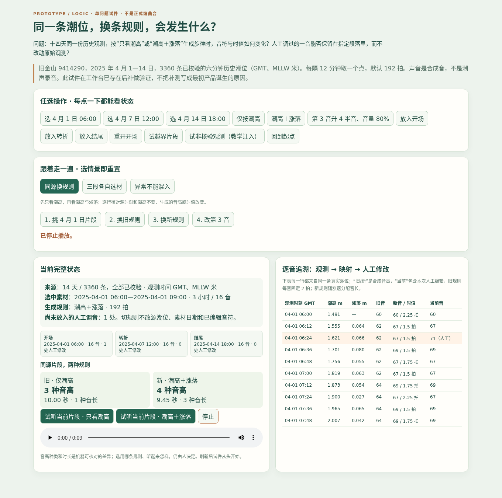

为做可复核的同源对照，制作时人工固定月初、月中、月末三个不同日期和时刻的三小时片段（4 月 1 日 06:00、4 月 7 日 12:00、4 月 14 日 18:00），**不是由算法选出的最佳片段**，也不声称它们在音乐上最好。旧/新规则共用这三段、同一音阶音色和 192 拍，只换映射规则，避免把源点、音色或节拍差误认成规则效果。每段每 12 分钟取一个点，得到 16 音。**在这三个固定片段上**，仅看潮高时每段各只有 3 种不同音高，且每音固定 2 拍；加入相邻观测的涨落方向与相对幅度后，三段分别有 **4、5、4 种音高**，并形成 1.5、1.75、2.25 拍三类时值。例如 4 月 1 日 06:12 的源潮高为 **1.555 米**，比前一个源点上涨 **0.064 米**；旧规则生成音高 **62**，新规则生成 **67、1.5 拍**。源值没变，改变的是如何“把涨潮写进旋律”。潮高仍给音区，涨落决定上/下行与快慢；这个规则是人为设计的音乐映射，不是 NOAA 测出的“潮声音高”。[试件浏览器回执](../../assets/skill-tide-musicbox/14day-logic/browser-check.json)、[同源状态测试](../../assets/skill-tide-musicbox/14day-logic/prototype14-logic.test.cjs)和[执行记录](../../assets/skill-tide-musicbox/14day-logic/RUN-REPORT.md)可复查这些数字、音符修改和异常拒绝。

**最终规则是人工选取，不是测试自动选。**你已实际试听并确认采用“潮高＋涨落”作为编曲台默认规则。为什么选它：同源比较显示它在保留潮高音区的同时，还让涨跌成为旋律方向、让变化幅度影响时值；在这三段样本里，旧规则每段只有 3 种音高且音长不变，新规则有 4、5、4 种音高及三类音长。数据解释了这项选择的**可核对依据**，人工试听决定了**是否采用**；本次补测只是复核既有选择，不伪称是 Skill 或测试替你作出音乐判断。没有记录主观评分，也不把音高种类更多等同于人人觉得更好听；旧规则仍可试听、也能用于打开原配方。

### 第四步：把验证过的规则放进可编排工作台

[十四日离线编曲台](../../assets/skill-tide-musicbox/tide14-studio.html)才是用来创作的作品，不是 LOGIC 试件换名。先从十四天总览点一天，再在整日曲线上拖出 2/3/4 小时片段；每隔 12 分钟映射一音，旁边能回查该音的时间、潮高、生成音高和人工半音/音量改动。调好以后就地放入开场、转折、结尾；三段能取自不同日期、分别试听、重新打开、明确更新或移除。撤销/重做、整曲试听、导出 WAV 和带来源指纹的 JSON 配方均可用，刷新前应先保存配方。导入旧配方不会偷偷换成新规则或新节拍。

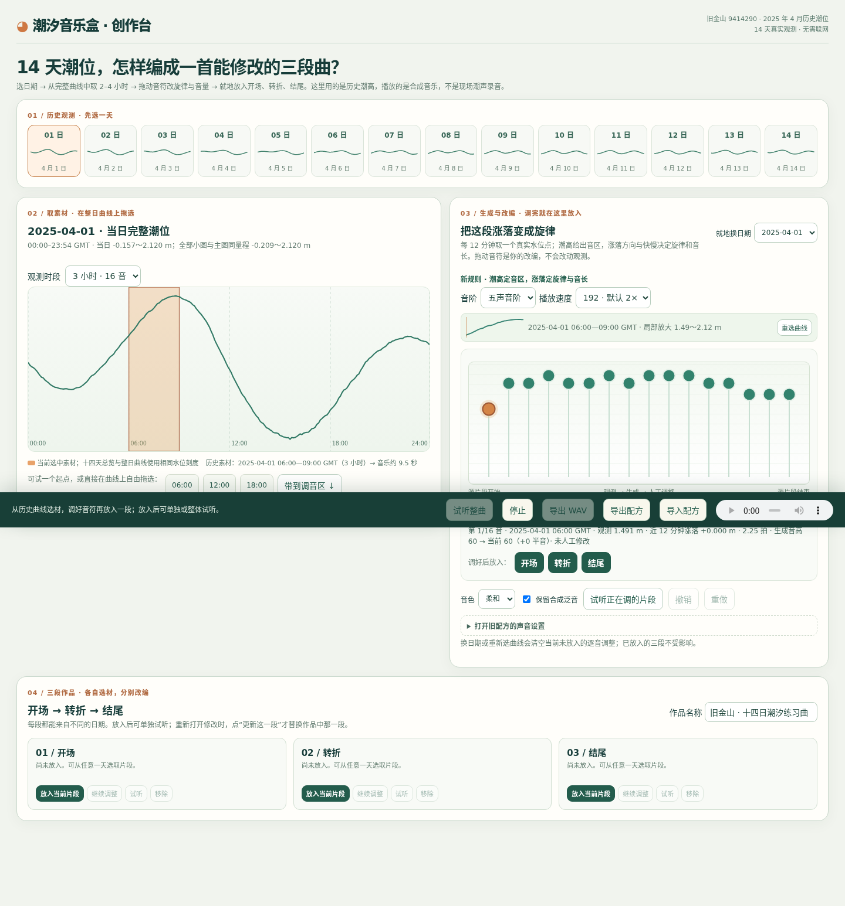

为了让规则与人工改动分别听得见，下面三份声音都来自**同一组人工固定的三个三小时源片段、共 48 个音**；统一音阶、音色和 192 拍。差别只在映射规则或人工逐音编辑，[生成脚本](../../assets/skill-tide-musicbox/make-tide14-examples.cjs)与[C 的配方](../../assets/skill-tide-musicbox/十四日-演示人工改编-配方.json)可核对。三组不是三次独立模型调用，也不是三段不同的潮汐录音。

| 听什么 | 真正改了什么 | 能核对到什么 |
|---|---|---|
| [A · 仅看潮高](../../assets/skill-tide-musicbox/十四日-演示原始映射.wav) | 三段同源、固定 2 拍/音 | 每段 3 种音高，整曲约 30 秒 |
| [B · 潮高＋涨落](../../assets/skill-tide-musicbox/十四日-演示新规则未改编.wav) | 同一源点，改规则，不改任何音符 | 三段分别 4、5、4 种音高，约 27.89 秒 |
| [C · B 的人工改编](../../assets/skill-tide-musicbox/十四日-演示人工改编.wav) | 在 B 上对三段各 2 个音调高低和音量 | 共 6 处手调，约 27.89 秒；源片段不变 |

### 第五步：验收什么，还要由人做什么

十四日数据恢复[4 项测试](../../assets/skill-tide-musicbox/test_extract_14day.py)、正式音乐[8 项模型及音频测试](../../assets/skill-tide-musicbox/tide14.test.cjs)、这次规则试件[3 项状态测试](../../assets/skill-tide-musicbox/14day-logic/prototype14-logic.test.cjs)均通过。新增音频测试复算 A/B/C 的 48 个同源时刻、6 处人工编辑，并将三份 WAV 与保存文件逐字节核对；状态测试还检查三段独立、已放入段落不被草稿覆盖、越界和教学注入拒绝。[原型浏览器回执](../../assets/skill-tide-musicbox/14day-logic/browser-check.json)记录了按钮、引导情景、旧/新片段音频时长、停止与手机 390px 无横向溢出；[正式编曲台回执](../../assets/skill-tide-musicbox/tide14-browser-check.json)另验收拖选、调音、三段试听、WAV/配方导出导入和手机触摸。自动化不能替人判断好听；**你实际试听后人工选择新规则**与自动化结果是两种证据。

下载仓库后，本地浏览器打开[规则试件](../../assets/skill-tide-musicbox/14day-logic/prototype14-logic.html)，依次点“同源换规则”“三段各自选材”“异常不能混入”，看看源值、音符和段落怎样变；再打开[音乐盒](../../assets/skill-tide-musicbox/tide14-studio.html)亲手从不同日期挑三段、改一个音、分段及整曲试听，并导出配方后重新导入。GitHub 文件预览不会运行离线 HTML。输入、生成步骤、截图和原始回执见[本案例的过程材料](../../assets/skill-tide-musicbox/README.md)：试件是本轮在工作台已有后补测的，**没有改写成先做试件再造工作台的虚构时间线**。

<a id="skill-bedroom-layout"></a>

## 卧室里想添书桌：不用重画几张图，怎样试出两种摆法？

> 固定输入：模拟房间、已有家具与三张候选书桌；不是户型照片的自动测量结果。
>
> 页面实测日期：2026-10-29。用同一间模拟房间试摆，记录操作过程和导出的结果。

### 场景与输入

想添一张书桌，麻烦的不只是算出剩余面积：床、衣柜和床头柜已经在房里，换桌子或挪衣柜以后，还要重新看重叠和开门空间。如果每试一次都从头画平面图，家具二选一、三选一就很费劲；更想要的是**用同一间房直接拖动、旋转，再把满意的两种尝试并排看**。

这个案例先由人画出[模拟原始布局图](../../dataset/cases/bedroom-layout-studio/room-plan.svg)，配上[固定尺寸数据](../../dataset/cases/bedroom-layout-studio/room-data.json)：房间 420 × 330 cm，窗宽 130 cm，房门宽 80 cm；已有床 150 × 200 cm、衣柜 120 × 60 cm、床头柜 45 × 45 cm。可选书桌 A/B/C 的尺寸为 100 × 55、120 × 60、140 × 70 cm；也可以在页面填入自己的家具名称与宽、深。[输入与图像来源](../../dataset/cases/bedroom-layout-studio/README.md)记录了坐标和出处。**这是一套用于试做产品的模拟数据，不是 AI 从实拍户型里测出的尺寸。**

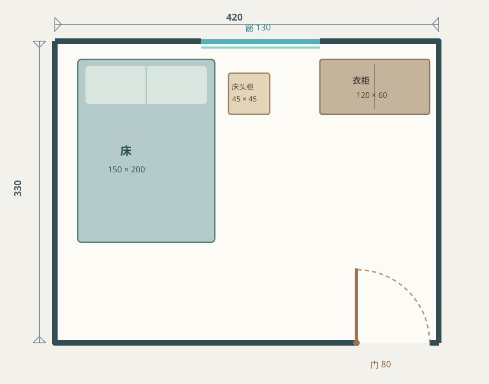

### Prompt：把任务、工具和验收一起说清

这里最重要的不是让 AI “帮我设计最好的卧室”，而是说明**尺寸从哪里来、必须怎样使用 Skill、要有哪些可操作状态、如何证明结果是真的**。下面节选制作前[原始 Prompt](../../assets/skill-bedroom-layout/skill-run/PROMPT.md)中关于最终产品的任务输入，保留原文；原件末尾还有当时的阶段核查要求，作为过程记录保存，不把先期页面当作本案例的另一件交付物。

```text
请读取仓库保存的 `skills/external/anthropics/web-artifacts-builder/SKILL.md`，严格按其要求使用原始 `scripts/init-artifact.sh` 新建隔离工程，开发交互页面，再由原始 `scripts/bundle-artifact.sh` 打包为可离线打开的 `bundle.html`；保存真实命令与运行结果。不要替换或冒充其他 Skill，遇到依赖或打包失败即停止并告知使用者。

输入是 `dataset/cases/bedroom-layout-studio/room-data.json` 与同目录 `room-plan.svg` 记录的模拟卧室：420×330 cm，北墙窗宽130 cm、南墙房门宽80 cm；床、衣柜、床头柜和候选书桌 A/B/C 的尺寸与位置以固定数据为准。不要从图片推测真实尺寸。可以复用现有源码中的纯几何计算及固定数据，以便保持同一判断合同；不要复制既有网页的完整组件/布局冒充本轮 Skill 新产物。

产出一个真实可试的多状态 React 界面：初始家具、加入候选或自填一件家具、图上拖动和旋转、越界/重叠/开门冲突阻止保存、保存恢复 A/B 并导出 PNG。适配桌面和手机，避免多余装饰。模型和 Skill 不代替人判断真实通道、搬运、采光或“最优”。
```

Prompt 把“做页面”落实成几个可以检查的动作：读取确定的尺寸，允许人动手改摆位，把冲突反馈出来，最后交付可以真正打开和导出图片的页面。下面就沿着这条操作路径，看页面怎样完成一次试摆。

### Skill 怎样进入制作过程

这次使用的是从 GitHub 保存的 [`web-artifacts-builder`](../../skills/external/anthropics/web-artifacts-builder/SKILL.md)。它适合把多个交互状态组织成 React 页面，并打包为可离线打开的单个 HTML。本轮实际运行了它的原始初始化与打包脚本，执行边界见[来源记录](../../skills/external/anthropics/web-artifacts-builder/SOURCE.md)。

| 制作步骤 | 这次留下了什么 |
|---|---|
| 用 Skill 的原始初始化脚本建工程 | 生成 React 工程及 shadcn/ui 组件；新页面实际使用 Button、Card、Input、Badge、Alert |
| 接入案例的模拟数据和判断规则 | [页面源码](../../code/cases/bedroom-layout-studio/skill-web-artifacts-builder/README.md)组织候选选择、家具移动、冲突提示、方案存档；固定数据与纯几何判断来自人工编写的案例输入及先期实现，不是 Skill 自动推断 |
| 用 Skill 的原始打包脚本交付 | 得到可直接打开的[离线试摆页面](../../code/cases/bedroom-layout-studio/skill-web-artifacts-builder/bundle.html)，不必安装依赖才能试用 |

[初始化日志](../../assets/skill-bedroom-layout/skill-run/init-log.txt)与[打包日志](../../assets/skill-bedroom-layout/skill-run/bundle-final-log.txt)记录了原脚本的实际执行。运行中遇到依赖源不可达、版本不一致和打包中断，调整隔离工程后才完成。这里的 Skill 负责**页面工程与交付链路**；固定尺寸、家具重叠和房门开启范围由案例数据与几何逻辑负责。继续使用易辨认的 2D 俯视图，让人看清家具位置和占地。

### 跟着一次试摆走：选择、遇到冲突、再调整

打开页面时，床、衣柜、床头柜已在房间里；左侧可以选三张候选书桌，也能填自己的家具尺寸。图上的家具可以拖动，点选后会在旁边出现“↻ 90°”；不必为每次调整重新画平面图。

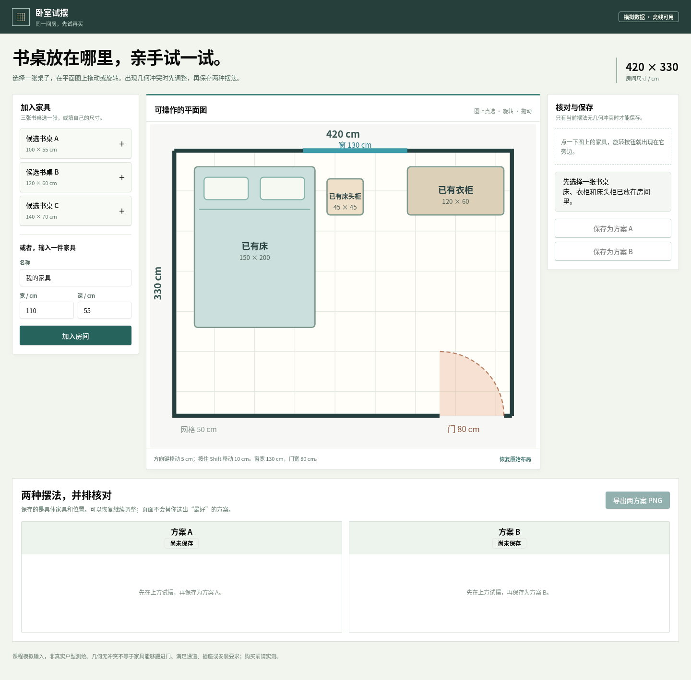

这次浏览器操作留下了一条完整路径：

| 试摆动作 | 页面给出的反馈 |
|---|---|
| 加入候选书桌 B，先保存为方案 A | 书桌进入房间图，方案 A 留下这次摆位 |
| 点选衣柜并在图上旋转 90° | 衣柜与书桌 B 重叠，页面指出冲突并禁用方案 B 的保存按钮 |
| 恢复原始布局，改选候选书桌 C 并旋转，保存为方案 B | 两张候选桌子的摆法出现在同一页，保存后刷新仍可恢复 |
| 点击“导出两方案 PNG” | 浏览器实际下载包含 A、B 两张平面图的图片 |

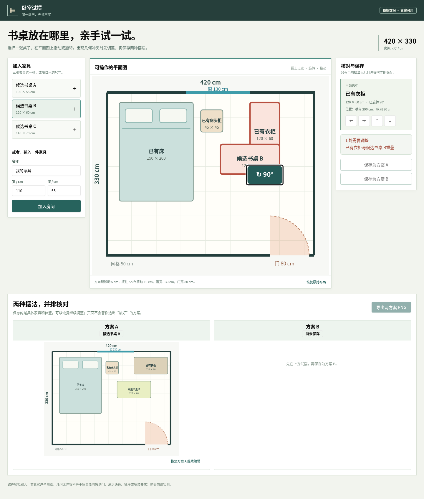

这比看一张完成图多说明一件事：**冲突不是让人凭眼睛猜的。**程序按照家具矩形占地检查越界、重叠与房门开启范围；调整后再次计算，才允许保存。50 cm 浅网格和床品图示帮助读图，不充当新的测量数据。除上面这条试摆路径，还实际验收了鼠标拖动、自填家具、键盘移动、图上旋转、刷新恢复和 PNG 文件下载；[手机画面](../../assets/skill-bedroom-layout/skill-run/skill-mobile.png)与[只针对最终页面重跑的浏览器回执](../../assets/skill-bedroom-layout/skill-run/browser-final-check.json)分别用于检查小屏幕和操作结果。[复跑脚本](../../assets/skill-bedroom-layout/skill-run/verify-final.cjs)还核对了实际下载的 PNG 与展示图逐字节相同。

### 把两种摆法带走

最终页面完成上面的选桌、旋转、保存操作后，浏览器验收实际下载了这张 PNG：左边保留书桌 B 的摆法，右边是旋转后的书桌 C。对着图可以继续看两张桌子的占地、与床和衣柜的间隔，以及房门的开启区域。**这张图由验收脚本操作最终页面导出，不冒充人亲手导出的结果。**

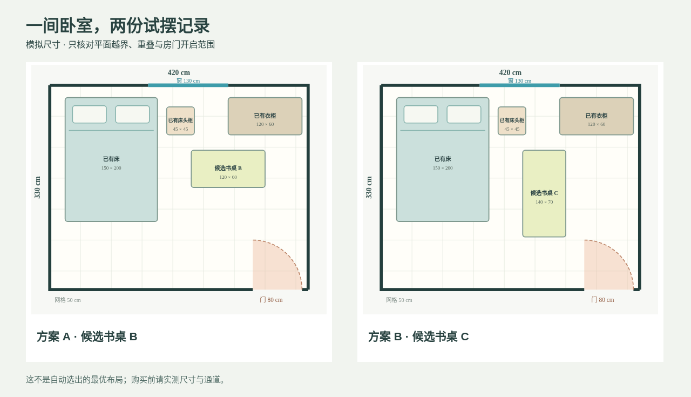

导出 PNG 方便带走和讨论；若还想挪动家具，可以回到页面恢复当前浏览器里保存的方案继续试。单独一张图片不保存可编辑的家具位置。

**摆得下，还要不要买？**页面能指出已覆盖的几何冲突，却不会替人决定书桌靠哪侧更顺手、光线如何，也无法从模拟尺寸推断搬运和安装。结果图适合拿来讨论两种摆法；真要购买，还需要用房间和家具的实测尺寸核对。

### 自己试一次

下载仓库后，用浏览器打开[本轮 Skill 版离线页面](../../code/cases/bedroom-layout-studio/skill-web-artifacts-builder/bundle.html)；GitHub 文件预览不会运行网页。先加入书桌 B，旋转衣柜看冲突提示与禁用保存；恢复后换书桌 C，调整、保存 A/B 并导出 PNG。再试着填入自己的家具尺寸，检查能否加入、移动和旋转。页面不需要安装依赖或注册账号；想看制作过程，可以从[原始 Prompt](../../assets/skill-bedroom-layout/skill-run/PROMPT.md)、[工程说明](../../code/cases/bedroom-layout-studio/skill-web-artifacts-builder/README.md)与[运行证据](../../assets/skill-bedroom-layout/skill-run/README.md)逐步回看。

**课堂讨论：**展示你试出的两张图，说出“程序帮我排除了哪种冲突”和“我还需要亲自确认什么”。这既是在验收工具，也是在决定下一步怎样摆放，而不只是给页面打一个“好看”的分数。

<a id="skill-s10"></a>

## S10：查询发出却没有回执，工作台该显示什么？

> 固定数据：`dataset/10-telecom-complaint-orchestration/case.csv`  
> 实测日期：2026-09-17  
> 结论边界：A/B 只保存完整 Prompt，不冒充独立模型运行；C/D 为本地实际生成页面，并完成桌面、手机、键盘和状态切换检查。

### 场景与任务

工作人员要核查一条通信请求：本地任务已登记，查询也发出去了，外部效果却还没有回执。工作台若为了看起来“完成”而把它写成已生效或未生效，就把未知改成了结论。“做一个好看的后台”没有说明业务任务、状态、证据边界和验收方式。结构化 Prompt 能把需求说清楚，Skill 能把工作流和检查步骤固定下来，UI Kit 能统一组件外观；三者不是同一种东西，也不能互相替代。

本实验复用 B10 的 1,000 条匿名课程数据，不另编业务故事。页面任务固定为“通信请求恢复核查”：工作人员可以查看调用链和证据，记录“仍未知 / 已生效 / 未生效”，但不得把缺少外部回执误写成失败或成功。

### 四组怎样比较

| 组 | 唯一变化 | 当前证据 |
|---|---|---|
| A 普通 Prompt | 只有“做一个好看的通信投诉后台” | [完整 Prompt](../../assets/S10/prompts/A-ordinary.txt)，未做独立模型调用 |
| B 结构化 Prompt | 补齐布局、状态、响应式、可访问性和禁止项 | [完整 Prompt](../../assets/S10/prompts/B-structured.txt)，未做独立模型调用 |
| C `ui-workbench` Skill | 用固定工作流、状态矩阵和浏览器验收生成页面 | [实际页面](../../assets/S10/skill-only/index.html) |
| D `ui-workbench` + Tabler | 保持 C 的内容和交互，只增加固定版本 UI Kit | [实际页面](../../assets/S10/tabler/index.html) |

A/B 可以比较“指令写进了什么”，却不能比较“页面谁更好”：这两组没有独立生成页面。C/D 才有可打开、可操作的结果。

### Skills 介绍：流程 Skill 和 UI Kit 的边界

课程自有 [`ui-workbench`](../../code/skills/ui-workbench/SKILL.md) 不是一段“让页面更高级”的形容词，而是一套可重复执行的合同：先读数据和禁止结论，再定义队列、记录、证据、决策和完成门；随后补齐空白、待核对、明确结果、禁用和错误状态；最后做键盘、手机、控制台和水平溢出检查。

它由 Skill Creator 初始化并在本项目内实现，不是从 GitHub 冒充下载的第三方 Skill。生成器使用 Python 标准库，输入受 `--allowed-root` 限制，不修改源 CSV。D 组另加 Tabler 组件样式；Tabler 是 UI Kit，不负责规定业务状态。

### Prompt：四组保存的输入

以下为四组保存的原始输入。先读它们怎样提出任务，再对照下方的实际页面与验收记录。

**A：普通 Prompt**

```text
做一个好看的通信投诉后台。
```

**B：结构化 Prompt**

```text
基于 B10 通信请求恢复核查，做一个桌面优先且可响应的后台工作台。左侧是可搜索、可按三种场景筛选的匿名任务目录；中间显示本地记录、网络边界、外部效果三段调用链和证据矩阵；右侧记录查询目标、说明、仍未知/已生效/未生效、结果摘要和证据编号。必须包含空白、禁用、待核对、明确结果和错误提示状态，键盘可达，手机端不得水平溢出，不得生成个人信息或虚构外部结果。
```

**C：流程 Skill**

```text
使用 $ui-workbench 读取 dataset/10-telecom-complaint-orchestration/case.csv，按其工作流、状态矩阵、可访问性和浏览器验收规则生成 B10 工作台；不加载外部 UI Kit。
```

**D：流程 Skill + Tabler**

```text
使用 $ui-workbench 读取同一 B10 数据和交互合同，并使用固定版本 @tabler/core@1.4.0实现按钮、徽标、卡片和表格；不得把 Tabler 写成 Skill，保持与 C 组相同功能和文案。
```

逐字输入另存于 [`assets/S10/prompts/`](../../assets/S10/prompts/)。

### 运行结果：数据与状态不是装饰

构建器只读扫描 CSV，得到 1,000 条记录和三种场景分布：响应丢失 333 条、效果未知 333 条、尚未提交 334 条。代表任务为 `CN-TEL-2025Q2-0008`，地区显示为福建福州。

页面把事实、未知和动作分开：

- 本地任务已登记，可以陈述；
- 查询发出后未取得响应，可以陈述；
- 外部效果未知，不能推断成失败；
- “仍未知”必须填写原因；
- “已生效 / 未生效”必须同时填写结果摘要和证据编号；
- 演示按钮只更新页面状态，不向任何外部系统发请求。

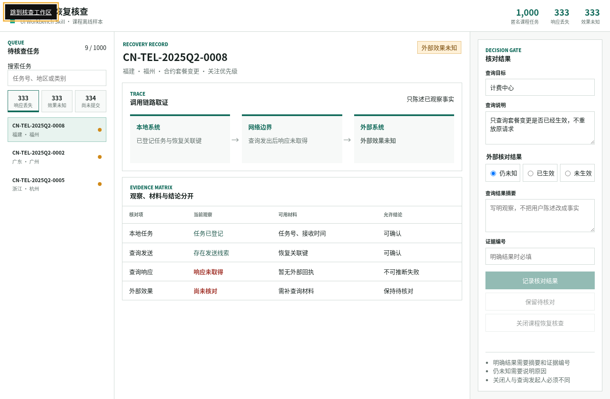

### 加上 Tabler 之后，哪里变了

D 组使用 `@tabler/core@1.4.0` 的官方 CSS。项目副本与官方 npm tarball 逐字节一致，SHA-256 为 `7ef750bd10546a695d0b12767ad8048bd8f3ec5de7daefb1067f9d0daa3d1c9a`；同时核对了 GitHub 仓库 `tabler/tabler` 的 commit `b295d84b3eb57b05003ba155f4da925be71f1214` 和 MIT 许可证。

Tabler 是 UI Kit，不是 Skill。它没有决定“外部效果未知时要停下来”，也没有替页面补齐证据门槛；这些来自 Skill。它实际改善的是按钮、徽标、边框、表格和间距的一致性，代价是额外引入 536,141 字节 CSS。

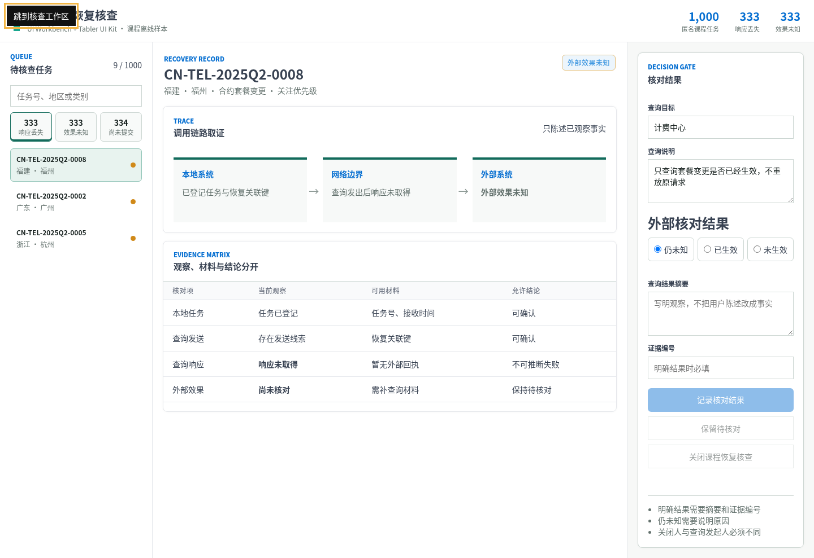

### 真实浏览器怎样核对

两份页面用同一套交互脚本验收，结果一致：

| 检查 | C Skill-only | D Skill + Tabler |
|---|---|---|
| 初始“响应丢失”可见项 | 3 | 3 |
| 切换“效果未知”后 | 3 | 3 |
| 搜索 `0003` 后 | 1 | 1 |
| 空表单记录按钮 | 禁用 | 禁用 |
| “仍未知 + 原因” | 可保留待核对 | 可保留待核对 |
| 明确结果但无证据 | 仍禁用 | 仍禁用 |
| 补齐证据编号 | 可记录 | 可记录 |
| 首个 Tab 焦点 | `skip-link` | `skip-link` |
| 1440×900 / 390×844 页面横向溢出 | 0 / 0 | 0 / 0 |
| 控制台 error | 0 | 0 |

手机端把三区工作台改成纵向任务流；宽表格只在自己的容器内横向滚动，不让整个页面溢出。截图左上角出现“跳到核查工作区”，是键盘验收时获得焦点的跳转链接，不是版式故障。

手机端两组仍可操作，但版式不同。对照图片看三区工作台缩窄之后，任务、证据和记录按钮是否还能按顺序找到：

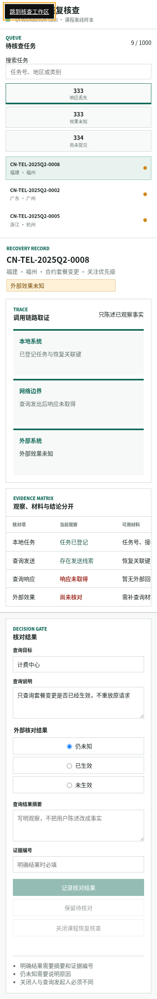

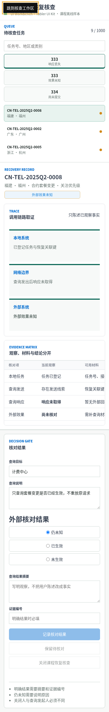

### 结论与课堂选择

Prompt 负责表达需求，但它不会自动保证执行者逐项验收；Skill 固定流程、状态和证据边界；UI Kit 提供成熟组件样式；模型或 Agent 负责读取这些约束并生成工件。

C 和 D 的业务正确性相同，说明 UI Kit 没有让业务规则“更聪明”。D 的视觉一致性更好，但多出约 523 KiB 依赖。对一次性离线演示，C 更轻；对需要持续扩展且已有 Tabler 设计体系的后台，D 更容易保持组件一致。

**课堂提问：**已发出查询，却没有外部响应；能否直接点“未生效”？如果想记录“已生效”，只写一段摘要够吗？**参考答案：**没有回执时仍是未知；记录明确结果必须同时给摘要和证据编号。先用 [C 组页面](../../assets/S10/skill-only/index.html)验证，再在 [D 组页面](../../assets/S10/tabler/index.html)重复。组件风格可以不同，但状态门不能变化。

### 不用 API Key，怎样复跑

本实验是本地 CSV、Python 生成器、静态 HTML 和浏览器检查，没有调用云模型或外部业务接口，因此不需要 API Key：

```bash
python3 -B code/skills/ui-workbench/scripts/build_ui_comparison.py \
  --input dataset/10-telecom-complaint-orchestration/case.csv \
  --allowed-root dataset/10-telecom-complaint-orchestration \
  --tabler-css vendor/tabler/1.4.0/tabler.min.css \
  --output-dir assets/S10
```

生成回执见 [receipt.json](../../assets/S10/receipt.json)，浏览器回执见 [browser-verification.json](../../assets/S10/browser-check/browser-verification.json)。

<a id="skill-s11"></a>

## S11：地图看起来立体，真的能进入浙江吗？

> 数据来源：DataV 行政区边界公共接口  
> 实测日期：2026-09-17  
> 结论边界：只展示行政区边界、hover 和下钻，不把 B20 光伏数据虚构映射到省市。

### 场景与任务

展示中国地图时，把一张图片倾斜、加上阴影，就能做出立体感。可如果观众要把鼠标放到浙江、点进去看市级边界，再返回全国，图像的厚度就不等于交互能力。这次从已保存的真实 GeoJSON 出发，比较一张视觉草图、轻量 Three.js 实现与外部 Skill 的完整模板。先定义“真三维”的检查条件：页面确有 WebGL canvas，能 hover、下钻和返回，再讨论材质与飞线值不值得增加。

### 三组怎样比较

| 组 | 实际实现 | 当前产物 |
|---|---|---|
| A CSS 伪 3D | JPG 倾斜、阴影和假厚度 | [A 组页面](../../assets/S11/A-css-fake/index.html) |
| B 普通 Prompt 手写 | Three.js 读取真实 GeoJSON，生成挤出几何 | [B 组页面](../../assets/S11/B-three/index.html) |
| C GitHub Skill | `three-scope-map` 固定 Vue/Three.js 模板 | [C 组源码与构建配置](../../assets/S11/C-skill/) |

### Prompt：三组保存的输入

**A：视觉草图**

```text
把中国地形图片做成立体地图效果，可以使用 CSS 透视和阴影。
```

**B：轻量 Three.js**

```text
使用 Three.js 和真实中国省级 GeoJSON 做一个 3D 地图。支持鼠标 hover；点击浙江省下钻到市级，并能返回全国。不得把 B20 光伏数据映射到省市。
```

**C：外部 Skill 模板**

```text
使用 $three-scope-map 的一对一模板和真实 GeoJSON 生成中国 3D 地图，保留 Earth 入口、挤出侧壁、边界、标签、hover、飞线、追光、浙江下钻、返回上级、GPL-3.0 SPDX 与原作者署名；构建后必须做桌面和手机浏览器、canvas 非空像素、WebGL、hover、下钻、控制台和资源体积验收。
```

原始文字也保存在 [`assets/S11/prompts/`](../../assets/S11/prompts/)；三组比较的是**同一任务由不同实现承担的结果**，不是三个隔离模型会话的成绩。

### 数据：真实边界从哪里来

本案例没有把现有业务数据硬塞到地图。全国和浙江边界由已审查的 Skill 数据解析器从明确 URL 下载，并在写入前验证层级、要素数量、坐标范围和行政代码。

| 数据 | URL | 要素 | 层级 | SHA-256 |
|---|---|---:|---|---|
| 中国 | `https://geo.datav.aliyun.com/areas_v3/bound/100000_full.json` | 35 | 省级 | `99adfeded5223848bbe37a0a12f8023e11ee12161c7800521c27db42fdeac275` |
| 浙江 | `https://geo.datav.aliyun.com/areas_v3/bound/330000_full.json` | 11 | 市级 | `f87241d47687264861aa619b8dc37ffeb61a2be5d6018a8c01ec0ce0acb5cb38` |

全国数据与 GitHub Skill 模板自带 `china.json` 哈希完全一致。浙江使用本轮重新下载的当前公开数据，保存在 `assets/S11/data/`，不依赖浏览器临时联网。

### Skill 介绍与实际使用

是。C 组使用固定 commit 的真实源码副本，不是根据文字说明重新仿写。

| 字段 | 证据 |
|---|---|
| GitHub | `songsummer920-dazzle/three-scope-map-skill` |
| 固定 commit | `605867c0dc7f3a3b3ce601e76a695e4d9fe7a943` |
| 本地位置 | `skills/three-scope-map/` |
| 许可证 | GPL-3.0-or-later |
| 署名 | `作者全平台ID：宋夏天Dazzle；公众号：送你整个夏天` |
| 安全结论 | `CAUTION` |

我重新从 GitHub 下载该 commit 的 19,358,400 字节归档，将其中 `three-scope-map/` 与本地目录逐文件比较：59 个文件完全一致；`SKILL.md` SHA-256 为 `11593171e9de7decade8385fdff90d3c43ffad084f75c7b8567c50cc4f4c4193`。

随后真实运行了模板完整性校验、GeoJSON 解析器、严格项目检查、依赖安装、Vue 类型检查、Vite 生产构建和浏览器交互。`LICENSE`、`NOTICE`、`CITATION.cff`、SPDX 和原作者代码署名均保留在 C 组运行副本。

本机没有 `skillspector` CLI，因此 `CAUTION` 是源码语义审查结论。Skill 包含可联网的数据解析器、浏览器 `localStorage` 相机配置和较大的构建依赖，但未发现密钥读取、持久化、混淆或任意命令执行。本案例没有运行无关主题脚本，也没有写入密钥。

### A：看起来立体，不等于能操作

A 看起来有透视，但页面中没有 canvas，不能 hover、计算边界或下钻。它适合做反例：一张斜放的地图图片不能证明“Three.js 地图已经完成”。

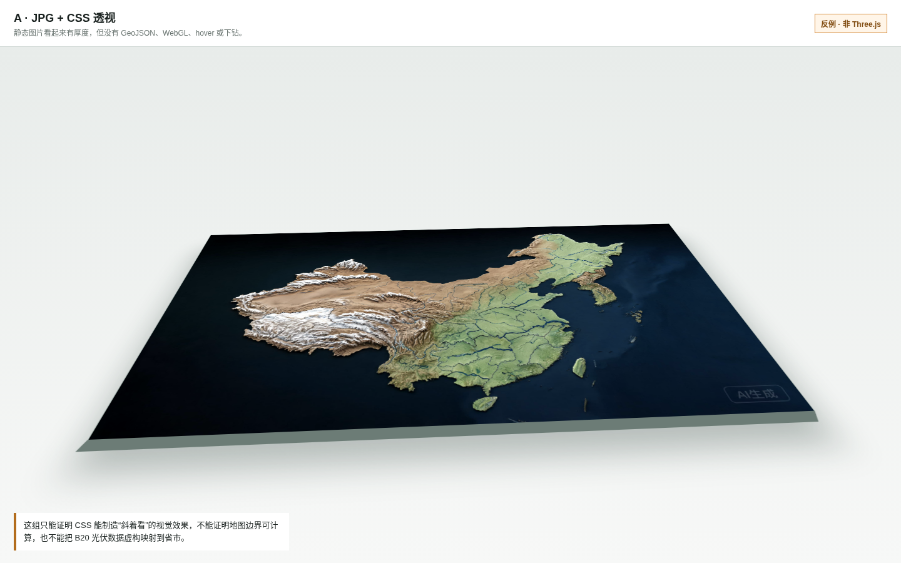

### B：轻量 Three.js，能下钻但没有完整舞台

B 组用本地 Three.js 0.178.0 把 Polygon / MultiPolygon 转为 `ExtrudeGeometry`，实现：

- 全国 35 个省级要素；
- WebGL canvas，而不是 SVG 或图片；
- 鼠标射线 hover；
- 浙江 11 个市级要素离线下钻；
- 返回全国；
- 桌面和手机自适应。

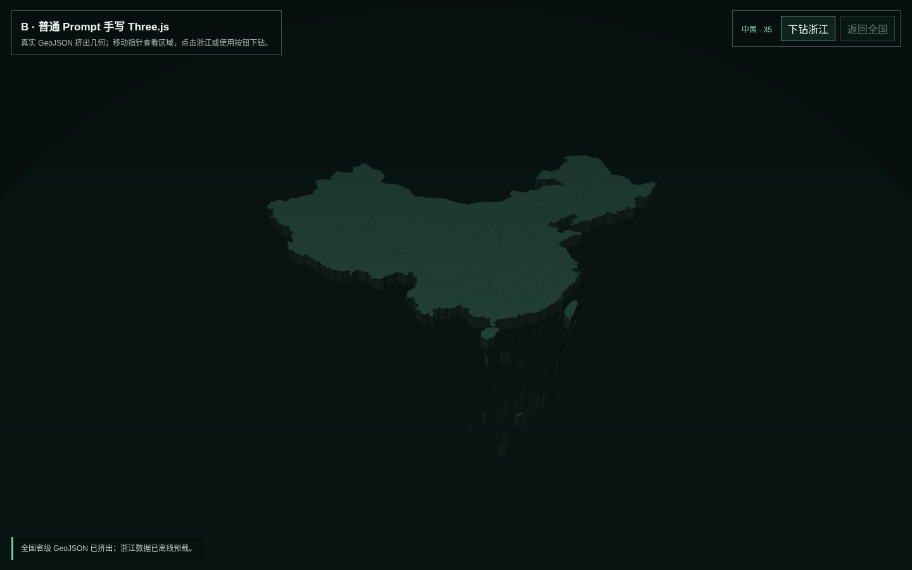

浏览器实测记录到 hover“黑龙江省”，状态按 `35 → 11 → 35` 完成下钻和返回。canvas 像素 spread 为 37.17，非空；桌面和 390×844 手机均只有 1 个 WebGL canvas、无页面级横向溢出、0 console error。

[B 组手机画面](../../assets/S11/browser-check/B-three-mobile.png)可以与下方的 C 组手机截图一起看：能否操作和画面是否清楚，要分别核对。

它的限制也很明显：没有标签体系、飞线、追光、地形材质、南海插图和 Earth 入口，视觉层次远弱于 C。

### C：Skill 模板把哪些能力组合起来

C 从 Skill 自带的一对一模板开始，没有重新凭印象手写。严格检查确认存在：Earth 球体、China 曲面、挤出侧壁、行政边界、地形纹理、hover 抬升、标签、飞线、外轮廓追光、南海插图、层级栈、相机配置和资源释放。


真实浏览器操作顺序为：Earth 上 hover 中国 → 点击进入全国地图 → hover 浙江省 → 下钻至 11 个市 → 返回全国。桌面截图中的发光侧壁、标签和轮廓不是后期图片，而是通过 Chrome 运行的 WebGL canvas。

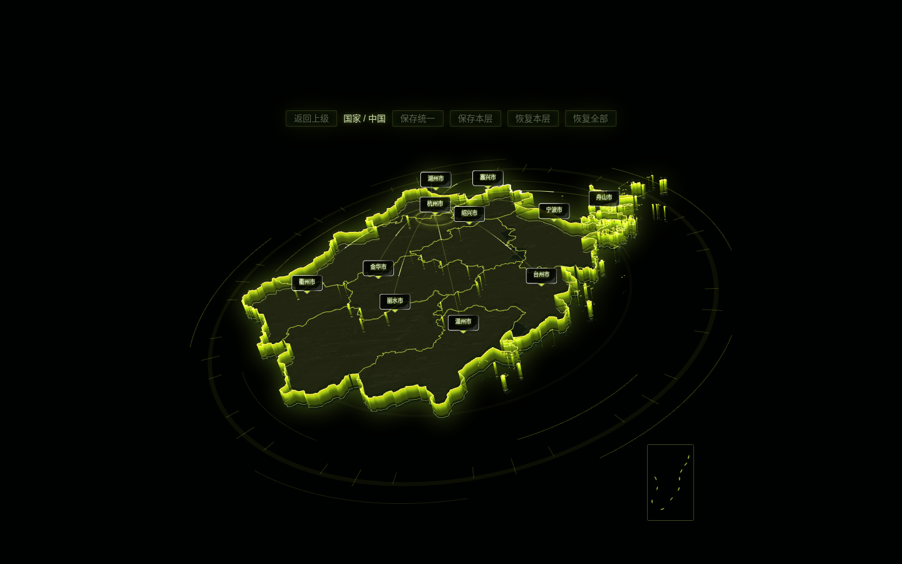

### 对照手机画面：C 也有代价

| 维度 | B 手写 | C Skill 模板 |
|---|---:|---:|
| 生产页面代码 | 10,334 B | 15 文件，共 9,964,445 B |
| 本地依赖目录 | 复用课程 Three.js | 111,223,489 B |
| 主 JS | 本地 ESM 两文件约 1.99 MB | 4,730 KB，gzip 1,623 KB |
| 功能 | hover、浙江下钻、返回 | Earth、材质、标签、飞线、追光、下钻、相机 |
| 桌面可读性 | 通过，较素 | 通过，表现力强 |
| 手机可读性 | 通过 | 自动检查无横向溢出，但人工视觉检查不通过 |

C 的 390×844 截图暴露了真实问题：顶部控制栏被压成竖排，全国 35 个标签相互拥挤。canvas 非空和 `scrollWidth == clientWidth` 并不能替代人工看图。

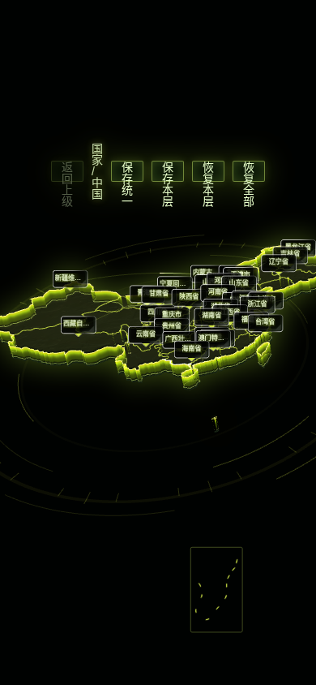

安装时还发现 `nanoid@3.3.16` 的高危公告 `GHSA-2v37-7h3g-55p8`。它是 Vite → PostCSS 的间接开发依赖，本案例只在运行副本升级到 `nanoid@3.3.19`，再次审计为 0 vulnerability；原始 `skills/three-scope-map/` 固定版本没有改动。

### 结论与课堂选择

真正的 Skill 增益不只是“颜色更亮”，而是把 GeoJSON 层级、材质、交互、下钻、过渡、验证和署名绑成一套可复用流程。C 在桌面展示中明显领先 B；代价是包体、构建复杂度、GPL 义务和移动端适配工作。

如果目标只是一个轻量离线行政区选择器，B 更合适；如果要做高表现力的大屏入口，并且愿意承担筛选、适配和许可证要求，C 才值得采用。A 只能当视觉草图，不能算 Three.js 交付。

**课堂练习：**先对照 [B 的桌面结果](../../assets/S11/browser-check/B-three-desktop.png)与上面的 C 桌面、手机图，说出“能下钻”和“适合手机直接交付”分别需要什么证据。**参考思路：**B 与 C 都要实点浙江、返回全国；C 的 Earth 与材质增加表现力，但手机控制栏和标签拥挤，不能因为自动检查没有横向溢出就说手机可用。若任务只需离线选省市，应优先考虑 B。

### 不用 API Key，怎样展示

GeoJSON 下载是公开 URL，页面构建和浏览器渲染都在本机完成，不需要 OpenAI Key 或地图商业 API Key。数据已保存在仓库，后续离线展示只需本地静态服务器：

```bash
cd assets/S11
python3 -m http.server 5292 --bind 127.0.0.1
```

打开 `http://127.0.0.1:5292/`。完整运行回执见 [receipt.json](../../assets/S11/receipt.json)，浏览器回执见 [browser-verification.json](../../assets/S11/browser-check/browser-verification.json)。
