# 第六部分　二十个综合业务案例

案例从一句需要当班处理的问题开始。页面里只展示完成判断所需的数据、角色和动作；模型负责整理、检索和提出候选，金额、权限、状态变化与高影响决定由确定性规则或人工完成。

| 编号 | 当班问题 | 场景 |
|---|---|---|
| [B01](#case-b01) | 一张 8.17 万元取消单，缺的是哪张原单？ | 跨境零售售后 |
| [B02](#case-b02) | 3,000 元预算，8 元券先发给谁？ | 会员试投 |
| [B03](#case-b03) | 6,970 条餐饮评论，先查清哪个问题？ | 本地生活经营 |
| [B04](#case-b04) | 收入证明缺失：谁补，谁复核？ | 信贷材料补正 |
| [B05](#case-b05) | 08:27 发生、09:09 才收到的更正怎样处理？ | 医院转运协同 |
| [B06](#case-b06) | 六项污染物全空的记录要不要纳入摘录？ | 空气质量数据发布 |
| [B07](#case-b07) | 请求更少，履约为什么反而最慢？ | 即时零售架构评审 |
| [B08](#case-b08) | 数值冲突：谁取证，谁采信？ | 水产养殖事件响应 |
| [B09](#case-b09) | 352 秒没有记录，现在能不能提交检查申请？ | 地铁空压机 Agentic RAG |
| [B10](#case-b10) | 查询已发出、响应没回来，现在能不能重试？ | 通信投诉恢复 |
| [B11](#case-b11) | 地区切片没有过线，模型还能准入吗？ | 企业模型准入 |
| [B12](#case-b12) | 30 条记录有 5 次越界，缺的交接证据怎样补？ | 疫苗冷链调查 |
| [B13](#case-b13) | 制动异响的客户回答够不够转技师？ | 汽车售后分流 |
| [B14](#case-b14) | 精矿硅连续高值，先查药剂、矿浆还是仪表？ | 浮选工艺核查 |
| [B15](#case-b15) | 生产观测未通过，先复测还是先查通道？ | 半导体质量复测 |
| [B16](#case-b16) | 风机连续七个运行日下偏，先补什么？ | 风机出力调查 |
| [B17](#case-b17) | 三路波形都在，要不要列入排检候选？ | 包装切刀健康复核 |
| [B18](#case-b18) | 主汽低温持续 24 分钟，先查哪一段？ | 锅炉事件核查 |
| [B19](#case-b19) | 第 217 次测量循环三项同级，谁先查？ | 液压系统维护排序 |
| [B20](#case-b20) | 光伏站出现少发线索，站端先查什么？ | 光伏损失归因 |

## 上游十个案例怎样进入新体系

| 原案例 | 融合位置 |
|---|---|
| 电商早会异常订单台 | B01、B02、B03 的经营问题与证据分层 |
| P2P 信贷画像 | B04 的材料补正、人工复核与高影响边界 |
| 零售经营综合闭环 | B02、B03、B07 的指标、调查和架构决策 |
| 中文医疗知识库 RAG | B05 的隐私边界与 B09 的证据型检索 |
| PostgreSQL 关系库查询 | 产品架构章节的数据合同与查询边界 |
| 子系统分解与接口契约 | 产品架构章节和 B07 架构评审 |
| RAG 评测台 | B09 检索检查与 B11 模型准入门禁 |
| SDD 系统建造 | 课程项目中的规格、实现和验收 |
| 仓库事件总线 | Loop、事件驱动和幂等处理专题 |
| 通信投诉升级 | B10 的查询恢复、状态核对和人工关闭 |

下方保留 B01—B20 的完整案例正文；也可由[案例索引](../案例索引.md)跳转。运行入口为 `http://127.0.0.1:3200`。

## 案例与逻辑思维方法论映射

二十个案例与逻辑思维方法论的映射如下：

| 案例 | 核心方法论 |
|------|----------|
| B01 零售售后 | 命题清晰化→量词严谨性→逻辑边界守护 |
| B02 会员试投 | 归纳三前提→参照系选择→命题清晰化 |
| B03 餐饮评论 | 事实与观点分离→证伪思维→量词严谨性 |
| B04 信贷补正 | 同一律→逻辑边界守护→量词严谨性 |
| B05 医院转运 | 逻辑一致性→命题清晰化→逻辑边界守护 |
| B06 空气质量 | 全集/子集辨析→量词严谨性→逻辑一致性 |
| B07 即时零售 | 相关性≠因果→命题清晰化→逻辑边界守护 |
| B08 水产养殖 | 逻辑边界守护→事实与观点分离→同一律 |
| B09 地铁空压机 | 逻辑一致性→证伪思维→逻辑边界守护 |
| B10 通信投诉 | 逻辑边界守护→命题清晰化→量词严谨性 |
| B11 模型准入 | 证伪思维→全集/子集辨析→归纳三前提 |
| B12 疫苗冷链 | 逻辑一致性→命题清晰化→逻辑边界守护 |
| B13 汽车售后 | 命题清晰化→相关性≠因果→量词严谨性→证伪思维→逻辑边界守护 |
| B14 浮选核查 | 归纳三前提→参照系选择→相关性≠因果→逻辑一致性→逻辑边界守护 |
| B15 半导体复测 | 同一律→相关性≠因果→量词严谨性→归纳例外→证伪思维 |
| B16 风机下偏 | 全集/子集辨析→参照系选择→证伪思维→逻辑一致性→逻辑边界守护 |
| B17 切刀复核 | 归纳三前提→量词严谨性→证伪思维→逻辑边界守护 |
| B18 锅炉核查 | 参照系选择→逻辑一致性→归纳vs演绎→相关性≠因果→逻辑边界守护 |
| B19 液压排序 | 同一律→相关性≠因果→量词严谨性→归纳例外→证伪思维 |
| B20 光伏归因 | 全集/子集辨析→参照系选择→证伪思维→逻辑一致性→逻辑边界守护 |


## 完整案例：输入、作品和复查

<a id="case-b01"></a>

### 综合案例 B01　一张 8.17 万元取消单，缺的是哪张原单？

#### 需求

售后人员必须在退款前找到可核对的原单；如果金额、时间或商品关系不足，就留下补证任务，不能靠相似金额猜测。

#### 问题

售后队列里出现了一张很扎眼的取消记录：发票 `C496116`、商品代码 `M`、数量 `-1`，按课程固定汇率换算为人民币 81,768.96 元。金额很大，但这条记录没有自动告诉我们三件最重要的事：原订单是哪一张、货是否退回、退款是否已经发生。

本案例要解决的是：材料不全时，怎样让售后继续工作，又不让系统误退款？

退款核验专员先回答三个问题：

1. 这条取消记录能否与某张原订单可靠关联？
2. 当前还缺原单查询回执、付款凭证、商品关系还是取消原因？
3. 缺口没有补齐之前，应该创建补证任务，还是由主管暂缓退款？

#### 逻辑思维方法论：从取消信号到原单核验的命题化

本案例的方法论链条如下：

1. **命题清晰化**：售后队列里出现"一张 81,768.96 元的取消记录"——但"取消记录"只是现象，不是可验证的命题。要判断原单是否存在，必须把它变成具体字段：发票 `C496116`、商品代码 `M`、数量 `-1`、`is_cancellation_proxy=true`。`is_cancellation_proxy` 只表示发票号具有取消记录的形式特征，不是退款回执，也不是退货签收。

2. **量词严谨性**：14,794 条课程样本记录中，只有部分取消记录能直接确认原单——"部分有原单"只在已核验的范围内成立，不能推广到全部 14,794 条。代表队列里的大额记录没有找到可确认原单，页面因此把其他记录标为"待逐笔排除"，而不是给出一个看似精确的关联分数；没有原单的记录不能因为"金额相似"就关联。

3. **逻辑边界守护**："暂缓退款"不是判定用户有问题，只是在材料不完整时停止不可逆动作。退款是不可逆的，材料不全时只能创建补证任务、提交人工复核或由主管暂缓——系统不自动退款，也不靠相似金额猜测原单。

#### 数据

本地数据来自 UCI Online Retail II，共 14,794 条课程样本记录。页面使用的主要字段是 `invoice_id`、`stock_code`、`quantity`、`invoice_at`、`unit_price_gbp`、`customer_id`、`country` 和 `is_cancellation_proxy`。

`is_cancellation_proxy=true` 只表示发票号具有取消记录的形式特征。它不是退款回执，也不是退货签收。人民币金额使用课程内固定汇率，只用于统一案例口径，不代表实时汇率。

选中的大额记录并没有在代表队列中找到可以直接确认的原单。页面因此把其他记录标为"待逐笔排除"，而不是给出一个看似精确的关联分数。

#### 解决方案

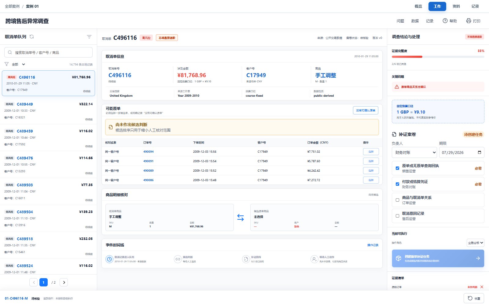

<video src="../../assets/diagrams/B01-requirement.webm" controls muted loop></video>

<video src="../../assets/diagrams/B01-architecture.webm" controls muted loop></video>

页面分成四块：

- 顶部先给出退款金额、数量、关系核对队列和案卷状态。
- 中间把取消记录与候选记录画成订单关系，虚线明确表示"待核对"。
- 右侧案卷保留发票、商品、客户、国家和原始单价，方便回到原始记录。
- 底部固定展示当前对象、操作角色和当前状态允许执行的动作。

正常处理顺序是：

```text
待核验
  ├─ 业务分析：创建原单补证任务 → 待补证
  │    └─ 业务分析：提交独立人工复核 → 人工复核待处理
  └─ 业务主管：暂缓退款 → 退款已暂缓
```

"暂缓退款"不是判定用户有问题，只是在材料不完整时停止不可逆动作。

#### CodeBuddy Prompt

把下面的 Prompt 交给 CodeBuddy。先让它读取已有数据字段、业务规则和状态流程，不要先重写工作流：

```text
请实现案例 B01 的退货证据核验台。

业务目标：售后人员需要核对取消发票、原订单和退款材料；材料不足时只能补证、提交人工复核或由主管暂缓退款。

数据：只使用 dataset/01-retail-return-evidence/case.csv 中的真实字段。金额用 line_amount_cny；is_cancellation_proxy 只能显示为取消信号，不能解释为已经退款。

页面：左侧显示取消记录与候选订单关系，右侧显示案卷摘要，底部显示交易记录、取消信号和人工动作。候选关系必须标明待核对，不能生成虚构置信度。

交互：售后专员创建补证任务，材料回传后由另一名复核人确认；主管可以写明理由后暂缓。刷新页面后仍能看到案卷状态和操作记录。

完成后运行类型检查、聚焦测试和生产构建。
```

#### 演示

**操作**：

1. 打开案例 B01，顶部进度条第一步"1 找原单"变蓝高亮。在页面中部候选列表里点击 `C496116` 这一条（该条变蓝表示选中），再在取消单卡片底部点击"没有可确认原单"按钮（该按钮变红表示已确认无原单）。
2. 顶部进度条第二步"2 发起补证"变蓝高亮。在页面右侧材料清单中，保留已勾选的"原单或无原单查询回执"和"付款或结算凭证"两项必需材料，再勾选"商品与取消单关系"复选框，在下方"负责人"和"期限"输入框填写后，点击底部"创建补证任务"按钮。
3. 顶部进度条高亮"3 等待材料"。在右侧材料列表逐项点击"标记回传"（含"商品与取消单关系"，标记后材料项变绿，"商品明细关系"显示"关系材料已回传"）。
4. 顶部进度条高亮"4 人工复核"。在"复核说明"框填写至少 6 个字符的说明（框下显示字符计数），全部材料回传且说明满 6 字符后"提交独立人工复核"按钮变蓝可点击。
5. 也可以恢复案例后切换业务主管，在"暂缓理由"框填写理由再点"暂缓退款"。

**结果**：创建任务后状态从"待核验 · v0"变为"待补证 · v1"。材料未齐时复核按钮不可用；全部回传后才能进入人工复核。取消形式标记不能替代原单回执、付款凭证和商品关系材料；点了"没有可确认原单"时，"商品明细关系"只能靠"商品与取消单关系"材料回传来确认，不能靠候选编码相同。


#### 实现与排错

- 实现：[`code/cases/01-retail-return-evidence`](../../code/cases/01-retail-return-evidence)。
- 聚焦测试：[`case-01-return-evidence.test.tsx`](../../code/app/tests/case-01-return-evidence.test.tsx)。
- 排查：若材料已经回传但仍不能提交复核，先核对材料编号是否都关联当前取消单，再检查提交人与复核人是否被错误地设成同一人。

---

<a id="case-b02"></a>

### 综合案例 B02　3,000 元预算，8 元券先发给谁？

#### 需求

会员运营要做第一轮小流量试投：从匿名用户中抽出 300 人，80% 发券、20% 留作对照，总预算不超过 3,000 元。同样的筛选条件和分组种子再次打开时，名单不能变化。

#### 问题

现有文件只有浏览、加购和购买次数，没有消费金额、优惠券曝光、领取、核销和投放后的购买记录。它可以帮助运营选出一批人，却不能回答“发券后会多卖多少”。

#### 数据

数据来自 Beibei 用户行为。课程把 162,933 条行为记录整理为 5,000 名匿名用户的汇总表，页面使用 `user_id`、`view_count`、`cart_count`、`buy_count`、`engagement_score` 和 `value_segment`。

`engagement_score = view_count + 3 × cart_count + 8 × buy_count`。浏览与加购次数最多保留 12 次，当前 5,000 人都达到这个上限，因此分数主要由购买次数拉开。四个层级也是按排序等分得到的，每层 1,250 人；它们适合课程筛选，不应被解释成自然形成的“客户价值”。

- 可以做：按历史行为筛选、稳定抽样、计算券面预算。
- 不能做：预测核销率、计算新增收入、判断投放是否有效。

#### 解决方案

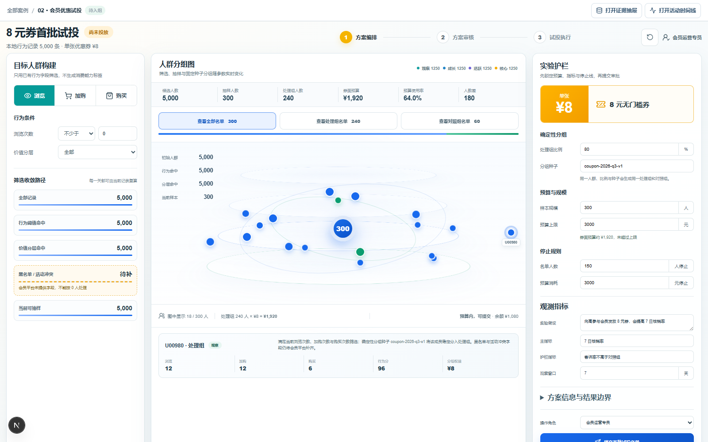

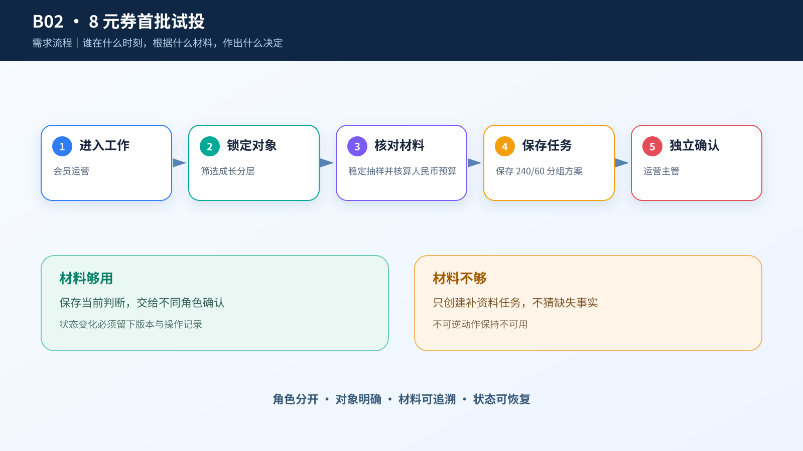


人群分组图是页面中心。筛选条件变化时，它同步显示剩余人数；固定种子把 300 人稳定分为 240 人发券组和 60 人对照组。点开任一成员，可以看到浏览、加购、购买次数及入组原因。

实验设置集中在右侧：单张 8 元、预算上限、样本人数、80%/20% 比例、观察期、主要指标和提前停止条件。默认券面预算为 `240 × 8 = 1,920 元`。黑名单和活动冲突字段尚未接入，页面明确标为“待补”，不会按 0 人处理。

运营提交名单后，主管可以确认试投或退回修改。确认名单只表示方案可以进入真实投放，不代表优惠券已经产生效果。

#### 方法卡：把大判断缩成最小可证伪实验

“发券能不能提升会员价值”无法由当前历史行为表直接回答。先把它缩成一个可失败的小实验：

```text
目标判断：8 元券是否使主要指标相对对照组改善。
固定输入：候选人规则、样本数、处理/对照比例、随机种子、观察窗。
先写反例：什么结果出现时应否定或暂停该判断。
只设计能区分两种结果的最小样本和最少字段；不预测核销率或收入。
输出：实验组、对照组、主要指标、限制指标、停止条件、尚缺埋点。
在真实结果回来前只写“实验已设计/名单已确认”，不得写“策略有效”。
```

这里“最小”不是人数越少越好，而是只增加足以回答当前判断的变量、数据和动作。页面的稳定分组、预算门和停止条件就是这张方法卡的可见工件。

#### CodeBuddy Prompt

```text
请实现案例 B02 的 8 元券首批试投页面。

只使用本地会员行为字段，不生成消费金额、优惠券曝光、核销结果或转化提升。首屏明确显示“尚未投放”。

按 value_segment 和行为次数筛选候选人。用户可以设置样本人数、人民币预算、处理组比例和分组种子；相同条件与种子必须得到相同名单，处理组和对照组不能重叠。点开成员时显示 user_id、view_count、cart_count、buy_count 和入组原因。

提交前填写方案名、要验证的判断、主要指标、限制指标、观察天数，以及人数和预算两条停止规则。运营人员先保存名单，主管确认后才能开始；名单不合适时退回调整。确认名单不代表试验已经有效。

检查预算联动、稳定分组和刷新恢复；相同条件与种子必须得到同一名单。
```

#### 演示

1. 选择一种历史行为和最低次数。
2. 设置 300 人、80%/20% 比例和分组种子。
3. 核对发券组 240 人、对照组 60 人，以及 1,920 元券面预算。
4. 点开一名用户，查看其浏览、加购、购买次数和入组原因。
5. 填写观察期、主要指标和停止条件，提交首批名单。
6. 刷新页面，确认名单和方案没有变化；再由主管确认或退回。

**结果**：相同条件和种子仍得到同一份名单。页面只保存试投计划，不显示尚未发生的转化提升。


#### 实现与排错

- 实现：[`code/cases/02-member-value-experiment`](../../code/cases/02-member-value-experiment)。
- 聚焦测试：[`case-02-member-trial-domain.test.tsx`](../../code/app/tests/case-02-member-trial-domain.test.tsx)。
- 排查：若刷新后试投名单变化，检查抽样前是否按匿名会员编号稳定排序，并确认分组种子没有在客户端重新生成。

---

<a id="case-b03"></a>

### 综合案例 B03　6,970 条餐饮评论，先把哪个问题查清？

#### 需求

餐饮运营要从一批混合差评中选定一个问题，找到支持它和不支持它的顾客原话，再交给负责人做一次小范围调查。

#### 问题

一条评论常常同时谈排队、服务、上菜和口味。标签出现得多，不代表问题影响最大，也不代表改一个功能就能解决。先读原话、再找相反样本，才能把“顾客不满意”缩小成一个具体问题。

#### 逻辑思维方法论：从混合差评到单一问题的收窄

本案例的方法论链条如下：

1. **事实与观点分离**：评论原文是顾客的主观表达（观点），星级评分是可验证的数值（事实），标签值（`-2/-1/0/1`）是查找辅助而非结论。服务态度 1,936、排队 345、上菜 701、口味 1,115 都是负向标签的出现次数，不是投诉单数量——标签次数多不等于问题影响最大。推理必须建立在可验证的事实上，不能把标签次数当投诉数。

2. **证伪思维**：一条评论常常同时谈排队、服务、上菜和口味。选定一个主题后，不能只找支持这个判断的原话——还要找不支持这个判断的原话。两组原话共同约束"要查清的问题"：只有支持原话的判断，可能是确认偏误；相反原话的存在，恰恰说明这个主题不是唯一问题。

3. **量词严谨性**：服务态度 1,936、排队 345、上菜 701、口味 1,115 都是负向标签的出现次数，不是投诉单数量——标签次数多不等于问题影响最大，更不等于"所有差评都是这个问题"。6,970 条评论按星级固定抽取，一星 1,370 条、其余每星 1,400 条——每个星级、每条评论独立判定，不能从标签次数多就推出"这是最主要问题"。数据没有结构化门店、订单、地域和可靠时间，因此不能制作门店排名或经营趋势。

#### 数据

数据来自美团 ASAP 中文餐饮评论。原始数据有 46,730 条，课程按星级固定抽取 6,970 条：一星 1,370 条，其余每个星级各 1,400 条。

页面使用 `review`、`star`、`Service#Hospitality`、`Service#Queue`、`Service#Timely` 和 `Food#Taste`。标签值中，`-2` 表示没有提到，`-1` 表示负向，`0` 表示中性，`1` 表示正向。

服务态度 1,936、排队 345、上菜及时性 701、菜品口味 1,115，都是负向标签的出现次数，不是投诉单数量。数据没有结构化门店、订单、地域和可靠时间，因此不能制作门店排名或经营趋势。

#### 解决方案

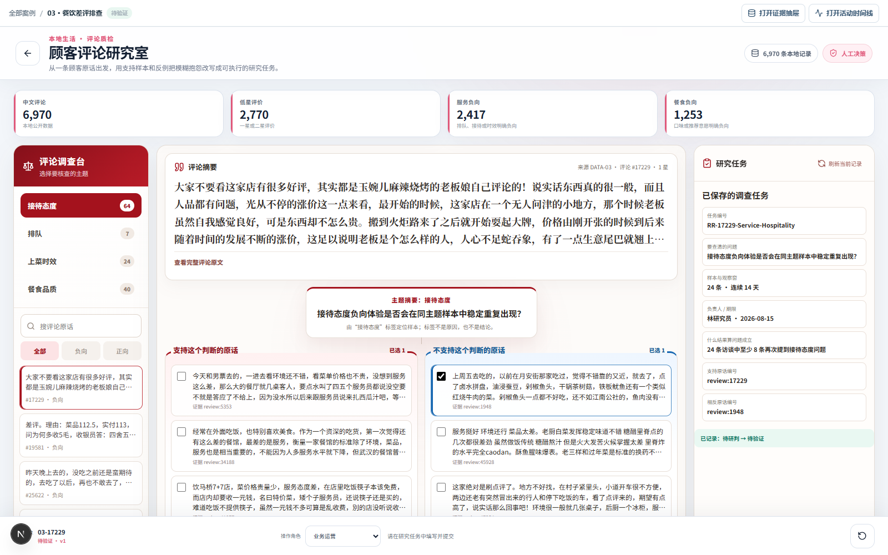

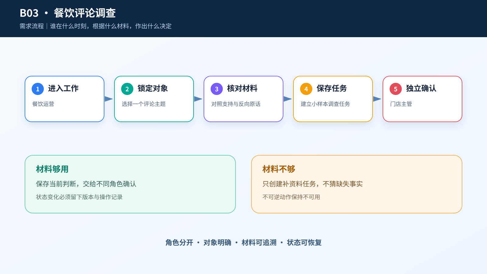

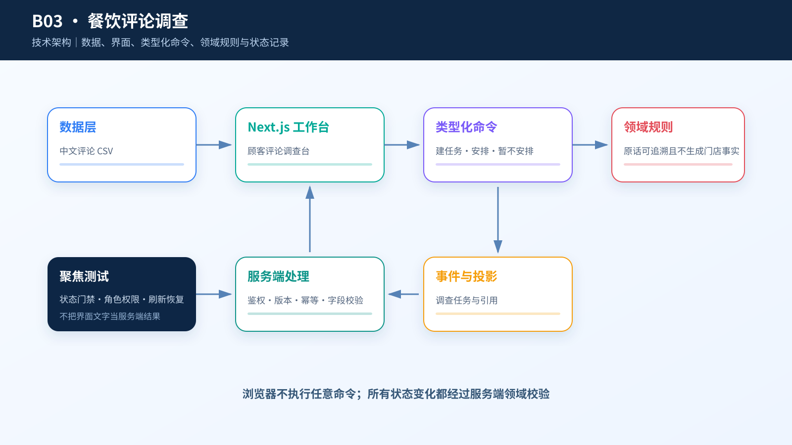

页面先展示一条顾客原话，过长内容只显示摘要，完整原文可以展开。选择“接待态度、排队、上菜时效、餐食品质”中的一个主题后，系统把候选评论分为两组：支持这个判断的原话，以及不支持这个判断的原话。

两组原话共同约束“要查清的问题”。右侧填写调查方法、样本人数、负责人、日期、观察期，以及什么结果算问题成立。创建任务后，这些内容和所选原话会保存；刷新页面仍能看到。

主管可以安排调查，也可以暂不安排并保留当前材料。标签只帮助查找评论，不会自动生成产品需求。

#### CodeBuddy Prompt

```text
请实现案例 B03 的顾客评论调查页面。

主视觉从 review 原文开始，不先生成结论。显示 star，以及 Service#Hospitality、Service#Queue、Service#Timely、Food#Taste 四个标签；-2/-1/0/1 分别表示未提及、负向、中性、正向。

按主题、关键词和正负向查找已经装载的评论。对当前主题，分别选择至少一条负向原话和一条正向或相反原话；同一条评论不能同时进入两组。

创建调查任务时保存要查清的问题、研究方法、样本规模、负责人、期限、观察窗、判断条件和原话编号。主管可以安排调查，也可以写明理由后暂不安排。不要发明门店、订单、评论时间、排名或因果结论。

长评论在首屏只显示四行摘要，完整原文按需展开。只保留一个任务提交入口，并检查刷新恢复和角色权限。
```

#### 演示

1. 打开一条同时提到多个问题的低星评论。
2. 选择“排队”或“接待态度”，定位对应原话。
3. 选一条支持这个判断的原话，再选一条相反原话。
4. 写清要调查的问题。
5. 填写调查方法、24 条样本、负责人、日期和判断条件。
6. 创建调查任务；刷新后核对任务和原话仍在，再由主管安排或暂不安排。

**结果**：系统保存的是一项待调查的问题及其原话，不会根据标签次数自动生成需求。


#### 实现与排错

- 实现：[`code/cases/03-local-service-voc`](../../code/cases/03-local-service-voc)。
- 聚焦测试：[`case-03-review-research-domain.test.tsx`](../../code/app/tests/case-03-review-research-domain.test.tsx)。
- 排查：若筛选后的主题数与评论明细对不上，检查主题统计和明细查询是否使用了同一城市、时间窗与分词规则。

---

<a id="case-b04"></a>

### 综合案例 B04　收入证明缺失：谁补，谁复核？

#### 需求

成都客户经理提交了申请 `CR20260000001`，金额为人民币 3,799.19 元。材料复核员要确认缺少什么、交给谁补、什么时候回传；材料补齐后，必须换一名复核员再检查一次。

这一步只决定材料能否进入后续人工审查，不决定授信、拒贷或额度。

#### 问题

四类材料混在一张清单里时，最容易出现三种错误：已经核验的材料被重复索取，补件记录串到另一张申请，或者初审人员自己完成第二次复核。只做一个“资料不全”标签，无法避免这些问题。

#### 逻辑思维方法论：从材料清单到双岗复核的角色一致

本案例的方法论链条如下：

1. **同一律**：申请人、担保人、受益人、初审人、复核人是不同角色——这些概念在材料、流程、数据中含义必须一致。四类材料混在一张清单里时，最容易出现三种错误：已经核验的材料被重复索取（"已核验"与"缺失"概念混淆）、补件记录串到另一张申请（"当前申请"与"上一份草稿"概念混淆）、初审人员自己完成第二次复核（"初审"与"复核"角色混淆）。同一身份不能同时完成初审和复核，这是同一律的硬约束。

2. **逻辑边界守护**：这一步只决定材料能否进入后续人工审查，不决定授信、拒贷或额度。页面不展示附件影像、个人身份信息、信用分或自动决定——材料复核的权限边界是"是否齐全"，不是"是否批准"。只有真实缺失项（`missing` 或 `pending`）才出现"发起补正"，已核验项必须禁用。

3. **量词严谨性**：同目录的 30,000 条 UCI 历史信用卡样本只用于离线讲解方法和偏差——历史违约标签、性别、年龄和婚姻状态不能成为个体复核理由。从 30,000 条样本归纳出的统计规律是或然结论，不能推广为"这个申请人也会违约"。历史样本不进入当前申请页面，个体复核必须基于当前申请的真实材料状态。

#### 数据

页面只读取 `applications.csv`：1,200 条确定性合成申请、19 个字段、1,200 个唯一申请号。六个城市各 200 条，三种渠道各 400 条；收入材料缺失 72 条、身份待核 48 条、授权未确认 24 条、申请一致性需举证 12 条。

精选申请来自成都，渠道为客户经理，申请金额为 379,919 分，换算后是人民币 3,799.19 元。身份已核验、授权已确认、申请信息一致，只有收入材料缺失。

同目录的 30,000 条 UCI 历史信用卡样本只用于离线讲解方法和偏差。它不进入当前申请页面；历史违约标签、性别、年龄和婚姻状态也不能成为个体复核理由。

#### 解决方案

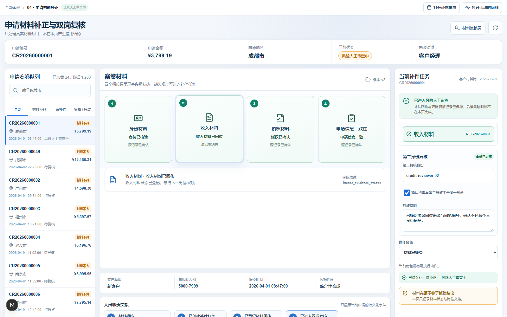


页面以一张匿名案卷为中心。四个材料槽位直接显示源记录状态，只有真实缺失项才出现“发起补正”；已核验项不能勾选。补件任务必须写清负责人、回传日期和缺少内容，并绑定当前申请号和材料类型。

材料回传后，第二名复核员逐项确认来源与一致性。同一身份不能同时完成初审和复核。页面不展示附件影像、个人身份信息、信用分或自动决定。

#### CodeBuddy Prompt

```text
请实现案例 B04 的“申请材料补正与双岗复核”。

页面权威数据只能是 dataset/04-credit-human-review/applications.csv。申请队列必须支持搜索，不得只让前 12 条可达。金额从 requested_amount_fen 转成人民币元。

四个材料槽位只显示字段状态，不伪造附件缩略图。只有源记录为 missing 或 pending 的材料才允许请求补正；已核验材料必须禁用。任务恢复时，只合并 objectId 等于当前申请的事件，切换申请后不得继承上一份草稿。

补件任务保存材料类型、初审身份、负责人、回传期限和说明；所有请求项回传后，另一名复核人才可填写意见并确认；暂缓申请必须填写原因。

不显示姓名、证件号、手机号、信用分、违约概率、建议额度、自动授信或拒贷结论。支持键盘焦点、reduced-motion 和确定性首屏。
```

#### 演示

1. 搜索并打开 `CR20260000001`。
2. 核对身份、授权和申请一致性，定位缺失的收入材料。
3. 填写补件负责人、日期和具体说明，发起材料补正。
4. 刷新页面，确认任务仍绑定这张申请和收入材料。
5. 记录材料回传，由另一名复核员填写核对说明。
6. 提交后续人工审查，或由主管说明原因后暂缓。

**结果**：已核验材料不会被重复索取；材料未回传或两次复核使用同一身份时，页面不会允许继续。


#### 实现与排错

- 实现：[`code/cases/04-credit-human-review`](../../code/cases/04-credit-human-review)。
- 聚焦测试：[`case-04-credit-material.test.tsx`](../../code/app/tests/case-04-credit-material.test.tsx)。
- 排查：若补正材料齐全后复核按钮仍不可用，检查必填字段、材料状态以及申请岗与复核岗是否真正分离。

---

<a id="case-b05"></a>

### 综合案例 B05　08:27 发生，09:09 才收到：这条更正怎么处理？

#### 需求

转运单 `TRN-0001` 的前五条事件都在发生后 1—2 分钟进入系统；第六条更正在 08:27 发生，到 09:09 才被收到，晚了 42 分钟。协调员要决定保留当前状态并追加更正，还是升级协调，再请接收方独立会签。

#### 问题

“事情何时发生”和“系统何时收到”是两只不同的时钟。按接收顺序直接覆盖，会把晚到事件误当成刚刚发生；按发生顺序静默重排，又会改写已经完成的处理历史。正确做法是保留原事件，再追加一条可追溯的调和记录。

#### 逻辑思维方法论：从晚到事件到调和记录的时间对齐

本案例的方法论链条如下：

1. **逻辑一致性**：`event_time` 表示业务动作发生时间，`received_at` 表示系统收到时间——这是两只不同的时钟，必须分开排列。按接收顺序直接覆盖，会把晚到事件误当成刚刚发生；按发生顺序静默重排，又会改写已经完成的处理历史。正确做法是保留原事件，再追加一条可追溯的调和记录；两条时间轴不能合并成一条。

2. **命题清晰化**：调度员说"转运晚到了"——但"晚到"是模糊表述。要判断是晚到、乱序、重复还是会签缺失，必须把"晚到"变成可验证的命题：转运单 `TRN-0001` 的第六条更正在 08:27 发生、09:09 才被收到，晚了 42 分钟。六类冲突各有 120 条，每类的命题化方式不同——笼统称"延迟"会掩盖具体冲突类型。

3. **逻辑边界守护**：晚到事件只允许消费一次；提交后生成追加记录，不覆盖原历史。升级协调保留完整事件编号，不删改已发生的事件；同一晚到事件不能反复重开。数据没有楼层、电梯或真实床位位置，因此页面不画院区地图——边界守护不仅是动作边界，也是数据边界：没有的位置信息不能补造。

#### 数据

本案例有 4,320 条确定性合成运营事件、720 张转运单，每单固定 6 条事件。六类测试冲突各 120 条：晚到、乱序、重复、会签缺失、互斥状态和晚到重开。

`event_time` 表示业务动作发生时间，`received_at` 表示系统收到时间。数据只保留转运编号、来源系统、科室、床位申请编号、岗位、事件版本、会签和冲突类型；不含患者身份、诊断、治疗或临床优先级。冲突比例是课程设计，不代表医院运营水平。

#### 解决方案

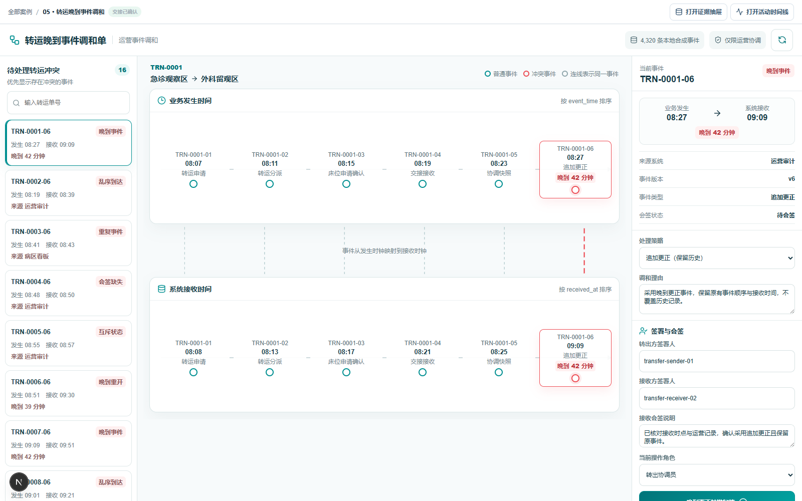


主画面只保留两条时间轴：上方按 `event_time` 排列业务事件，下方按 `received_at` 排列系统接收。点击同一事件，两处时点和连接线同时高亮；只有用户推进接收时钟后，尚未到达的事件才出现。

右侧显示当前事件、来源、版本、冲突类型、处理策略、理由和双方会签。晚到事件只允许消费一次；提交后生成追加记录，不覆盖原历史。数据没有楼层、电梯或真实床位位置，因此页面不画院区地图。

#### CodeBuddy Prompt

```text
请实现案例 B05 的“转运晚到事件调和单”。

按 transport_id 聚合事件。业务发生轴按 event_time 排序，系统接收轴按 received_at 排序；延迟由两个 ISO 时间计算。队列进入转运单时优先选中冲突事件，权威状态不得预选。

六类 conflict_type 使用不同中文说明。只有 late_event 和 late_reopen 显示迟到分钟；duplicate、out_of_order、missing 和 mutually_exclusive 不得写成迟到。

护士确认时必须保存选中事件、处理策略、具体理由和转出身份；接收方由另一人会签；升级协调保留完整事件编号；同一晚到事件只能追加一次更正。

不展示患者身份、诊断、治疗、临床建议、楼层、电梯、氧气接口或虚构床位。动效只用于表现业务发生时间与系统接收时间的差异。
```

#### 演示

1. 打开 `TRN-0001`，把接收时钟停在 08:25，只查看已进入系统的前五条事件。
2. 推进到 09:09，观察第六条事件落到接收轴，并与 08:27 的发生时点连线。
3. 选择“保留当前状态并追加更正”或“升级协调”。
4. 填写理由和转出方身份，提交调和决定。
5. 切换接收方，用不同身份完成会签。
6. 刷新后核对原事件、追加记录和双方身份仍在。

**结果**：42 分钟差异不会被隐藏，原事件不会被覆盖，同一晚到事件也不能反复重开。


#### 实现与排错

- 实现：[`code/cases/05-hospital-flow-coordination`](../../code/cases/05-hospital-flow-coordination)。
- 聚焦测试：[`case-05-hospital-transfer.test.tsx`](../../code/app/tests/case-05-hospital-transfer.test.tsx)。
- 排查：若晚到更正没有进入待调和队列，分别检查事件发生时间与系统接收时间；两者不能被一个更新时间覆盖。

---

<a id="case-b06"></a>

### 综合案例 B06　古城站 12:00 六项污染物全空：这条记录要不要纳入摘录？

#### 需求

数据编辑准备整理一份 2016-12-27 12:00 的历史空气质量数据摘录。每条记录必须保留六项污染物原值。古城站这一行六项全空，编辑要决定把它锁定进摘录，还是注明原因后从本批次排除。

#### 问题

这行仍有气温、气压、风向和风速，因此不是整行损坏；但气象值不能补出污染物。其他站点同一时点有读数，也不能替代古城站的原始空值。

#### 逻辑思维方法论：从全空行到摘录排除的子集判断

本案例的方法论链条如下：

1. **全集/子集辨析**：21,039 行是全集，12 个站点是子集，古城站 `No=33541` 六项全空是子集现象。任一时点最多只有 3 个站点，没有"同一小时 12 站全市快照"——全集的聚合指标（1,998 行至少缺一项）可能掩盖子集差异（古城站全空）。必须能下钻到单站单时点，不能用全集的完整率代表每个站点。

2. **量词严谨性**：任一时点最多只有 3 个站点有记录——"最多 3 个站点"只在已采集的范围内成立，不能反向推广为"同一小时 12 站全市快照"。古城站全空不代表 12 站都全空，万柳记录完整也不代表古城站正常——每个站点每个时点独立判定，不能从子集推全集，也不能从全集的完整率代表每个站点。

3. **逻辑一致性**：古城站这一行仍有气温 2℃、气压 1028.4 hPa、风向 E、风速 1.3 m/s——但气象值不能补出污染物。气象字段和污染物字段是不同测量对象，气象值齐全不等于污染物齐全，不能用气象值插补污染物的空值。其他站点同一时点有读数，也不能替代古城站的原始空值——"当前切片同一时点记录"仅供核对抽样内容，不用于插补。

#### 数据

本地保留 UCI Beijing Multi-Site Air Quality 的完整派生 Parquet；页面读取每 20 行固定抽取 1 行得到的课程切片：21,039 行、12 个站点、8,766 个抽样时点。任一时点最多只有 3 个站点，没有“同一小时 12 站全市快照”。

切片中有 1,998 行至少缺一项污染物，共 3,730 个空单元格。古城站 `No=33541` 在 2016-12-27 12:00 的 PM2.5、PM10、SO2、NO2、CO 和 O3 全部为空；气温 2℃、气压 1028.4 hPa、风向 E、风速 1.3 m/s 仍然保留。

数据不能说明缺测原因、仪器是否故障、污染来源、AQI、健康建议或官方发布结论。页面处理的是历史数据摘录，不是实时监测。

#### 解决方案

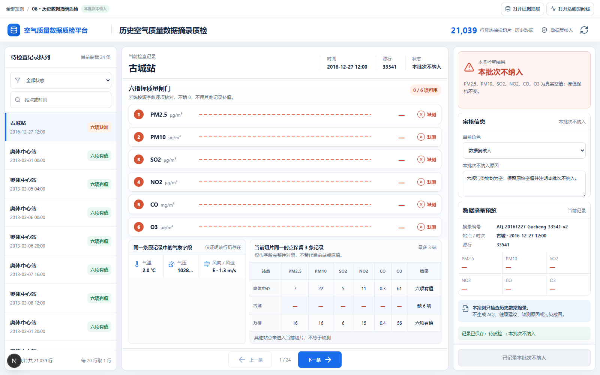


中央六道质量闸门逐项显示污染物原值、单位和“有值/缺测”。气象字段放在次级区域，避免被误解为补值来源。下方只列当前切片在同一时点实际保留下来的另外两条记录，并明确“仅供核对抽样内容，不用于插补”。

字段完整的记录可以锁定成一条数据摘录，再由另一名复核人确认；缺任一污染物时，只能填写原因并标记“本批次不纳入”。源记录永远不被修改，空值也不会变成 0。

#### CodeBuddy Prompt

```text
请实现案例 B06 的“历史空气质量数据摘录质检”。

只读取 dataset/06-beijing-air-quality-audit/case.csv。按 station、No 和 observed_at 定位记录；空值显示为“缺测”，不能填 0。按 observed_at 查到的其他记录称为“当前切片同一时点记录”，不能称为邻站或全市快照。

首屏用六道质量闸门显示 PM2.5、PM10、SO2、NO2、CO 和 O3。保留温度、气压、风向、风速和降雨，但不解释污染原因。不使用地图、AQI、健康建议、实时监测或官方发布措辞。

六项完整时才能“锁定数据摘录”，另一名复核人确认后才纳入；缺项时选择“本批次不纳入”，并保存站点、时次、源行、具体缺项和原因。

检查记录选择、双人复核、刷新恢复和键盘操作。
```

#### 演示

1. 打开古城站 `No=33541`，逐项核对六道质量闸门。
2. 查看气象字段，确认记录仍在，但六项污染物都缺测。
3. 展开同一抽样时点的另外两条记录，确认它们不能用于补值。
4. 填写排除原因，将古城记录标记为“本批次不纳入”。
5. 恢复案例，选择同一时点字段完整的万柳记录并锁定数据摘录。
6. 切换另一名复核人确认纳入，刷新后核对原值和处理记录。

**结果**：古城空值保持原样且不进入完整摘录；万柳记录保存六项原值后才允许第二人确认。


#### 实现与排错

- 实现：[`code/cases/06-beijing-air-quality-audit`](../../code/cases/06-beijing-air-quality-audit)。
- 聚焦测试：[`case-06-air-quality-release.test.tsx`](../../code/app/tests/case-06-air-quality-release.test.tsx)。
- 排查：若六项污染物全空的行仍被纳入摘录，检查空值解析和发布状态判断，不要把空字符串或缺测值转成 0。

---

<a id="case-b07"></a>

### 综合案例 B07　请求更少，履约为什么反而最慢？

#### 需求

架构评审要定位高峰履约变慢发生在哪个领域边界，并给出可回滚的拆分方案，不能只凭请求量决定是否拆服务。

#### 问题

7 月 14 日，订单接入处理了 9,981 条请求，P95 是 202ms；履约只有 7,595 条请求，P95 却达到 912ms，恢复用了 39 分钟。会上有人马上提出“拆微服务”。这一步太快：四组数值只说明同一日期窗口里发生了什么，还不能说明哪条调用拖慢履约，更不能证明拆分会更快。

这次评审只做三种决定：继续模块化观察、请求补充观测，或批准一条尚未投入生产的事件契约试点。

#### 逻辑思维方法论：从共变现象到架构决定的因果阻断

本案例的方法论链条如下：

1. **相关性≠因果**：7 月 14 日订单接入处理 9,981 条请求 P95 是 202ms，履约只有 7,595 条请求 P95 却达到 912ms，恢复用了 39 分钟——请求少与 P95 高是共变现象，但不能推出"拆微服务就快"。四组数值只说明同一日期窗口里发生了什么，还不能说明哪条调用拖慢履约，更不能证明拆分会更快。会上有人马上提出"拆微服务"——这一步太快，共变≠因果。

2. **命题清晰化**：会上有人说"履约慢"——但"慢"无法比较窗口。7 月 14 日履约只有 7,595 条请求，P95 达到 912ms，恢复用了 39 分钟——这些才是可验证的命题。`operational-evidence.csv` 有 56 条记录覆盖 14 个日期 4 个责任域，适合比较窗口，不是生产 trace，也不证明四个域之间存在调用关系——"慢"命题化后才能比较，不能凭印象。

3. **逻辑边界守护**：这次评审只做三种决定：继续模块化观察、请求补充观测，或批准一条尚未投入生产的事件契约试点。事件分支停在"试点待执行"，不会冒充已经拆分或上线——架构决定的边界是"可回滚的拆分方案"，不是"已经拆分"。补观测至少选择调用链、容量曲线、变更影响中的两项，不能凭请求量决定是否拆服务。

#### 数据

`case.csv` 有 12,000 条公开订单基准切片，只保留订单编号、到达时点源值和商品数。原来源没有声明到达值的单位，因此页面只写“到达时点（源值）”，不能换成分钟或营业高峰。

`operational-evidence.csv` 有 56 条确定性中国运营记录：1 个课程场站、14 个日期、4 个责任域。每行包含请求数、P95、发布数、故障分钟和恢复分钟。它适合比较窗口，不是生产 trace，也不证明四个域之间存在调用关系。

#### 解决方案

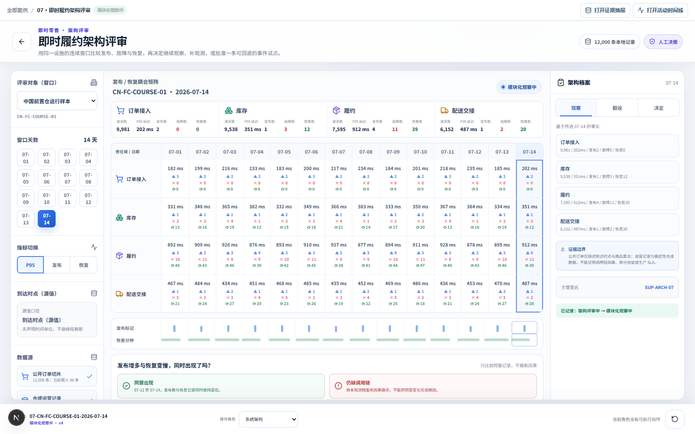


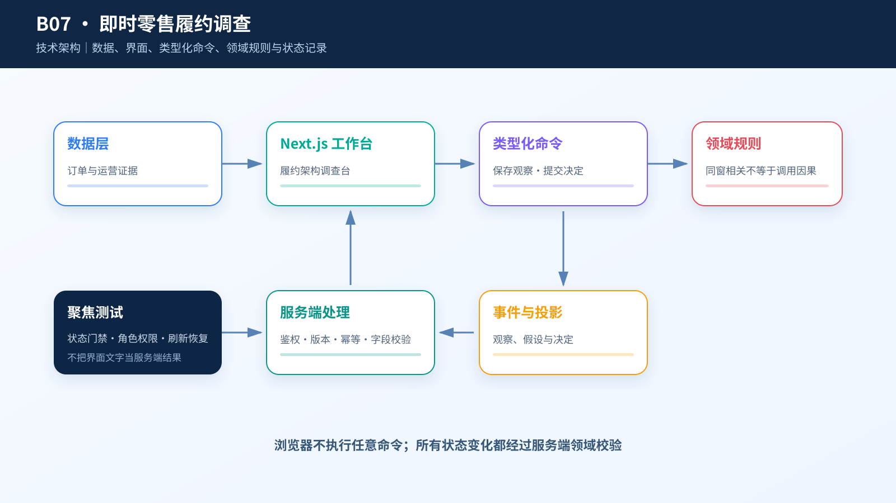

左侧选择 14 个场站日期窗口。中间是 14×4 矩阵：每个单元显示 P95 和发布、故障、恢复标记；日期游标同时移动四个责任域。底部只给出两句判断：“发布增加与恢复变慢同窗出现”“仍缺调用链，不能确认因果”。右侧依次保存观察、待验证假设和决定。

状态变化分三步：

```text
系统架构：锁定评审窗口 → 架构评审中
业务主管：继续模块化观察 → 模块化观察中
          请求补充观测 → 待补观测
          批准单事件试点 → 事件契约试点待执行
```

#### CodeBuddy Prompt

```text
请实现案例 B07 的即时履约架构评审台。

读取 case.csv 和 operational-evidence.csv。主对象是 facility_code + scenario_date，不是单笔订单。中间实现 14 列日期 × 4 行责任域矩阵；默认显示 P95 及发布、故障、恢复标记，聚焦单元后显示完整值。公开订单和合成运营记录分开标注。

首次提交只保存事实、一个待验证假设、约束和风险。主管可以继续保留模块化单体、要求补观测，或批准一条事件契约试点。补观测至少选择调用链、容量曲线、变更影响中的两项；事件试点写清生产方、消费方、事件名、去重字段、顺序规则、回退条件、负责人和验收标准。

不要出现“晚高峰”“已经拆分”“已经上线”或“因果已证实”。动效只帮助比较日期和责任域，不模拟尚未发生的架构变更。
```

#### 演示

1. 选择 `CN-FC-COURSE-01 · 2026-07-14`，沿日期游标比较四域记录。
2. 记录“履约请求较少但 P95 和恢复时长最高”，同时标明“相关，不代表因果”。
3. 以系统架构身份锁定窗口。
4. 切换主管，选择“请求补充观测”，勾选调用链、容量曲线和变更影响，提交后再恢复评审。
5. 第二次可选择继续观察，或填完一条事件契约并批准试点。

**结果**：页面只保存可追溯的架构决定。事件分支停在“试点待执行”，不会冒充已经拆分或上线。


#### 实现与排错

- 实现：[`code/cases/07-instant-retail-architecture`](../../code/cases/07-instant-retail-architecture)。
- 聚焦测试：[`case-07-retail-architecture.test.tsx`](../../code/app/tests/case-07-retail-architecture.test.tsx)。
- 排查：若总览与链路明细给出不同结论，沿同一请求编号检查投影游标和事件顺序，先排除旧投影再讨论架构瓶颈。

---

<a id="case-b08"></a>

### 综合案例 B08　数值冲突：谁取证，谁采信？

#### 需求

养殖现场出现传感器与人工复测冲突时，值班人员要看清来源、时间和校准状态，再决定补采、复测或人工处置。

#### 问题

事件 `CN-AQ-02-038` 的传感器在线，四项读数齐全，上游却把证据状态标为“数值冲突”。系统没有提供冲突字段和另一组数值，办公室人员不能凭猜测消除冲突。

可执行流程只有三步：调度员派发，现场人员回传照片和四项复测值，另一名主管决定是否采信。任何一步缺失都只能等待证据。

#### 逻辑思维方法论：从数值冲突到三栏取证的边界守护

本案例的方法论链条如下：

1. **逻辑边界守护**：页面按三栏展开同一份取证单——系统记录、现场回传、主管采信。主界面没有设备控制：不自动投药、不自动增氧、不判断水质根因。三次动作留下三个身份和三段回执，系统只组织取证，不控制现场设备；阶段切换动效只提示任务已解锁，不模拟现场操作。

2. **事实与观点分离**：传感器读数（水温 32.12℃、溶氧 5.75 mg/L、pH 7.31、浊度 8.82 NTU）是可验证的事实，`evidence_status` 标为"数值冲突"是上游标注——标注需要核对，不能直接当成结论。事件 `CN-AQ-02-038` 的传感器在线、四项读数齐全，但上游标为冲突却没有提供冲突字段和另一组数值——办公室人员不能凭猜测消除冲突，只能等待证据。

3. **同一律**：系统记录、现场回传、主管采信是三栏证据，各自含义不同：系统记录是传感器自动读数，现场回传是人员到场后的观察，主管采信是主管综合判断后的结论。三栏不能互相覆盖：原始读数必须并存，不能只保留最后一个值——系统记录的水温 32.12℃ 不能被现场回传的"水温正常"覆盖，现场回传也不能被主管采信的结论替换。

#### 数据

`case.csv` 有 864 条确定性记录，覆盖 9 个区域、每区 96 个小时；高风险 181 条、设备离线 16 条、来源缺失 10 条、数值冲突 12 条，异常并集 38 条。

代表事件位于 `CN-POND-02`，时间是 2026-06-02 13:00：水温 32.12℃、溶氧 5.75 mg/L、pH 7.31、浊度 8.82 NTU，风险为高，只允许人工复核。数据没有经纬度、基地、巡检队、预计到达时间、鱼类健康、投药记录或设备控制回执，页面不得补造。

#### 解决方案

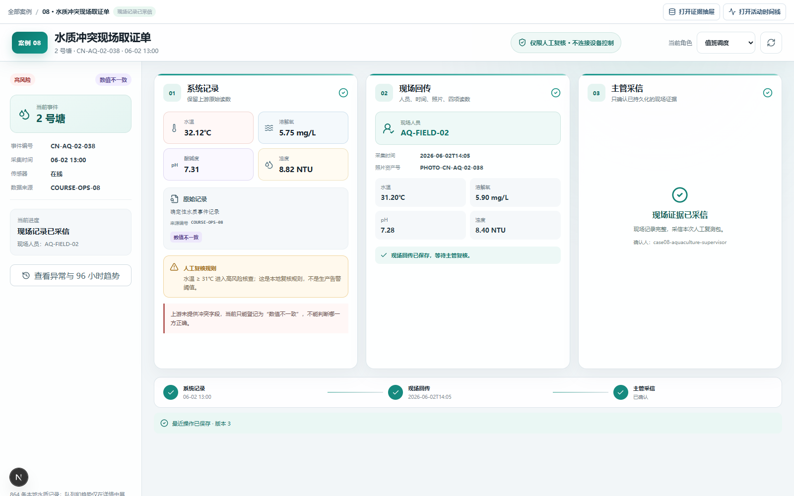


页面按三栏展开同一份取证单：系统记录、现场回传、主管采信。开始时只有第一栏有值；派发后第二栏解锁，现场人员填写身份、采集时间、照片资产号和四项读数；提交后第三栏才允许主管填写采信说明。96 小时四测点趋势放在事件详情抽屉，不占据主流程首屏。

```text
现场调度：派发现场取证 → 现场取证中
现场人员：提交现场回传 → 待主管采信
业务主管：采信现场记录 → 现场记录已采信
现场调度：暂缓等待证据 → 等待现场证据 → 可重新派发
```

#### CodeBuddy Prompt

```text
请实现案例 B08 的养殖塘事件响应台。

只使用 case.csv 中的 event_id、event_time、region_id、四项读数、sensor_status、evidence_status 和 risk_level。内部值 value_conflict 在界面写成“数值冲突”。不要生成地图、坐标、基地、队伍、ETA 或冲突对端值。

页面分为系统记录、现场回传、主管采信三栏。调度员指定现场人员；该人员提交照片资产号和四项复测值；另一名主管决定采信哪组记录。资料不足时进入等待状态，之后可以重新派发。

主界面没有设备控制。阶段切换动效只提示任务已解锁，不模拟现场操作。
```

#### 演示

1. 打开 `08-CN-AQ-02-038-CN-POND-02`，核对系统记录和“数值冲突”。
2. 以调度员身份指定现场人员 `AQ-FIELD-02`，说明需要回传的五类证据并派发。
3. 切换现场人员，填写采集时间、照片资产号和四项复测值，提交回传。
4. 尝试让同一现场人员采信，确认系统拒绝；切换另一名主管后填写说明并采信。
5. 恢复案例，选择“暂缓等待证据”，再从等待状态重新派发。

**结果**：三次动作留下三个身份和三段回执。系统不判断水质根因，也不控制现场设备。


#### 实现与排错

- 实现：[`code/cases/08-aquaculture-event-response`](../../code/cases/08-aquaculture-event-response)。
- 聚焦测试：[`case-08-aquaculture-domain.test.tsx`](../../code/app/tests/case-08-aquaculture-domain.test.tsx)。
- 排查：若冲突数值被直接覆盖，检查采集时间、来源优先级和人工采信记录；原始读数必须并存，不能只保留最后一个值。

---

<a id="case-b09"></a>

### 综合案例 B09　352 秒没有记录：现在能不能提交检查申请？

#### 需求

地铁设备调查必须把事件、检修记录和引用材料对齐；存在 352 秒空窗或权限缺口时，只能补取资料或转人工。

#### 问题

空压机遥测在 00:18:07 后突然消失，直到 00:23:59 才恢复。TP2 从 -0.018 变成 8.384 bar，油温从 49.45 变成 68.525℃，电机电流从 0.04 变成 5.675 A。问题不在于“哪个值异常”，而在于最关键的 352 秒变化过程没有记录。

这套产品先检查数据连续性，再核对本地资料。断档窗口只能请求补记录；选择恢复后的连续窗口，工程师核对资料后，另一名主管才可以提交现场目视检查申请。

#### 逻辑思维方法论：从 352 秒空窗到检查申请的连续性门禁

本案例的方法论链条如下：

1. **逻辑一致性**：空压机遥测在 00:18:07 后突然消失，直到 00:23:59 才恢复——断档前、352 秒空白、恢复后是三段不同条件的数据，必须分段处理。TP2 从 -0.018 变成 8.384 bar、油温从 49.45 变成 68.525℃、电机电流从 0.04 变成 5.675 A，这些是恢复后的值，不能与断档前的值跨段平均。352 秒没有记录就是没有记录，不能插值成事实；缺少记录应显示为待补数据，不能补成正常记录。

2. **证伪思维**：这套产品先检查数据连续性，再核对本地资料——连续性门禁是证伪逻辑：先找有没有断档窗口，有断档就锁定申请表单，没有断档才解锁。选择恢复后的连续片段并完成资料核对后，表单才解锁。服务端根据所选片段内相邻时间戳重新计算最大间隔，不相信浏览器上传的"已通过"标记——验收口径是"未发现可以排除检查的断档"。

3. **逻辑边界守护**：连续片段只生成一份人工检查申请，不生成诊断或设备动作。检索只排序四条本地资料，没有模型往返、MCP 或 A2A 网络请求；禁止输出故障诊断、停机、维修或控制命令。设备图必须标注"非真实几何"，点击测点只改变信息连线和读数焦点，不模拟设备控制——检索辅助与设备控制的边界必须守住。

#### 数据

`case.csv` 是 UCI MetroPT-3 的 4,090 条固定历史切片。页面准备三个片段：故障区间起点、包含 352 秒空白的断档窗口、恢复后的连续窗口。服务端根据所选片段内相邻时间戳重新计算最大间隔，不相信浏览器上传的“已通过”标记。

`knowledge.jsonl` 有 4 条本地资料：来源事实、字段说明、课程检查程序和人工审批边界。它们只参加确定性本地排序，没有模型往返、MCP 或 A2A 网络请求。公开数据没有线路、站点、资产号、真实设备几何、报警阈值、诊断和维修结果。

#### 解决方案

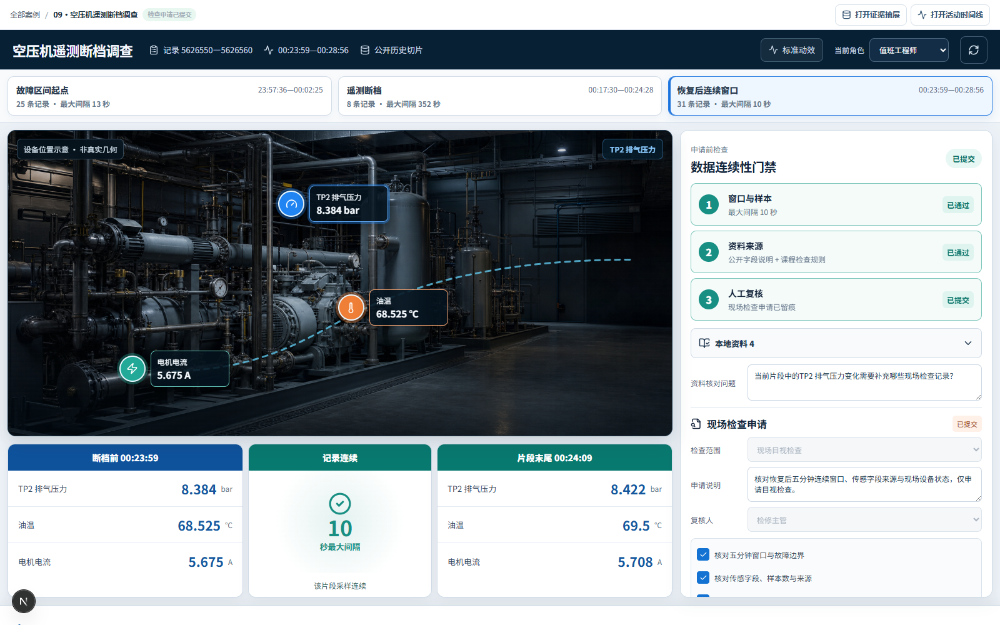


左侧设备示意只标出 TP2、油温、电机电流三个测点，并明确“非真实几何”。下方把断档前、352 秒空白、恢复后三段并排。右侧是三道门禁：窗口与样本、资料来源、人工复核。断档片段的申请表单保持锁定；选择恢复后的连续片段并完成资料核对后，表单才解锁。

```text
现场工程：核对本地资料 → 资料已核对
现场工程：请求补充设备记录 → 等待设备记录 → 可重新核对
业务主管：提交现场目视检查申请 → 检查申请已提交
```

#### CodeBuddy Prompt

```text
请实现案例 B09 的地铁空压机检索辅助排查台。

读取 case.csv 和 knowledge.jsonl。主对象是 investigation_id。提供三个真实时间片段，并按 timestamp 计算样本数和最大相邻间隔；断档窗口必须得到 352 秒。

按选定设计实现空压机示意、三个测点、断档前/空白/恢复后三联和右侧三道门禁。设备图必须标注“非真实几何”。点击测点只改变信息连线和读数焦点，不模拟设备控制。

检索只排序四条本地资料。提交检查申请前，服务端重新检查所选窗口：少于 3 条记录或最大间隔达到 120 秒时拒绝。申请类型只允许“现场目视检查”，由另一名主管确认；资料不足时保存补记录请求。禁止输出故障诊断、停机、维修或控制命令。
```

#### 演示

1. 选择“遥测断档”片段，核对 00:18:07、00:23:59 和三组前后值。
2. 查看第一道门禁失败和锁定表单，点击“请求补充设备记录”。
3. 恢复案例，选择“恢复后连续窗口”，点击三个测点观察读数联动。
4. 以工程师身份核对本地资料；切换另一名主管，完成三项检查并提交现场目视检查申请。
5. 刷新页面，确认状态和回执保留。

**结果**：断档片段永远不能越过服务端连续性门禁；连续片段只生成一份人工检查申请，不生成诊断或设备动作。


#### 实现与排错

- 实现：[`code/cases/09-metro-agentic-rag`](../../code/cases/09-metro-agentic-rag)。
- 聚焦测试：[`case-09-metro-rag-domain.test.tsx`](../../code/app/tests/case-09-metro-rag-domain.test.tsx)。
- 排查：若 352 秒空窗被页面补成正常记录，检查检索空结果的处理；缺少记录应显示为待补数据，不能插值成事实。

---

<a id="case-b10"></a>

### 综合案例 B10　查询已经发出，响应却丢了：现在能不能重试？

#### 需求

投诉协同要在网络中断后安全恢复，识别请求是否已经受理，避免重复建单、重复升级或丢失人工处理进度。

#### 问题

客服系统向计费中心发出查询，网络随后中断。本地只知道“没有收到响应”，却不知道请求是否已经生效。直接再发一次，可能把一次操作做成两次；什么也不做，又会让任务一直悬着。

处理重试前先分清三件事：本地已经记录了什么、网络在哪里断了、外部系统实际发生了什么。

#### 数据

`case.csv` 有 1,000 条匿名课程任务，类别比例参考工信部 2025 年第二季度公开汇总，任务号、城市、渠道和故障场景为确定性合成。333 条记录属于“请求可能已提交、响应丢失”，333 条外部结果未知，334 条没有发送线索。

代表任务 `CN-TEL-2025Q2-0008` 是福建福州的资费争议。数据不含姓名、手机号、账号和真实运营商回执；投诉内容仍是用户陈述，不能被页面改写成已经查实的事实。

#### 解决方案

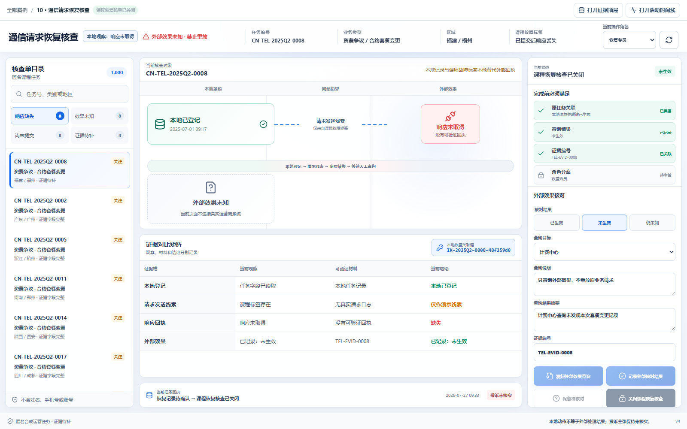

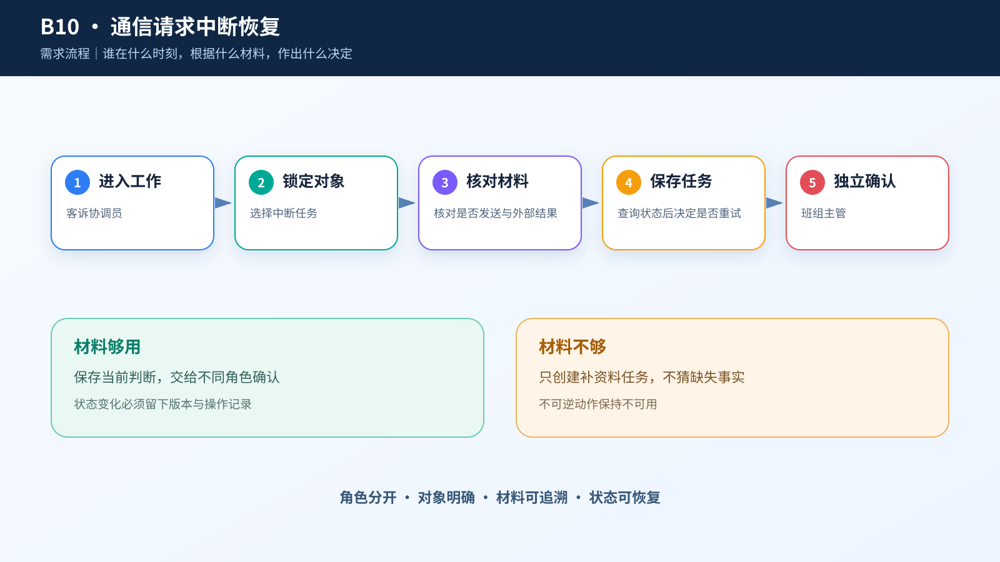


左侧目录按结果状态分组，也能按任务号、类别或地区搜索。中间用三段调用链展示“本地已登记—响应未取得—外部效果未知”，下方表格把观察、材料和结论分开。右侧完成实际操作：选择查询目标，记录核对结果和材料编号；如果仍然查不到，就说明原因并保留待核对。

```text
流程协调员：发起外部效果查询 → 外部效果待核对
流程协调员：记录查询结果和材料编号 → 恢复记录待确认
业务主管：核对创建人、结果和材料 → 课程恢复核查已关闭
```

主管必须与查询发起人不同。刷新页面后，已经写入的结果和材料编号仍然存在。

#### CodeBuddy Prompt

```text
请实现案例 B10 的通信请求恢复核查工作台。

读取 dataset/10-telecom-complaint-orchestration/case.csv，以 task_id 为任务主键。左侧提供分组和搜索；中间分开显示本地记录、网络中断点和外部效果；右侧填写查询目标、查询说明、核对结果、结果摘要和证据编号。

用户先发起外部查询；网络中断时只能用同一个业务键安全重试。记录明确结果时必须同时提交摘要、材料编号和核对人；结果仍未知时保持待核对并说明原因。关闭任务只能由另一名业务主管执行，服务端再次检查保存的结果和材料编号。

不要生成个人信息、虚构外部结果或投诉成立结论。检查明确结果、未知结果、缺材料、同人关闭、重复提交和刷新恢复。
```

#### 演示

1. 搜索 `CN-TEL-2025Q2-0008`，查看调用链和四行核对表。
2. 以流程协调员身份发起查询；先选择“仍未知”，填写原因并保留待核对。
3. 改为“已经生效”或“没有生效”，填写结果摘要和材料编号并保存。
4. 切换业务主管关闭核查，刷新页面确认记录仍在。

**结果**：系统没有猜测外部结果，也没有自动重发请求；它把一次网络中断变成一份可继续核对的业务记录。

#### 与 S10 Skill 实验的关系

B10 回答的是业务问题：响应丢失后，怎样保留事实边界、查询外部效果并安全关闭任务。S10 回答的是工程问题：面对同一批数据和状态规则，普通 Prompt、结构化 Prompt、流程 Skill 与 UI Kit 分别解决什么。

| B10 中已有的业务约束 | S10 怎样拿来做对比 |
|---|---|
| 1,000 条匿名任务和 `333 / 333 / 334` 三类场景 | 固定输入，防止各组通过换数据获得优势 |
| “仍未知 / 已生效 / 未生效”三种结果 | 检查页面是否完整表达未知状态和证据门 |
| 不生成个人信息、不虚构运营商回执 | 写入 Skill 的禁止项和浏览器验收 |
| 搜索、筛选、记录结果与材料编号 | C/D 使用完全相同的内容和交互合同 |

S10 没有替换 B10 的正式产品页面，而是抽出一个可离线复跑的工作台切片。实验结果表明：`ui-workbench` Skill 负责工作流、状态矩阵和验收；Tabler 只改善组件一致性，并不会自动补齐业务判断。完整 A/B/C/D 过程、页面截图和回执见 [S10 Prompt、Skill 与 UI Kit 分工实验](10-通用Skill案例-开发与设计.md#skill-s10)。


#### 实现与排错

- 实现：[`code/cases/10-telecom-complaint-orchestration`](../../code/cases/10-telecom-complaint-orchestration)。
- 聚焦测试：[`case-10-recovery-domain-v5.test.ts`](../../code/app/tests/case-10-recovery-domain-v5.test.ts)。
- 排查：若恢复操作生成两笔请求，检查幂等键是否由原请求编号派生，并确认响应丢失只触发查询或安全重试。

---

<a id="case-b11"></a>

### 综合案例 B11　地区切片差了 1.7 个百分点，模型还能准入吗？

#### 需求

模型准入评审要同时检查总体指标、地区切片和安全门禁；任一关键材料不足时必须补测，不能用平均值覆盖局部风险。

#### 问题

候选模型做了九项本地评测，八项通过。唯一的阻断项是地区切片准确率差：实测 4.7%，要求不高于 3.0%，而且对应切片材料缺失。总体成绩再漂亮，也不能填补这份空白。

团队需要决定的是补测什么、由谁复核、满足哪些条件才能确认补测完成，而不是让页面替企业批准模型上线。

#### 数据

`case.csv` 有 9 行，风险、公平、安全各 3 项；8 项通过，1 项需要补测。每行保存指标、实测值、比较方式、要求、样本量、切片名称和材料状态。所有指标和门槛都是本地课程评测，不是 Qwen 官方结论。

公开 Qwen 元数据只用来说明候选来源。数据没有真实评测时间、成本、时延、生产流量或发布授权。

#### 解决方案

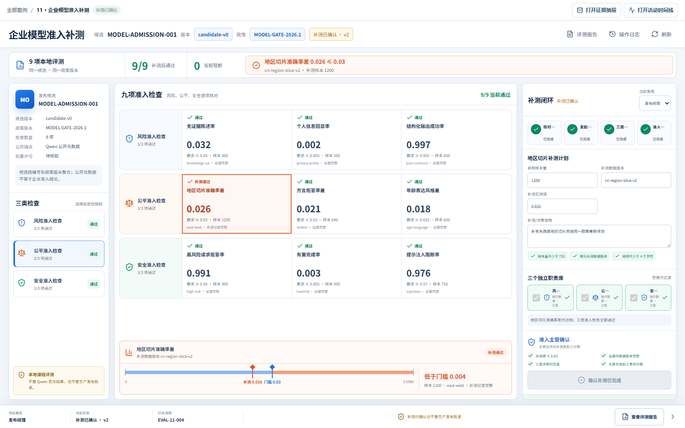


顶部先给出“8/9 通过、1 项阻断”。中间三条检查轨道把九项结果一次排开，地区切片标尺直接显示 4.7% 与 3.0% 的差距。右侧填写补测样本量、数据版本和新结果；补测过线后，风险、公平、安全三个职责分别签署，最后由另一名主管确认。

```text
发布经理：提交补测范围、数据版本和说明 → 补测中
三类评审：逐项签署风险、公平和安全检查
准入主管：确认补测值、材料、签署和人员分离 → 补测已确认
```

若团队不接受该候选，主管可以在补测开始前拒绝；进入补测后不能再走这条捷径。

#### 方法卡：专家会诊必须产生分歧矩阵

多写三个“你是专家”不会自动提高质量。让风险、公平和安全三个视角分别引用同一份材料，并禁止互相代答：

```text
风险评审：只判断阈值、失败后果和回滚条件。
公平评审：只判断切片覆盖、差异和缺失材料。
安全评审：只判断滥用面、权限和安全测试证据。

每个视角输出：已知事实｜阻断项｜需补证据｜建议动作｜置信边界。
汇总时生成分歧矩阵：议题｜三方结论｜共同证据｜冲突原因｜由谁决定。
任一方缺少材料时标“证据不足”，不得用多数投票覆盖硬门禁。
最终结论只能是补测、拒绝或满足条件后再评审，不替企业批准上线。
```

这才是“专家会诊”的可检查结果：不是三段风格不同的长文，而是三类职责、证据和分歧都能落到准入门。

#### CodeBuddy Prompt

```text
请实现案例 B11 的企业模型准入补测总控台。

读取 dataset/11-model-release-multi-agent/case.csv，以 candidate_id + policy_version 聚合九项评测。按 risk、fairness、safety 分成三条轨道，每项显示实测值、要求、样本量、切片和材料状态；对 EVAL-11-004 画出 4.7% 与 3.0% 的阈值标尺。

补测申请必须写明不小于原样本量的目标、新数据版本和说明。小流量试用前，系统重新检查补测值达标、材料完整、风险/公平/安全三类评审均由不同人员签署，且主管不是补测发起人。主管也可以在初始状态写明理由后拒绝候选模型。

页面始终写明“本地评测”，不要生成真实发布结论、评测时间、成本或时延。测试补测不过线、缺少签署、签署人重复、同人确认、初始拒绝和刷新恢复。
```

#### 演示

1. 打开“地区切片准确率差”，核对 4.7%、3.0%、720 个样本和材料缺失状态。
2. 填写更大的样本量、新数据版本和补测说明，发起地区切片补测。
3. 输入一个仍高于 3.0% 的结果，观察确认按钮保持锁定；再改成达标值。
4. 完成三类签署，切换另一名主管确认；打开操作日志查看状态变化。

**结果**：页面清楚回答“为什么现在不能确认”，也能说明补齐哪些条件后才算完成本地补测，但不会把课程结果包装成生产发布批准。


#### 实现与排错

- 实现：[`code/cases/11-model-release-multi-agent`](../../code/cases/11-model-release-multi-agent)。
- 聚焦测试：[`case-11-model-admission-domain.test.tsx`](../../code/app/tests/case-11-model-admission-domain.test.tsx)。
- 排查：若地区切片未通过仍能准入，检查准入条件是否读取最新补测状态，而不是只读取总体指标。

---

<a id="case-b12"></a>

### 综合案例 B12　30 条运输记录里有 5 次越界，缺的交接材料怎么补？

#### 需求

冷链运营要把温度越界与交接材料逐一对应，先形成调查单和补证清单，不能自动判定疫苗是否可用。

#### 问题

四川彭州的一条县域冷链路线共有 30 条五分钟记录，其中 5 条高于 8℃，最高 9.3℃；同一调查单又缺少交接记录。此时可以确认“运输记录需要调查”，却不能确认箱内装了什么，更不能判断任何产品是否可用。

调查人员需要把温度变化、交接、路线记录、校准和离线情况放在同一时间带上，先确定调查窗口，再补齐能够核对的材料。

#### 逻辑思维方法论：从温度越界到调查窗口的时间带对齐

本案例的方法论链条如下：

1. **逻辑一致性**：温度、交接、路线、校准和离线记录必须放在同一时间带上对齐——30 个五分钟事件排成时间带，点击任意事件立即看到该时刻的温度、交接、路线、校准和离线记录。温度曲线穿过缺测时段必须断开，不能连续连线；交接材料必须关联到具体越界记录，不能笼统关联到整条路线。缺失点必须保留为 null，不能插值制造连续运行——多源数据的时间对齐是前提，不是可选。

2. **命题清晰化**：运营报告说"温度越界"——但"越界"无法确定调查窗口。四川彭州县域冷链路线 30 条五分钟记录中 5 条高于 8℃，最高 9.3℃（08:35）——这些才是可验证的命题。调查窗口必须覆盖代表事件，不覆盖时"启动运输记录调查"保持不可用——"越界"命题化后才能锁定具体时间和数值。

3. **逻辑边界守护**：完成调查只表示记录已经复核，不表示产品可以使用或放行。冷链运营要把温度越界与交接材料逐一对应，先形成调查单和补证清单，不能自动判定疫苗是否可用——记录调查与产品放行是两个边界。课程数据没有个人信息、真实产品、真实批次、装箱清单或地理坐标，所有记录都禁止直接作产品可用性判断。

#### 数据

`case.csv` 有 12 个匿名调查单，每单 30 条记录，共 360 条。20 条记录高于 8℃，60 条缺交接记录，60 条缺路线记录，60 条校准过期，6 条存在离线时长。车辆、保温箱和记录仪使用 `COURSE-` 编号；路线、时间和运营记录为确定性合成。

公开热性能数据只提供温度形态参考。课程数据没有个人信息、真实产品、真实批次、装箱清单或地理坐标，所有记录都禁止直接作产品可用性判断。

#### 解决方案

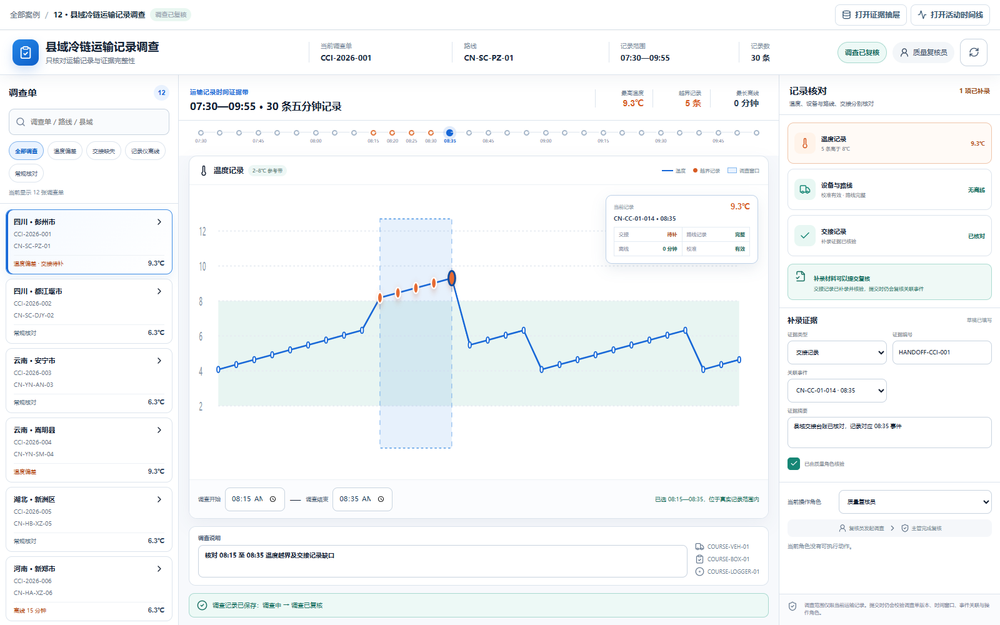

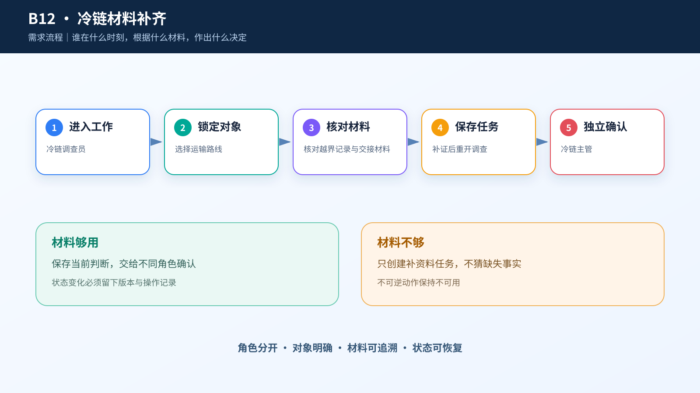


左侧按越界、交接、路线、校准和离线问题筛选调查单。中间把 30 个五分钟事件排成时间带，并在同一屏展示温度曲线和可拖动的调查窗口；点击任意事件，立即看到该时刻的温度、交接、路线、校准和离线记录。右侧列出缺口，要求补录材料编号、关联事件、摘要和核验状态。

```text
调查员：选择有效时间窗并说明原因 → 调查中
业务主管：材料不足 → 等待补证
业务主管：材料已补齐并核验 → 调查已复核
```

完成调查只表示记录已经复核，不表示产品可以使用或放行。

#### CodeBuddy Prompt

```text
请实现案例 B12 的县域冷链运输记录调查台。

读取 dataset/12-vaccine-cold-chain/case.csv，以 investigation_id + route_id 聚合一条路线的 30 个事件。左侧提供问题筛选和调查单搜索；中间按 event_time 绘制事件带、温度曲线和调查窗口；右侧逐项显示 handoff_status、route_record_status、calibration_status、offline_minutes 和 sample_completeness。

启动调查时必须提交覆盖代表事件的有效起止时间和说明。存在材料缺口时，质量人员补充材料类型、编号、关联事件、摘要并确认；资料仍不齐时状态保持“等待补证”。服务端重新验证时间窗、角色和补录字段。

不要生成地图坐标、产品名称、真实批次或可用性结论。测试无效时间窗、未覆盖代表事件、缺材料、未核验、等待补证后重开、主管复核和刷新恢复。
```

#### 演示

1. 搜索 `CCI-2026-001`，选择 08:35、9.3℃ 的记录，查看越过 8℃ 的五个点。
2. 缩小调查窗口，使它不再覆盖代表事件，观察“启动运输记录调查”保持不可用；恢复有效窗口并启动调查。
3. 切换主管，查看交接材料缺口；填写材料编号、关联事件和摘要，勾选质量角色已核验。
4. 完成调查复核并刷新页面，确认调查单、窗口和操作记录保留。

**结果**：30 条记录被还原成一条可以点击、筛选和复核的时间线；系统回答“缺什么、补到哪条记录”，但不越权回答产品能否使用。


#### 实现与排错

- 实现：[`code/cases/12-vaccine-cold-chain`](../../code/cases/12-vaccine-cold-chain)。
- 聚焦测试：[`case-12-cold-chain-domain.test.tsx`](../../code/app/tests/case-12-cold-chain-domain.test.tsx)。
- 排查：若温度曲线穿过缺测时段连续连线，检查缺失点是否保留为 null，并核对交接材料是否关联到具体越界记录。

---

<a id="case-b13"></a>

### 综合案例 B13　CN-AS-001 制动异响：客户回答够不够转技师？

#### 需求

汽车售后接车要用结构化追问补齐车型、现象、发生条件和安全影响，信息足够后再转技师，不自动给出维修结论。

#### 问题

进线 `CN-AS-001` 的客户说：“制动时右前侧出现短促金属异响。”服务顾问必须在通话中问清车辆能否移动、仪表有无警示、异响在什么条件下出现、是否反复发生。真正决定下一步的不是“问题问过没有”，而是客户回答了什么。

如果客户明确说不能安全移动，或无法确认，系统允许先转给技师，再补其他信息；普通情况则先补齐四项回答。页面只保存接车事实和交接记录，不替客户判断道路安全，也不生成维修方案。

#### 逻辑思维方法论：从异响观察到安全分流

本案例的方法论链条如下：

1. **命题清晰化**：客户说"制动时右前侧出现短促金属异响"——这是观察，不是命题。命题化后："CN-AS-001 进线报告制动时右前侧短促金属异响，发生条件与安全影响待追问"。模糊表述（"异响"）转化为可验证命题（具体进线 + 具体部位 + 待追问条件），才能进入后续推理。

2. **相关性≠因果**：异响与制动相关，但不能直接说"制动导致异响"——可能是路面碎石、悬挂、刹车片磨损。相关性是线索，不是诊断结论。页面只保存接车事实，不替客户判断道路安全，也不生成维修方案。

3. **量词严谨性**："16 条需要安全复核"是确定数量陈述，每条独立判定能否转技师；"全部禁止自动维修"是全称命题（∀），一条反例（某条被自动维修）即推翻。系统不能因为某条不需要安全复核就放开全部——全称与存在不能混用。

4. **证伪思维**：不自动给出维修结论，本质上是"不证实只证伪"——只标记缺项（反例条件），不猜测诊断（正例）。普通进线的验收口径是"四项回答 + 安全提示 + 技师组 + 交接说明"齐全才转交；但客户回答"不能移动"或"不确定"时优先转技师，未回答项留在待补——这是证伪优先于证实在安全场景的体现。

5. **逻辑边界守护**：客户回答"不能移动"或"不确定"时优先转技师——这是逻辑边界守护的触发：高影响（安全相关）时悬置自动判断，交人决定。页面不替客户判断道路安全，不生成维修方案。

#### 数据

`case.csv` 有 24 条确定性合成的中国匿名进线，覆盖制动、冷却、转向、电气、保养和轮胎六类。24 条客户原话互不重复，16 条需要安全复核，全部禁止自动维修。

旁边的 `public-reference.csv` 有 508 条 CC0 公开维修摘要，来源地域是印度，只用于参考字段组织；它与中国进线没有行级关系。案例没有真实客户身份、VIN、里程、故障码、车辆位置或维修结果。

#### 解决方案

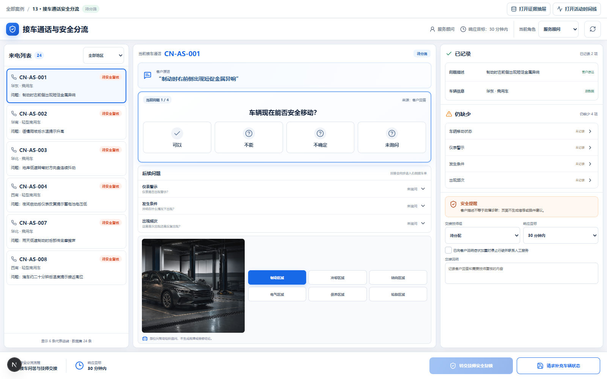

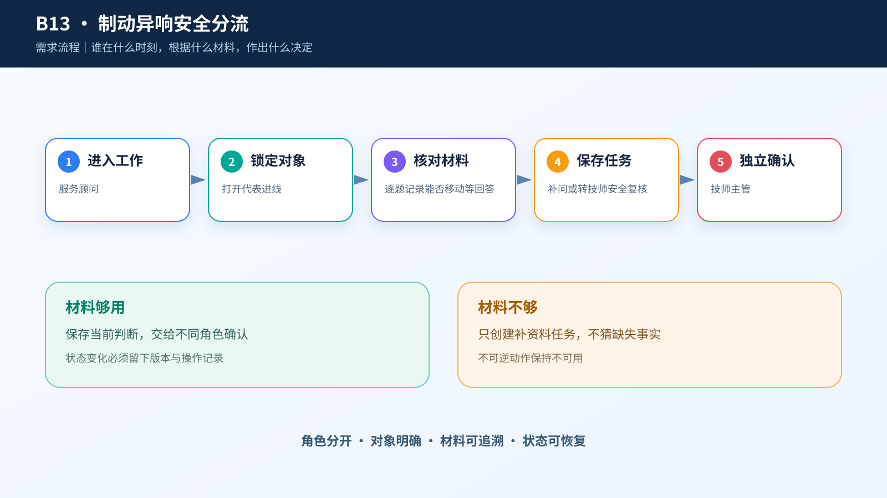


左侧只显示六条代表进线；中间一次追问一个问题，并提供“可以、不能、不确定、未询问”等可保存回答。回答后，右侧接车事实单立即增加一项，“仍缺少”同步减少。车辆图缩为部位定位辅助，不再占据主任务。底部只保留“保存并请求补充”和“转交技师安全复核”。

```text
服务顾问：记录已有回答并请求补充 → 待补充信息
服务顾问：补齐回答，或收到“不能移动/不确定”的高风险回答
          → 转交技师安全复核 → 技师复核已提交
技师主管：确认复核已接收 → 技师已接收
```

#### CodeBuddy Prompt

```text
请实现案例 B13 的接车通话与安全分流单。

读取 dataset/13-auto-service-triage/case.csv，默认选择 CN-AS-001，原样显示 symptom_text。左侧最多展示六条代表进线；不要把 24 条合成进线说成真实维修工单，也不要把 public-reference.csv 与它们做行级关联。

四个问题分别保存回答、中文标签和进线编号；“已回答”和“仍缺少”必须来自同一组问题。普通进线完成四项回答、安全提示、技师组和交接说明后才能转交；客户回答“不能移动”或“不确定”时，可以先转技师，未回答项继续留在待补清单。

补充请求保存已回答内容和未回答问题；安全转交只能由与服务顾问不同的技师主管接收。刷新后回答、缺项和交接记录不能丢失。不得生成故障诊断、维修、换件或救援结果。
```

#### 演示

**操作**：打开案例 B13，选择 `CN-AS-001`。先回答“可以”，观察右侧接车事实单和缺项数量变化；再保存补充请求。恢复初始状态后，回答“不能”，勾选安全提示，选择安全检视组并填写交接说明，确认其他三项尚未回答时也能优先转交。最后切换技师主管，填写接收说明并确认。

**结果**：客户回答、缺项和交接记录在刷新后继续保留，最终状态为“技师已接收”。页面没有把制动异响改写成故障诊断。


#### 实现与排错

- 实现：[`code/cases/13-auto-service-triage`](../../code/cases/13-auto-service-triage)。
- 聚焦测试：[`case-13-auto-service.test.tsx`](../../code/app/tests/case-13-auto-service.test.tsx)。
- 排查：若客户回答“不能移动”后仍不能转技师，检查安全回答的优先规则；未问完的问题应保留，但不能阻断高风险转交。

---

<a id="case-b14"></a>

### 综合案例 B14　连续高硅事件：先核对哪几列浮选槽？

#### 需求

工艺人员要把精矿硅偏高与相邻过程变量放在同一时间窗内复核，形成检查优先级，而不是自动修改浮选设定值。

#### 问题

事件 `FQ-0016` 从 2017-03-31 17:00 持续到 2017-04-02 07:00，39 个小时的精矿硅都落在课程设定的高值区。给矿、药剂、矿浆和七列浮选槽同时留下了记录，但曲线一起变化，不等于某一列槽已经被证明是原因。

当班工艺工程师真正要做的是：从事件记录里找出优先核对项，冻结一张能交给现场执行的核查单。生产主管只能下发这张单或阻断自动调参，不能把尚未完成的现场核查写成根因结论。

#### 逻辑思维方法论：高硅事件的归纳与参照系

本案例的方法论链条如下：

1. **归纳三前提**：从"高硅与 3 号槽偏差同时出现"归纳"3 号槽值得优先核对"——检查三前提：相关性（共变存在 ✓）、参照系（其他槽同期基线对比 ✗，案例明确"不是用同一个固定风量值横向比较七列槽"）、数据量（72 个连续点是否覆盖足够工况段 ✗）。三前提不齐，结论只能收窄到"值得核对"，不能推出"3 号槽是原因"。

2. **参照系选择**：要判断 3 号槽是否异常，必须有其他槽的同期基线。没有基线，"偏差"就没有参照系——偏差大还是小，取决于其他槽的分布。案例明确 3、1、2 号槽的优先顺序来自逐列历史基线派生记录，不是横向同值比较，参照系不可比时结论必须悬置。

3. **相关性≠因果**：高硅与 3 号槽偏差共变，但可能是：3 号槽导致高硅、高硅导致 3 号槽偏差、第三方因素（给矿品位/矿浆浓度/药剂用量）同时影响两者、巧合。要确定因果，需排除所有替代解释（排他性），调查阶段做不到。

4. **逻辑一致性**：不同工况段（给矿品位/矿浆浓度/药剂用量）的数据不能混算——高品位段的 3 号槽偏差与低品位段的偏差是不同条件下的现象，混算会偷换条件。底部用相互独立的量纲显示精矿硅、矿浆流量和 pH，就是在守护逻辑一致性。

5. **逻辑边界守护**：只生成工艺复核申请，生产主管只能下发核查或阻断自动调参，不能把尚未完成的现场核查写成根因结论——高影响设备操作的最终判断必须由人完成。系统不输出根因，也不修改设定值。

#### 数据

本地 `case.csv` 有 720 条小时聚合记录，来自公开的矿业过程质量数据；全表中间存在一次 319 小时间断，不能称为“连续 720 小时”。`FQ-0016` 使用的窗口则是完整的 72 个连续点：2017-03-30 08:00 至 2017-04-02 07:00。事件结束时有 180 个来源样本，矿浆流量 402.46 m³/h、pH 9.7445、精矿铁 64.03%、精矿硅 3.11%。

`events.csv` 按逐列历史基线把 3、1、2 号槽列为优先核对项。这个顺序来自事件派生记录，不是用同一个固定风量值横向比较七列槽。公开数据没有真实厂区、设备资产号、控制目标、报警阈值或检修结果，因此页面只组织人工核查，不输出根因，也不修改设定值。

#### 解决方案

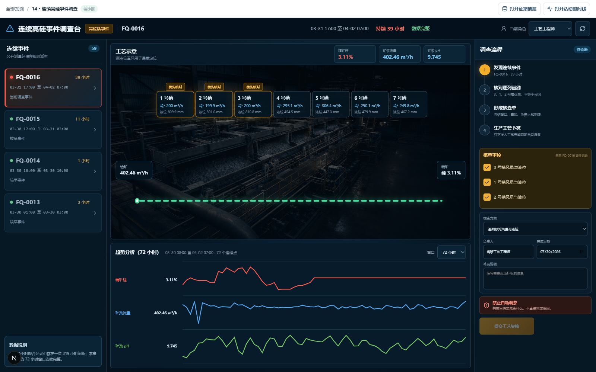


左侧按事件而不是零散小时组织调查；中间把七列槽作为工艺定位图，并把 3、1、2 号槽标成“优先核对”；底部用相互独立的量纲显示精矿硅、矿浆流量和 pH；右侧形成一张可执行核查单。工程师提交后，事件、窗口、核查项、负责人和期限一起冻结，主管不能在下发时偷换调查范围。

```text
工艺工程师：提交工艺复核 → 工艺复核中
生产主管：下发现场核查 → 核查已下发
          或阻断自动调参 → 调参已阻断
```

#### CodeBuddy Prompt

```text
请实现案例 B14 的连续高硅事件调查台。

读取 dataset/14-flotation-impurity-review/case.csv 和 events.csv。以 FQ-0016 为业务对象，固定加载 2017-03-30 08:00:00 到 2017-04-02 07:00:00 的 72 个连续点，并允许查看最后 24 或 48 个点。七列槽只绑定 column_1 到 column_7 的 air_mean 与 level_mean；3、1、2 号槽的优先顺序必须来自 FQ-0016 的 dominant_deviation，不能用统一目标值比较七列槽。

右侧按“发现事件—核对逐列基线—形成核查单—主管下发”排列任务。提交后固定事件、时间窗、核查项、负责人和期限，主管只能确认或退回，不能改写调查范围。工艺图标注为示意，不显示自动根因、置信度或调参建议；动画只在载入事件时帮助定位。
```

#### 演示

**操作**：打开案例 B14，核对 `FQ-0016` 的起止时间和 72 个连续点；查看为什么 3、1、2 号槽被列为优先项；填写核查方向、负责人、期限和补充说明后提交。刷新页面并切换生产主管，确认仍然是同一事件、同一窗口和同一组核查项，再下发现场核查或阻断自动调参。

**结果**：系统保存一张可恢复、不可被主管改写的核查单，不直接改动工艺参数。页面证明“先查什么”已经确定，不声称“根因是什么”已经确定。


#### 实现与排错

- 实现：[`code/cases/14-flotation-impurity-review`](../../code/cases/14-flotation-impurity-review)。
- 聚焦测试：[`case-14-domain-data.test.ts`](../../code/app/tests/case-14-domain-data.test.ts)。
- 排查：若同一事件的检查顺序每次打开都变化，检查是否按偏差绝对值和固定槽位编号稳定排序，并确认使用同一事件窗口。

---

<a id="case-b15"></a>

### 综合案例 B15　SECOM-0003 未通过：这次复测该测什么？

#### 需求

质量工程师要根据传感器异常、缺失和批次影响排出复测顺序；系统只能送审，不能把相关性写成根因或自动报废。

#### 问题

生产观测 `SECOM-0003` 没有通过质量门，第 158 号通道又恰好为空。值班工程师面临的不是"猜哪台设备坏了"，而是一个更具体的问题：哪些通道值得复测，申请里必须保留哪些事实，谁来确认这次复测。

#### 逻辑思维方法论：复测决策的同一律与证伪

本案例的方法论链条如下：

1. **同一律**：SECOM、复测通道、覆盖率——这些概念在申请、确认、隔离各环节含义必须一致。"复测"在质量工程师侧是"选中通道并保存申请"，在质量主管侧是"复核同一份已保存申请并确认"，不能偷换成"自动报废"。词链贯通（观测编号 + 所选通道 + 三项核对 + 说明 + 角色 + 任务编号）才能让 Agent 不猜错。

2. **相关性≠因果**：第 158 号通道覆盖率 8.8% 与 SECOM-0003 未通过质量门相关，但不能直接说"通道缺失导致未通过"——可能是共同原因（工艺偏差）同时导致通道缺失和质量不通过。案例明确"数据里没有设备、工序、单位、控制限、晶圆坐标或复测结果，因此不能画缺陷地图，也不能给出根因或报废结论"——相关性是线索，不是归因。

3. **量词严谨性**："12 个练习通道中 sensor_158 覆盖率 8.8%"是存在命题（∃），不能推广为"所有低覆盖率通道都有问题"（∀）。每个通道独立判定，不能一刀切。案例明确"它不适合被当作稳定的判定依据"，是针对 158 号的判断，不是全称结论。

4. **归纳例外预警**：从历史数据归纳出"覆盖率低于某阈值的通道值得复测"——这是归纳结论，必然有例外。不能把归纳结论当必然用，必须有"例外通道"的处理路径（如覆盖率低但实际正常的通道）。

5. **证伪思维**：复测决策的验收口径不是"证明这个通道有问题"，而是"在当前材料范围内未发现可以排除复测的反例"——找反例（看似正常但实际异常的通道）比找正例更有效。质量主管"资料仍不足时继续隔离，不改变原始观测"就是悬置判断。

#### 数据

数据来自 UCI SECOM，共 1,567 条生产观测，其中 104 条未通过。课程选出 12 个匿名通道用于练习；`sensor_158` 只有 138 条记录有值，覆盖率 8.8%。这说明它不适合被当作稳定的判定依据，却很适合讲清"先看数据是否站得住，再决定复测范围"。

`SECOM-0003` 是课程生成的观测编号，不是真实晶圆批次。数据里没有设备、工序、单位、控制限、晶圆坐标或复测结果，因此不能画缺陷地图，也不能给出根因或报废结论。

#### 解决方案

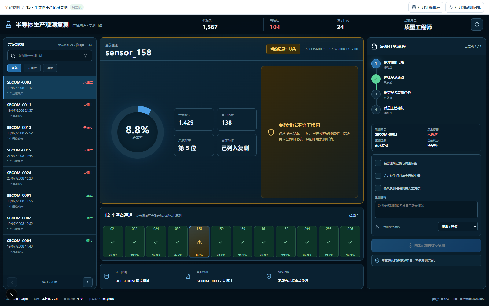


左侧是 24 条演示观测队列，并明确标出完整数据集共有 1,567 条；中间一次只聚焦一个通道，覆盖率、缺失量和当前原值放在同一视区。下方的 12 通道矩阵同时负责切换查看和选择复测对象，不再用第二套卡片重复选择。右侧把工作收成四步：核对记录、选择通道、保存申请、主管确认。

```text
质量工程师：核对原始记录、缺失情况和人工复核要求
质量工程师：选中 sensor_158 等复测通道并保存申请
质量主管：复核同一份已保存申请并确认
质量主管：资料仍不足时继续隔离，不改变原始观测
```

#### CodeBuddy Prompt

```text
请实现案例 B15 的 SECOM 复测任务台。

读取 dataset/15-wafer-quality-review/case.csv。默认选择 SECOM-0003。左侧用可分页队列展示少量演示观测，并同时显示演示条数和数据集总数，不能把前者冒充后者。

中间只用一张 12 通道矩阵完成查看和复测选择；空值显示"缺失"，不能转成 0。聚焦区显示当前值、全局覆盖率、缺失量和关联排序，并明确说明关联不是根因。右侧按"核对记录—选择通道—保存申请—主管确认"显示进度。

复测申请保存观测编号、所选通道、三项核对、说明、角色和任务编号；质量主管可以确认复测、隔离当前记录或退回补充。页面不得补造晶圆批次、设备、工序、单位、控制限或缺陷坐标，也不能出现自动报废动作。
```

#### 演示

**操作**：打开案例 B15，选择 `SECOM-0003`。在矩阵中查看 `sensor_158`，确认当前值为"缺失"、覆盖率为 8.8%；再加入一个有值通道，完成三项核对，填写说明并提交。切换到质量主管，确认保存后的通道和任务编号没有变化，再确认申请。

**结果**：状态进入"复测申请已确认 · v2"。页面留下复测范围和审批记录，但不会把匿名信号写成设备故障或产品报废结论。


#### 实现与排错

- 实现：[`code/cases/15-wafer-quality-review`](../../code/cases/15-wafer-quality-review)。
- 聚焦测试：[`case-15-wafer-retest-domain.test.tsx`](../../code/app/tests/case-15-wafer-retest-domain.test.tsx)。
- 排查：若复测值已录入但状态不前进，检查测量项是否齐全、批次是否仍为 SECOM-0003，以及复核人是否独立于录入人。

---

<a id="case-b16"></a>

### 综合案例 B16　风机 T007 连续七个运行日出现下偏标记：先补什么？

#### 需求

运维班组要结合风速、功率和持续时长调整人工登检优先级，同时明确数据缺口，不能自动派工或远程控制设备。

#### 问题

风机 `T007` 连续七个运行日都有下偏标记。第 3 天平均风速 11.60 m/s、平均有功功率 1,140.76 kW；第 7 天分别降到 3.41 m/s 和 90.37 kW。看到这组数时，不能直接说风机坏了：风况变化本来就会带来功率变化，数据里又没有同群基线、限电指令、告警和维修记录。

可靠性工程师的任务是确定核查对象、检查数据是否够用，再决定提交现场核查还是先补同群数据。

#### 逻辑思维方法论：下偏核查的全集子集与边界

本案例的方法论链条如下：

1. **全集/子集辨析**：134 台风机是全集，T007 是子集。T007 的七日下偏是子集现象，不能代表全集。全场均值达标不等于 T007 健康，T007 异常不等于全场异常。聚合指标（全场均值）可能掩盖子集差异——必须能下钻到 T007。

2. **参照系选择**：第 3 天风速 11.60 m/s 功率 1,140.76 kW，第 7 天风速 3.41 m/s 功率 90.37 kW——功率下降可能只是风况下降。要判断"下偏"，必须有同风况基线（同群风机或功率曲线）。没有基线，"下偏"就没有参照系。系统明确列出四个缺口：同群基线、限电指令、告警、维修记录。

3. **证伪思维**：不能说"风机坏了"——这需要排除所有替代解释（风况下降/限电/传感器故障/维修历史）。只能收窄到"值得现场核查"。验收口径是"未发现可以排除核查的反例"。

4. **逻辑一致性**：七个运行日不能画成连续分钟曲线——不同日的时间段数据不能混算。时间粒度和缺日处理必须保持一致，不能用插值制造连续运行。案例排查项明确"页面只能连接真实站日，不能用插值制造连续运行"。

5. **逻辑边界守护**：只创建核查单，不自动派工或远程控制设备——风机的登检和停机是高影响动作，最终判断由人完成。现场核查任务保存发起人、负责人、回传班次；数据没有预期功率和同风况对照，页面只能组织核查，不能判断欠发原因。

#### 数据

`case.csv` 有 938 条风机日记录，覆盖 134 台风机、每台 7 个运行日。`underperformance_share` 在这里是 0/1 日级标记，不是故障概率；T007 的七条记录都为 1。每条记录还给出源记录数、有效风速记录数、有效功率记录数和平均值。

`turbine-locations.csv` 提供 134 台风机的横纵坐标，但这些是数据集内部相对位置，不是经纬度，不能画成真实地图。数据也没有预期功率和同风况对照，所以页面只能组织核查，不能判断欠发原因。

#### 解决方案

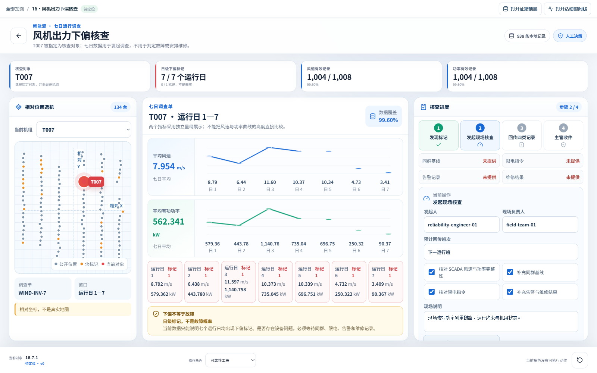


中间把 134 台风机画在相对坐标平面上，突出 T007；下方只比较七个运行日的平均风速和平均有功功率。右侧先确认下偏和有效记录，再明确列出四个缺口：同群基线、限电指令、告警、维修记录。

```text
可靠性工程师：创建七日资料核查单 → 现场核查中
现场人员：回填检查班次、四类回执和现场发现
另一名运行主管：确认核查材料已收件 → 现场核查已提交
运行主管：资料不足时请求补充同群数据 → 等待同群数据
```

#### CodeBuddy Prompt

```text
请实现案例 B16 的风机出力下偏核查台。

读取 dataset/16-wind-underperformance/case.csv，默认选择 turbine_id=7，按 day=1—7 排序。地图区域读取 turbine-locations.csv，只标注“相对坐标示意”，不得生成场站名称、经纬度或日历日期。

趋势只使用平均风速和平均有功功率，并分成两个独立量纲图；下偏字段只显示为日级标记。右侧明确写出同群基线、限电指令、告警、维修记录均未提供。现场核查任务保存发起人、负责人、回传班次和调取项；主管只确认材料收件，不生成维修排程。资料不足时继续补数据，不输出故障概率或自动维护建议。
```

#### 演示

**操作**：打开案例 B16，选择 T007，查看七日风速、功率和下偏标记；填写发起人、不同的现场负责人、预计回传班次，勾选需要调取的资料并提交任务。随后填写检查班次、同群基线、限电、告警、维修四类材料和现场发现，最后切换为不同身份的主管确认。任一材料缺失时，改为“请求补充同群数据”。

**结果**：提交任务后状态为“现场核查中 · v1”；四类材料和现场记录齐备、主管确认后为“现场核查已提交 · v2”。相对坐标只用于选择风机，下偏标记只触发核查。


#### 实现与排错

- 实现：[`code/cases/16-wind-underperformance`](../../code/cases/16-wind-underperformance)。
- 聚焦测试：[`case-16-wind-investigation-domain.test.tsx`](../../code/app/tests/case-16-wind-investigation-domain.test.tsx)。
- 排查：若七个运行日被画成连续分钟曲线，检查时间粒度和缺日处理；页面只能连接真实站日，不能用插值制造连续运行。

---

<a id="case-b17"></a>

### 综合案例 B17　BD-0003 三路波形都在：要不要列入排检候选？

#### 需求

包装线要从振动、负载和切割质量变化中识别检修候选，保留人工复核，不自动停机或更换部件。

#### 问题

包装设备会话 `BD-0003` 的健康偏差指数是 3.856，高于课程规则线 3.775，主导变化信号是“切刀转矩均值”。这足以进入人工复核，却不能说明刀具已经损坏。维护计划员要在三路同步波形中固定一个游标和一个样本窗口，再决定是否保存为排检候选。

#### 逻辑思维方法论：从健康偏差到排检候选的收窄

本案例的方法论链条如下：

1. **归纳三前提**：从"BD-0003 健康偏差指数 3.856 高于规则线 3.775"归纳"值得进入人工复核"——检查三前提：相关性（健康偏差与切刀转矩均值共变，主导信号已确认✓）、参照系（规则线 3.775 是公开来源区间，不是同型号切刀基线✗）、数据量（本地只有 BD-0001 至 BD-0008 共 8 个会话有 256 点波形，是否覆盖足够工况✗）。三前提不齐，结论只能收窄到"值得复核"，不能推出"切刀需要更换"。

2. **量词严谨性**：BD-0003 在本地 8 个有波形的会话中健康偏差最高——这是存在命题（∃），只在"有波形的 8 个"范围内成立，不能推广到全部 519 个会话（∀）。BD-0001 至 BD-0008 之外还有 511 个会话只有摘要、没有波形，既不能进入候选，也不能因为"没进入"就判定为正常。

3. **证伪思维**：BD-0003 健康偏差高，但三路波形（切刀转矩/切刀跟随误差/薄膜跟随误差）是否同步异常才是关键——如果三路同步正常，健康偏差高可能是噪声而非故障。复核不是"证明 BD-0003 有问题"，而是"在 256 点波形和三路同步游标范围内，未发现可以排除排检的反例"。

4. **逻辑边界守护**：只生成排检候选，不自动换刀或停机——高影响设备操作（换刀/停机）的最终判断必须由维护主管完成。系统列出缺口（刀具寿命、停机代价、换刀记录、绝对采样时间），不补造数据；页面保留原始量纲，不从曲线直接推断故障。

#### 数据

`case.csv` 有 519 个会话摘要，记录三路信号的均值、标准差、均方根、绝对峰值，以及规则线和复核等级。BD-0003 的源会话有 2,048 个样本；为了让运行结果稳定，本地 `waveform.csv` 为 `BD-0001` 到 `BD-0008` 各保留 256 个连续点，共 2,048 行。

BD-0003 的切刀转矩均值为 -0.0215，切刀跟随误差均值接近 0，薄膜跟随误差均值为 0.8211。来源没有提供这些信号的工程单位，也没有可用于排班的绝对时间、刀具寿命、产品质量、停机代价和换刀记录，因此页面保留原始量纲，不能从曲线直接推断故障或排检时段。

#### 解决方案

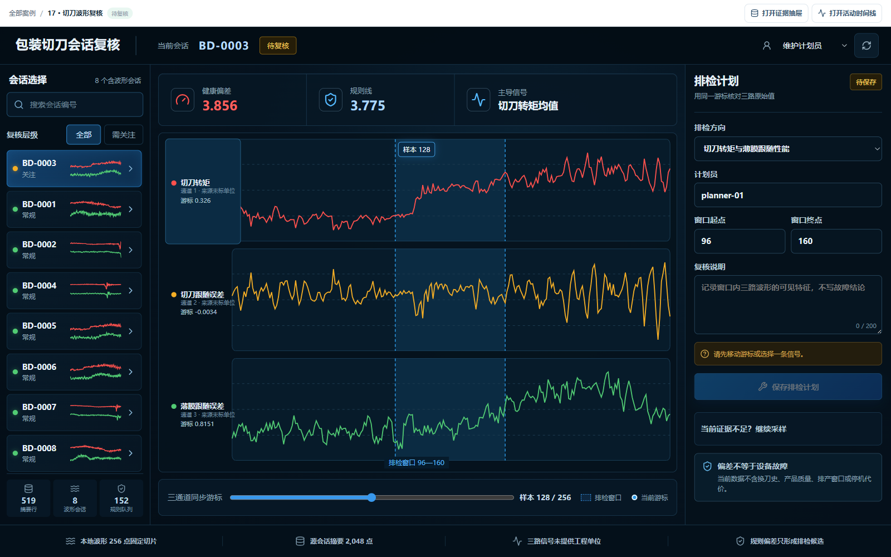


左侧只列本地确实有 256 点波形的 8 个会话；中间以三路同步波形为主画布，共用一个游标和一个样本窗口。右侧只显示当前角色要完成的表单。设备图只是环境示意，不标传感器位置。

```text
维护计划员：保存排检候选 → 排检候选待确认
维护主管：确认排检候选 → 排检候选已确认
维护计划员：继续采样观察 → 继续观察
```

#### CodeBuddy Prompt

```text
请实现案例 B17 的包装切刀波形复核台。

读取 dataset/17-cutter-health-review/case.csv，默认选择 BD-0003。再读取 waveform.csv，只筛选当前 session_id，并按 sample_index 排序；三条曲线分别绑定 cutter_motor_torque、cutter_follow_error、film_follow_error。

摘要中的 2,048 个源样本与本地 256 点波形切片要分开说明。只有 BD-0001 至 BD-0008 开放波形操作；其他会话只显示摘要，不能进入候选。保存排检候选时记录三路同步游标、检查窗口、计划员和说明；选择继续观察时填写追加样本数与理由。不得生成绝对采样时间、刀具寿命、停机、换刀或产品质量结论。
```

#### 演示

**操作**：打开案例 B17，选择 `BD-0003`，把共享游标移到样本 128，再把检查窗口设为 96—160；对照健康偏差 3.856、规则线 3.775 和游标处三路原始值，填写计划员、排检方向和说明后保存候选，再由另一名维护主管确认。若选择继续观察，需要填写追加样本数和理由。

**结果**：提交后为“排检候选待确认 · v1”，主管确认后为“排检候选已确认 · v2”。只有本地波形确实存在的会话才能进入候选核对。


#### 实现与排错

- 实现：[`code/cases/17-cutter-health-review`](../../code/cases/17-cutter-health-review)。
- 聚焦测试：[`case-17-cutter-review-domain.test.tsx`](../../code/app/tests/case-17-cutter-review-domain.test.tsx)。
- 排查：若 BD-0003 不能进入排检候选，检查三路波形覆盖和同一测量窗口；候选成立后仍需另一角色复核。

---

<a id="case-b18"></a>

### 综合案例 B18　BT-0044 主汽低温持续 24 分钟：先查哪一段？

#### 需求

运行人员要沿锅炉工艺路径核对温度、流量和负荷变化，形成可追溯的运行复核单，不把课程阈值当成厂方控制限。

#### 问题

2022-03-29 17:22:39，主汽出口温度跌到公开来源区间 530℃ 以下，17:46:59 事件结束，共持续 24 分 25 秒。事件内有 293 个原始采样点；对应的分钟窗口为 17:22 至 17:46，共 25 行。运行人员现在只能看到出口温度，不能凭一条曲线判断阀门、过热器或测点故障。

要做的不是“自动诊断”，而是把一个检查问题说清楚：先查哪一段，需要补哪组过程记录，由谁到现场核对。

#### 逻辑思维方法论：从低温事件到检查段的选择

本案例的方法论链条如下：

1. **参照系选择**：主汽出口温度跌到 530℃ 以下、最低 526.63℃——但"低于"需要参照系。530—545℃ 是源数据给出的参考区间，不是本案例掌握的厂方控制限。参照系不可比时，"低于"判断只能停在"低于来源区间下界"，不能推出"违反控制限"。系统必须核对 530℃ 从哪里来、适用于哪个窗口。

2. **逻辑一致性**：出口测温链路、末级过热器出口段、减温水调节段是三个不同位置——出口测点的低温与减温水调节段的低温是不同位置的现象，不能跨位置平均。阀位、流量和分段温度统一显示"未接入"，不能与出口温度混在同一曲线；30 条一级减温水流量补点只能说明流量曾被补点，不能画进温度曲线。

3. **归纳vs演绎**：规则"资料不全不能提交检查申请"是演绎前提；当前对象确实缺少阀位、减温水流量、过热器分段温度、压力和负荷，那么"当前需要补取资料"是演绎。24 分 25 秒持续低温则归纳出"值得沿工艺路径核查共同原因"，但还不能推出设备故障。演绎执行规则，归纳提出候选。

4. **相关性≠因果**：出口温度与减温水流量、阀位可能共变，但当前数据没有真实阀位和流量——连共变都无法确认，更别说因果。给水温度、煤质、负荷变化都可能同时影响出口温度和阀门动作，要确定因果需排除这些替代解释，而这些数据同样缺失。

5. **逻辑边界守护**：运行主管可"阻断自动调节"——这是锅炉特有的边界：不自动调整阀位、不自动停机、不把现场核查写成根因结论。系统标记缺项（阀位/减温水流量/过热器分段温度/压力/负荷），不补造数据；30 条一级减温水流量补点只能说明流量曾被补点，不能画进温度曲线。

#### 数据

- `events.csv`：93 个按公开来源区间派生的温度事件。`BT-0044` 的最低温度为 526.63℃，事件内 293 个原始采样点完整。
- `case.csv`：7,201 个分钟汇总。`BT-0044` 对应 25 个连续分钟点，最后一分钟均值为 529.846℃。
- `imputation-points.csv`：30 条一级减温水流量补点，只能说明流量数据曾被补点，不能画进温度曲线。

530—545℃ 是源数据给出的参考区间，不是本案例掌握的厂方控制限。数据中没有真实阀位、减温水流量、过热器分段温度、压力或负荷。

#### 解决方案

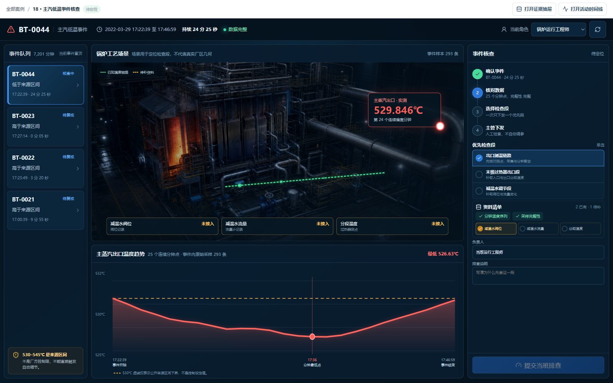

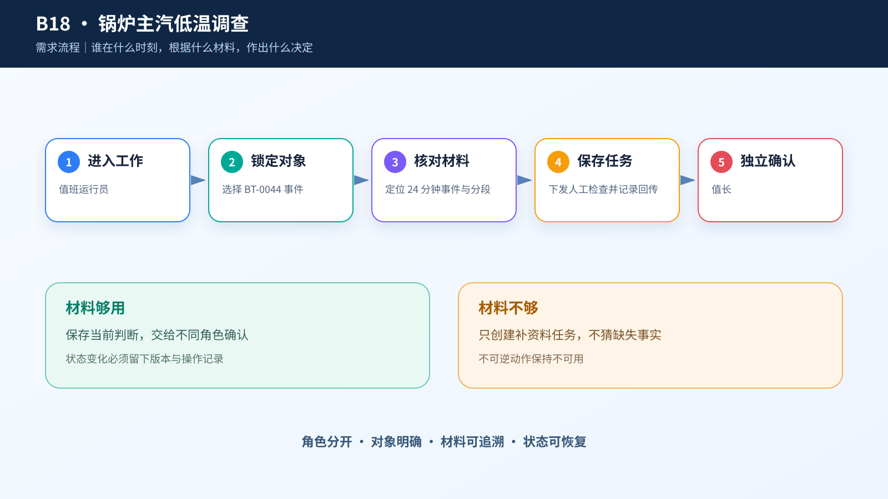


页面左侧列事件，中间把出口测点放回锅炉场景，并只画 `BT-0044` 的 25 个分钟点；阀位、流量和分段温度统一显示“未接入”。右侧只保留一次检查选择：出口测温链路、末级过热器出口段或减温水调节段。运行工程师提交后，检查段和资料清单被冻结，再由运行主管确认。

```text
锅炉运行工程师：提交当班排查 → 当班排查中
运行主管：确认优先检查段 → 检查已下发
运行主管：阻断自动调节 → 自动调节已阻断
```

#### CodeBuddy Prompt

```text
实现“BT-0044 主汽低温事件核查台”，使用 React 19 与 Next.js 16。

从 events.csv 读取 BT-0044，以 event_id 作为业务对象；从 case.csv 精确筛选 2022-03-29 17:22 至 17:46 的 25 个连续分钟点。趋势只绑定 steam_temperature_mean，事件卡显示 start_time、end_time、duration_seconds、minimum_temperature 和 source_samples。

页面分为事件队列、锅炉场景、25 分钟趋势和检查单。锅炉场景只标主汽出口实测值；减温水阀位、减温水流量和过热器分段温度显示“未接入”，不得生成数值。530℃ 只标成“来源区间下界”，不能写成控制限。

当班检查单保存事件编号、精确分钟窗口、检查段、负责人、说明、已有资料和至少一项待补来源。运行主管只能确认原检查段，或在控制条件不明时阻断自动调节。
```

#### 演示

**操作**：打开案例 B18，核对事件时段、293 个事件采样和 25 个分钟点；选择一个优先检查段，至少勾选一项待补资料，填写负责人和排查说明后提交。切换到运行主管，填写意见并确认原检查段。也可在首次提交前直接阻断自动调节。

**结果**：提交后为“当班排查中 · v1”，主管确认后为“检查已下发 · v2”。重新打开页面，事件、窗口、检查段和资料清单保持不变；页面始终不显示数据中不存在的过程数值。


#### 实现与排错

- 实现：[`code/cases/18-boiler-temperature-review`](../../code/cases/18-boiler-temperature-review)。
- 聚焦测试：[`case-18-event-contract.test.ts`](../../code/app/tests/case-18-event-contract.test.ts)。
- 排查：若 24 分钟低温被自动解释成设备故障，检查事件规则是否只生成分段核查任务；缺少操作记录时不得给出原因结论。

---

<a id="case-b19"></a>

### 综合案例 B19　第 217 次测量循环：三项同级，谁先查？

#### 需求

检修人员要根据压力、流量、温度和部件状态给设备排查排序；系统只负责分流复核，不自动执行维护动作。

#### 问题

第 217 次测量循环里，泵、冷却器和比例阀都处于最高关注级，蓄能器正常。数据没有给三个重点部件排先后，可靠性工程师必须结合本循环读数和最近 20 次变化，亲自确定先查哪一项。

#### 逻辑思维方法论：从三项同级到检查顺序的人工确认

本案例的方法论链条如下：

1. **同一律**：液压动力单元、压力、部件状态——这些概念在产品、工程、数据中含义必须一致。"状态等级"在数据里是"排序依据"，在业务里是"维修结论"，混用就是偷换概念。`cycle_id` 只是测量顺序，不是时间戳，也不是液压站编号；"临界"描述部件状态，"稳定"描述当次循环是否稳定，两者不能混为一谈。

2. **相关性≠因果**：压力、流量、温度与部件状态可能共变，但可能是：部件故障导致读数异常、读数异常导致部件被标级、第三方因素（负载/油液）同时影响两者。排序先后≠故障先后——三个"严重"项同级，数组顺序不是风险排名。

3. **量词严谨性**：第 217 次循环中泵、冷却器、比例阀三项同级严重——这是针对"第 217 次循环"的存在命题（∃），不能推广为"所有循环中这三项都最严重"（∀）。三项同级意味着数组顺序不是风险排名，蓄能器正常也不意味着整台设备健康；每项独立判定，不能一刀切。

4. **归纳例外预警**：2,205 个循环中"三项同级值得优先检查"是归纳结论——归纳结论是或然的，不是必然的，"同级严重但实际正常"的循环就是它的例外。系统保留"继续循环采样"作为降级路径：当遇到反例循环时，排序结论必须降级为"待观察"，而不是强行维持原结论——或然性降级是归纳结论的内在约束。

5. **证伪思维**：三项同级严重，但"同级"不等于"同因"——泵、冷却器、比例阀的严重可能各有原因。检查排序的验收不是"证明哪项有问题"，而是"同级严重但实际正常"的循环存在时，排序结论必须降级——证伪优先于证实，找反例比找正例更能约束结论。

#### 数据

数据来自 UCI 液压系统状态监测，共 2,205 个测量循环。每行保存主压力、回油压力、系统压力、电机功率、主流量、油箱温度、系统振动 7 项循环均值，以及 4 个部件的状态。第 217 次循环总体为“临界”，运行稳定性仍是“稳定”：前者描述部件状态，后者描述当次循环是否稳定。

`cycle_id` 只是测量顺序，不是时间戳，也不是液压站编号。数据没有站点、资产号、维修史、工单和检查结果，因此状态等级只能用于排序，不能直接变成维修结论。

#### 解决方案

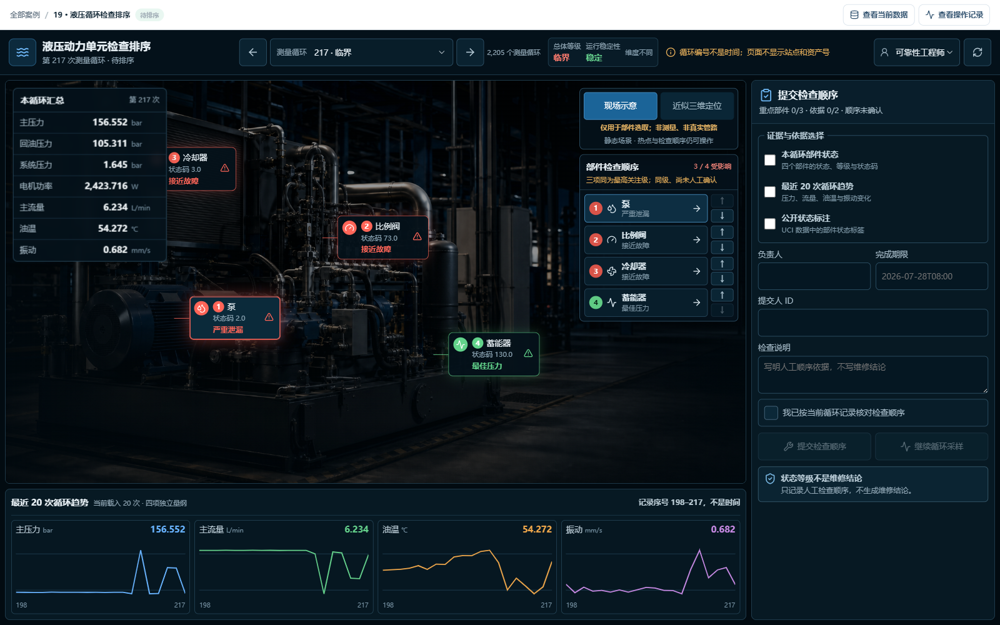


页面把 7 项本循环读数、4 个部件状态、人工检查顺序和最近 20 次记录放在同一屏。三个重点部件明确标为“同级、尚未人工确认”，避免把数组顺序误当成风险排名。默认画面是通用设备语境示意；用户主动打开“近似三维定位”时才加载三维部件，只用于选择，不表示真实管路、测点或数字孪生。

```text
可靠性工程师：提交检查顺序 → 检查顺序待确认
业务主管：确认检查顺序 → 检查顺序已确认
可靠性工程师：继续循环采样 → 继续采样
```

#### CodeBuddy Prompt

```text
请实现案例 B19 的液压动力单元检查排序台。

读取 dataset/19-hydraulic-condition/case.csv，默认选择 cycle_id=217，并显示 cycle_id=198..217。顶部绑定 main_pressure_mean、return_pressure_mean、system_pressure_mean、motor_power_mean、main_flow_mean、tank_temperature_mean、system_vibration_mean；横轴写“记录序列”，不能写时间。

四个部件直接读取泵、冷却器、阀和蓄能器的状态、等级与描述。三个“严重”项同级，初始顺序写“尚未人工确认”，不得生成风险分、站点、资产号、工单或维修结果。提交前核对全部重点部件，选择至少两项依据，确认顺序，并填写负责人、期限、提交人和说明；材料不足时继续采样。
```

#### 演示

**操作**：打开第 217 次循环，核对 7 项读数和 4 个部件；点击场景热点，调整检查顺序，选择至少两项依据，填写负责人、期限、提交人和说明后提交。切换到另一名维护主管，确认同一顺序。

**结果**：提交后为“检查顺序待确认 · v1”，主管确认后为“检查顺序已确认 · v2”。系统只保存检查顺序；故障部件仍要靠现场检查确定。


#### 实现与排错

- 实现：[`code/cases/19-hydraulic-condition`](../../code/cases/19-hydraulic-condition)。
- 聚焦测试：[`case-19-hydraulic-condition.test.tsx`](../../code/app/tests/case-19-hydraulic-condition.test.tsx)。
- 排查：若三项同级指标的顺序反复变化，检查固定次序和测量循环编号；排序只决定先查什么，不得改写健康结论。

---

<a id="case-b20"></a>

### 综合案例 B20　PV-08 在 2020-05-19 出现少发线索：站端先查什么？

#### 需求

运行团队要把少发拆成可核对的候选原因，明确需要补取的调度、告警和检修记录，不自动改变电站控制设定。

#### 问题

2020-05-19，PV-08 的 96 条记录聚合成一个站日：装机容量 30 MW，平均辐照度 331.79 W/m²，平均气温 21.61℃，平均功率 3.67 MW。归一化出力比为 0.362，疑似限电记录占比为 40.6%。这两项只是线索，性能工程师要先决定向站端补取哪类资料。

#### 逻辑思维方法论：从少发线索到站端核查的收窄

本案例的方法论链条如下：

1. **全集/子集辨析**：8 个匿名站点是全集，PV-08 是子集。PV-08 的少发线索是子集现象，不能代表全集。全场均值达标不等于每座站健康；5,327 个站日覆盖 8 个站点，聚合指标可能掩盖子集差异——必须能下钻到单站单日。

2. **参照系选择**：归一化出力比 0.362、疑似限电占比 40.6% 需要参照系——同历史时段、同辐照度、同容量。没有同辐照基线，"少发"就没有参照系（可能是天气原因）。系统明确列出缺口：调度限电记录、逆变器告警、检修工单；0.362 不是组件效率，40.6% 也不是发电损失。

3. **证伪思维**：0.362 和 40.6% 只是上游派生字段的日均值，本地快照没有计算公式——不能从这两个数字直接推出"设备侧故障"。核查方向的验收口径是"三类缺失资料（调度限电/逆变器告警/检修工单）都申请补取后才能提交"，不是已经取得；资料不足时只登记"禁止控制变更"，悬置判断而非给出结论。

4. **逻辑一致性**：空值和缺日必须留空并断开曲线，不能补成 0——高辐照低发与低辐照低发是不同辐照条件下的现象，补 0 会偷换条件。完整的 8×731 日期矩阵缺 521 个站日，PV-03 在 2020-05-19 没有记录当日禁用，PV-08 缺 2020-11-09 和 2020-11-10；缺日就是缺日，不能用插值制造连续运行。

5. **逻辑边界守护**：只生成核查单和"禁止控制变更"登记——后者是光伏站特有的边界：不自动派工、不远程控制电站、不声称站端控制已经改变。现场核查任务保存发起人、负责人、期限；资料不足时只登记"禁止控制变更"，把控制权留在站端人工手中。

#### 数据

`case.csv` 有 5,327 个唯一站日，覆盖 8 个匿名站点。完整的 8×731 日期矩阵缺 521 个站日；PV-03 在 2020-05-19 没有记录，PV-08 缺 2020-11-09 和 2020-11-10。页面遇到空值或缺日时必须留空并断开曲线，不能补成 0。

日期、记录数、辐照度、气温和功率由公开记录聚合。归一化出力比、温度降额和疑似限电占比来自上游派生字段的日均值，本地快照没有它们的计算公式。0.362 不是组件效率，40.6% 也不是发电损失。数据没有地理坐标、调度限电记录、逆变器告警和检修工单。

#### 解决方案

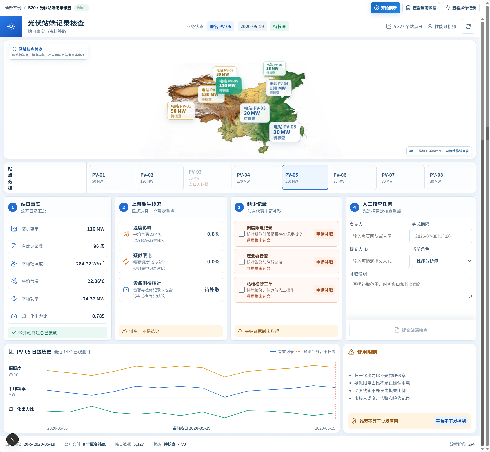

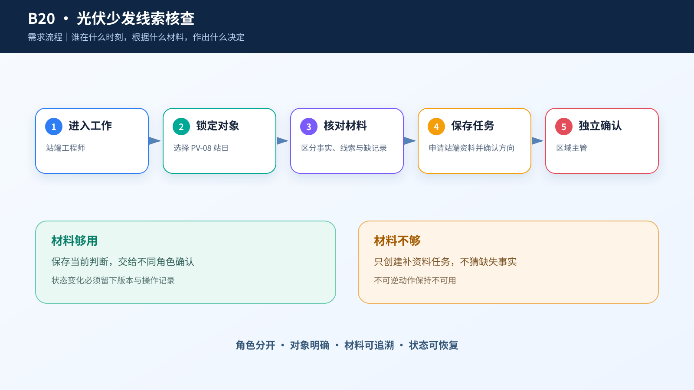


页面按四段组织工作：站日事实、派生线索、缺少的站端记录、人工核查任务。三类缺失资料都显示“数据集未包含”，勾选表示“申请补取”，不是已经取得。底部三条独立日级曲线只画最近 14 个真实站日。

顶部另设一张三维地形总览图，用于核查导航：底图是无文字的中国地形浮雕纹理，站点编号匿名（PV-01 ~ PV-08），坐标为示意排布而非真实地理坐标，不标注设备关系、不画连线、不生成位置置信度——地形只作视觉参照。

```text
性能工程师：提交站端核查 → 站端核查中
运维主管：确认核查方向 → 核查方向已确认
运维主管：登记禁止控制变更 → 禁止控制变更已登记
```

#### CodeBuddy Prompt

```text
请实现案例 B20 的光伏站端记录核查台。

读取 dataset/20-pv-loss-attribution/case.csv，默认选择 station_id=8、date=2020-05-19。站点来自 stations.csv。只允许选择真实存在的 station_id+date；PV-03 当日禁用并显示“当日无数据”。趋势取当前站最近 14 个真实站日，空值和缺日断线，不得补 0，也不得生成小时曲线。

将源事实、上游派生线索和缺失资料分栏展示。核查方向初始为空，用户单选“温度影响、疑似限电、设备侧待核对”；调度限电、逆变器告警和站端检修三项都申请补取后才能提交。主管确认核查方向；若资料不足，只登记“禁止控制变更”，不声称站端控制已经改变。
```

#### 演示

**操作**：打开 PV-08 的 2020-05-19，按“事实—线索—缺少记录—任务”从左到右核对；尝试切换 PV-03，确认当日不可选。回到 PV-08，选择一个暂定方向，申请三类资料，填写负责人、期限、提交人和说明后提交。刷新页面，再由另一名主管确认同一方向。

**结果**：提交后任务保留核查方向，主管确认后进入“核查方向已确认 · v2”。页面中的 40.6% 始终表示疑似记录占比，不会被写成发电损失比例。


#### 实现与排错

- 实现：[`code/cases/20-pv-loss-attribution`](../../code/cases/20-pv-loss-attribution)。
- 聚焦测试：[`case-20-pv-loss.test.tsx`](../../code/app/tests/case-20-pv-loss.test.tsx)。
- 三维总览：[`ChinaTerrain3D.tsx`](../../code/app/src/components/workbenches/case-specific/ChinaTerrain3D.tsx)（R3F + drei）。地形底图为无文字纹理，站点坐标示意排布、非真实地理坐标；点击 3D 标签可联动站点选择器，但不生成位置置信度或设备关系。
- 排查：若 40.6% 被显示成发电损失率，检查字段标签和派生说明；它只能表示疑似记录占比，也不能触发任何站端控制命令。

---
